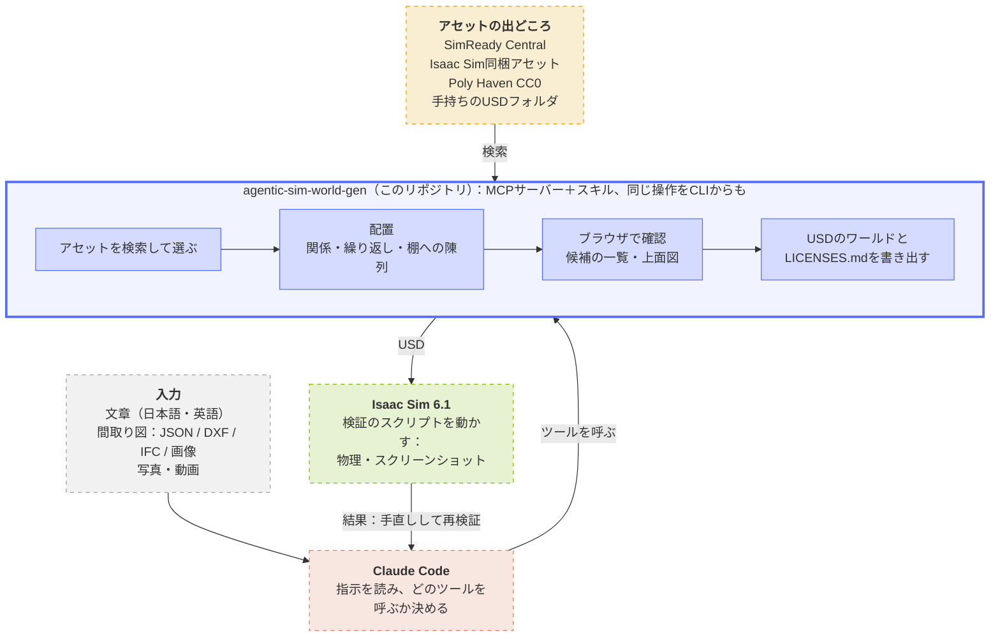
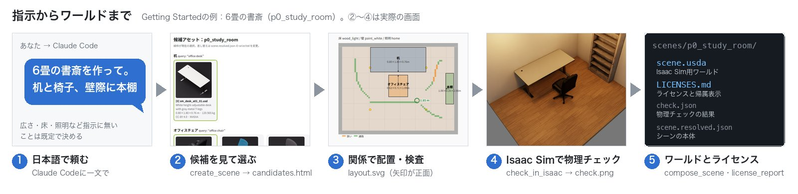
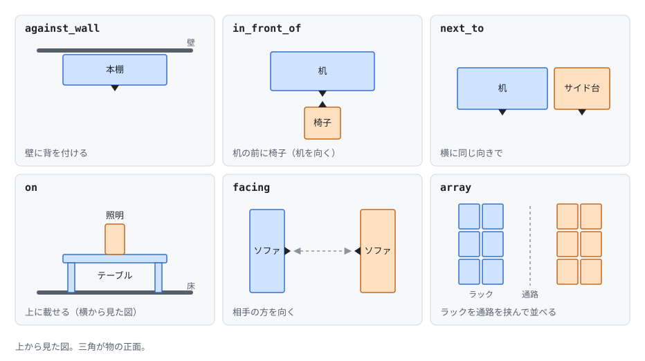

# agentic-sim-world-gen

[English](README.md) | 日本語 | [プロジェクトページ](https://atinfinity.github.io/agentic-sim-world-gen/ja/)

日本語（英語も可）の指示・間取り図・写真から、エージェント（Claude Code）がアセットを選んで配置し、Isaac Sim用のワールド（USD）を生成するツール。
アセットは[SimReady Central](https://huggingface.co/spaces/nvidia/simready-central)・Isaac Sim同梱アセット・[Poly Haven](https://polyhaven.com/models)のCC0モデル・手持ちのUSDフォルダから選ぶ。



青の太い枠がこのリポジトリ。点線はその外のもの（橙：Claude Code、黄：アセットの出どころ、緑：Isaac Sim、灰：入力）。

> [!IMPORTANT]
> NVIDIAの公式の製品ではなく、NVIDIAの後援・承認も受けていない個人のプロジェクトです。Isaac Sim・Omniverse・SimReady・ReplicatorはNVIDIA Corporationの商標です。

> [!WARNING]
> SimReady Centralの検索には、Webの画面が使っている公開されていないAPIを使っています。非公式で、予告なく変わったり使えなくなったりすることがあります。
> 公式の検索窓口（`search.simready.omniverse.nvidia.com`、`simready-search`パッケージが使うもの）は別の中身（主にIsaac Simの同梱アセット）を検索していて、Hugging Face上のSimReady Centralのデータセットは返さないため、代わりには使えません。

> [!CAUTION]
> アセットのライセンスはアセットごとに違い、非商用（CC-BY-NCなど）の物も選ばれます。シーンごとに書き出す`LICENSES.md`で、使う前に必ず確かめてください。Isaac Sim同梱アセットはNVIDIAのライセンスで、このリポジトリのApache-2.0の対象外です。アセットを同梱したUSDを人に渡すと再配布になります。

> [!CAUTION]
> 写真・動画からシーンを作るときは、人が写っている物を使わないでください。

**はじめての方は[Getting Started](docs/getting-started.md)**（cloneからIsaac Simでワールドを開くまで）。

## デモ：倉庫

[](docs/videos/warehouse_demo.mp4)

動作の様子（1ターンの会話、待ち時間は早送り）：作業フォルダのClaude Codeに「24m×16mの倉庫を作って。パレットラックを通路を挟んで4列に並べて、ラックの棚には段ボール箱を載せて。
手前の荷さばき場にパレットとフォークリフト。Isaac Simで物理チェックして、ライセンスもまとめて。」と頼むと、Claudeが既定を決めて一度に検索・配置し、
在庫が載ったラックを候補から空のラックに替えて（`select_asset`）棚に段ボール箱を並べる（`set_fill`）。Isaac Sim 6.1の物理チェックで滑った箱2個と動いたフォークリフトを見つけ、
箱の間隔を広げ、フォークリフトは候補を3つ試して（座席やハンドルの部品がずれる）歩行型の電動スタッカーに替えて合格させる（221物体）。
最後に指示との突き合わせ・ライセンス（すべてCC BY 4.0）を報告し、出来上がりを周り24方向から見る。
アセットは**SimReady Centralだけ**（`AGENTIC_SIM_WORLD_GEN_SOURCES=simready-central`、`AGENTIC_SIM_WORLD_GEN_MDL=0`）、床・壁はこのリポジトリの色とテクスチャ。
Ubuntuの画面の録画（Isaac Simは開かず、checkはheadless）。高画質版は[docs/videos/warehouse_demo.mp4](docs/videos/warehouse_demo.mp4)。

使ったアセット（すべてCC BY 4.0。詳細は[LICENSES.md](docs/images/warehouse_LICENSES.md)）：
"sm_rack_h3m_s02_01"・"sm_box_cardboard_b02_01"・"sm_vehicle_forklift_orange_a01_01" by NVIDIA（[nvidia/simready-assets](https://huggingface.co/datasets/nvidia/simready-assets)）、
"pallet" by ForgeCAD（[ForgeCAD/simready-assets](https://huggingface.co/datasets/ForgeCAD/simready-assets)）、
[CC BY 4.0](https://creativecommons.org/licenses/by/4.0/)。

1回の流れ（[Getting Started](docs/getting-started.md#4-claude-codeで最初のワールド)の例。②〜④は実際の画面）：



## できること

- **Claude CodeのMCPサーバー＋スキル**（63ツール）。同じ処理をCLI `agentic-sim-world-gen`でも呼べる
- 入力：自然言語（屋内・倉庫・屋外）、間取り図（JSON / DXF / IFC / 画像をなぞる）、写真・部屋を歩いて撮った動画（出典を記録）
- 配置：関係配置（壁際・机の前・隣・上・向き合う）、繰り返し配置（ラック列＋通路）、棚への物の陳列、重なり・はみ出し・ドア前の検査
- 見た目：床・壁のマテリアル（Isaac Sim同梱のMDL・CC0のPBR）、照明プリセット、雰囲気（moods）、屋外の地面・道路・建物・空（HDRI）
- 確認：候補のサムネイル一覧・上面配置図（ブラウザのプレビューで動かせる）、Isaac Sim 6.1で物理チェック＋スクショ（headlessか、起動中のIsaac Simでライブ）
- 合成データ：ReplicatorでRGB・bbox・セグメンテーション・深度（COCO / KITTI）
- ライセンス：アセットごとに出典・ライセンスをUSDとLICENSES.mdに記録

物は座標ではなく関係で置く。位置と向きはソルバが計算し、アセットを大きさの違う物に替えても関係は保たれる：



該当するアセットが無いときは近い物で代用し、そう報告する（3Dの生成はしない）。
手持ちのアセットのフォルダがあれば`local:`で足せる（下の「手持ちのUSDフォルダ」）。

## 動作環境

| | 確かめた環境 | 未確認 |
|---|---|---|
| Isaac Sim | 6.1のpip版、Ubuntu 24.04、RTX 2080 Ti | バイナリ（スタンドアロン）版、ほかのバージョン、Windows |
| 本体（検索・プレビュー・USD出力） | Ubuntu 24.04（Python 3.14）、macOS（Apple Silicon、Python 3.12） | Windows |

GPUの無い環境でも検索・プレビュー・USD出力まではできる（Isaac Simを使う操作だけが使えない）。
必要な物：Python 3.12以上と[uv](https://docs.astral.sh/uv/)、[Claude Code](https://claude.com/claude-code)（エージェントとして使うとき）、Isaac Sim 6.1（物理チェック・スクショ・合成データのときだけ）。

## クイックスタート（CLI）

```bash
uv sync --extra usd --extra hf --extra mcp --extra dev
source .venv/bin/activate

agentic-sim-world-gen resolve examples/p0_study_room.json -o out/study   # 検索 → candidates.html・layout.svg
agentic-sim-world-gen compose out/study/scene.resolved.json              # -> out/study/scene.usda
agentic-sim-world-gen check out/study                                    # Isaac Sim で物理チェック＋スクショ（Ubuntu）
```

usd-coreは`.venv`にだけ入れる（Isaac SimのPythonには入れない）。Isaac Simの場所は`ISAACSIM_PATH`（既定`~/isaacsim`）か
`ISAACSIM_PYTHON`（pip版のpython）で指定し、非対話で動かすには`OMNI_KIT_ACCEPT_EULA=YES`も要る。
ほかの環境変数は[Getting Started「3. 環境変数」](docs/getting-started.md#3-環境変数)。

## Claude Codeから使う（MCP）

リポジトリ直下の`.mcp.json`で`agentic-sim-world-gen` MCPサーバーが登録済み。リポジトリで`claude`を起動し、初回に承認する。
ワールドを作るだけなら`agentic-sim-world-gen workspace <dir>`で作業フォルダを作り、そこで起動する（[Getting Started](docs/getting-started.md) 4）。
別ディレクトリから使う場合：`claude mcp add agentic-sim-world-gen -- /path/to/repo/.venv/bin/agentic-sim-world-gen-mcp`

主なツール（全63ツールの引数は[.claude/skills/world-gen/tools.md](.claude/skills/world-gen/tools.md)）：

| ツール | 内容 |
|---|---|
| search_assets | アセット検索：SimReady Central・Isaac同梱・Poly Haven・手持ちフォルダ（英語クエリ＋類義語、サイズ条件、一致スコアで再ランク） |
| plan_questions | 場所ごとに結果を大きく変える質問と、その既定値（まず既定で叩き台を作り、後で聞く） |
| create_scene | SceneSpecから叩き台までを1回で：候補検索・プレビュー、配置に問題が無ければUSD出力と物理なしの描画も |
| show_gallery / start_from_example | 作例と過去のシーンを上面図で並べる / 選んだものから始める（指示があいまいな時） |
| set_purpose | 用途（demo / amr / manipulation / sdg）の既定（密度、ロボットの通路幅など）を当てる |
| open_preview | ブラウザでプレビューを開く（ツールを呼ぶたびに更新。上面図で物を動かす・候補を選ぶ・メモを書ける） |
| get_scene | 状態（候補、選択、配置の問題、プレビューのパス） |
| view_candidates | 候補のサムネイル画像を返す（Claudeが見て選ぶ） |
| select_asset / research_object | 候補の差し替え / クエリを変えて再検索 |
| set_layout | 関係で配置（壁際・机の前・隣・上・向き合う）→ 位置/向きを自動計算 |
| set_array | 繰り返し配置（ラック列＋通路、机の列）。ブロックごとlayoutで配置 |
| set_fill | 棚・冷蔵ケース・ショーケースに商品を並べる（段・幅・列） |
| propose_layouts / choose_layout | 配置の案を2〜4つ出して比べる / 1つ選ぶ |
| set_room | 部屋のサイズ・床/壁（プリセット・色・テクスチャ・MDL）・照明プリセット・天井・ドア/窓（openings）・間取り（plan_file）。屋外の敷地（outdoor・道路/歩道などのareas・建物buildings・空sky） |
| import_floor_plan | 間取り図（JSON / DXF / IFC）を読み込みplan.jsonとplan.svgを出力。IFCの家具（IfcFurnitureなど）は位置・向き・寸法・種類と物体の下書きとして返す。画像・PDFはエージェントがなぞってJSONにする |
| set_variants / set_screen | アセットのバリアント選択（照明On/Off、サイネージの`Screen` On/Offなど） / サイネージの画面に任意の画像を映す（出典はLICENSES.mdに記録） |
| move_object / add_object / remove_object | 手動配置、物の追加・削除（まとめて行うadd_objects / move_objectsもある） |
| fill_windows | 空いた窓の開口に窓のアセットとカーテン・ブラインドを入れる |
| moods / apply_mood | 場所に合う雰囲気の一覧 / 床・壁・照明をまとめて当てる |
| select_surface / set_tint | 床・壁のマテリアル候補を選ぶ / 物の色を塗り替える |
| set_assumptions / check_request | 決めたこと（指示か推測か）の記録 / 指示の項目ごとに満たしたかを確かめる |
| compose_scene | scene.usdaを出力 |
| view_fronts | 各物体を想定した正面からIsaac Simで描画（向きの確認、Ubuntuのみ。fillの商品は除く、`ids`で絞れる） |
| check_in_isaac | Isaac Sim（headless）で物理チェック＋スクショ（Ubuntuのみ）。`live=true`で起動中のIsaac Simの画面上で確認、`draft=true`で物理なしの叩き台の描画 |
| finish | 仕上げを1回で：USD出力（古ければ）→ 物理チェック → 指示との突き合わせ → ライセンス。直す物があればそこで止まる |
| set_collider | 当たり判定の無いアセットに見えない箱の当たり判定を付ける |
| set_input / compare_photo | 入力写真の出典・撮影カメラの記録 / 写真と同じ視点で描画して並べる（Ubuntuのみ） |
| fit_photos | 同じ部屋の写真が複数のとき、写真上の目印から部屋の寸法・開口・各カメラを求める |
| extract_frames | 部屋を歩いて撮った動画から、ぶれが少なく見え方の違うコマを4〜8枚選び、出典・時刻つきの入力写真にする（ffmpegが必要） |
| video_poses | 動画のコマの間のカメラの回転（と移動の向き）を測り、fit_photosに渡す |
| place_from_photos / measure_photo | 写真で位置を求めた物をその位置・向きに置く / 写真と寸法を比べる |
| nav_map | ロボット用の2D地図（Nav2のmap.pgm＋map.yaml）と、ドアから走れる範囲 |
| make_variants | 完成したシーンのバリエーション（アセット・配置・素材・サイズ）を作る |
| generate_data | Replicatorで合成データ（RGB・2D bbox・セグメンテーション・深度、COCO/KITTIも）。カメラ・照明・床壁色をランダム化（Ubuntuのみ） |
| license_report | 使用アセットのライセンス集計・帰属表示・警告、LICENSES.md出力 |

シーンは`$AGENTIC_SIM_WORLD_GEN_OUT/<name>/`（既定`~/agentic_sim_world_gen_scenes`）に保存される。

## アセット源

検索元は`AGENTIC_SIM_WORLD_GEN_SOURCES`で選ぶ（既定`simready-central,isaac,polyhaven`）。

| 名前 | 中身 | 検索のしかた |
|---|---|---|
| `simready-central` | [SimReady Central](https://huggingface.co/spaces/nvidia/simready-central)（Hugging Face。上のWARNINGを参照） | 検索APIに問い合わせる（オンライン）。アセット本体はHugging Faceのデータセットから参照する |
| `isaac` | Isaac Sim同梱アセット | 同梱の索引`src/agentic_sim_world_gen/data/isaac_6.1.jsonl.gz`をオフラインで検索（作り直し：`python scripts/build_isaac_index.py --bbox-props`） |
| `polyhaven` | Poly HavenのCC0 3Dモデル | 同梱の索引をオフラインで検索。シーンを合成するときだけ1kのUSDを取得し、シーンのフォルダにコピーする |
| `local:<dir>` | 手持ちのUSDフォルダ | `agentic-sim-world-gen index`で作った索引（下） |

- IsaacアセットをローカルやNucleusに置いている場合は`ISAAC_ASSETS_ROOT`にそのルート（`Isaac/`の親）を指定する。未設定なら公開のURLを参照する。
- 床・壁の材質は、Isaac Sim同梱のMDLとCC0のPBR（ambientCG・Poly Haven）の索引から選ぶ。`AGENTIC_SIM_WORLD_GEN_MDL=0`でMDLを、`AGENTIC_SIM_WORLD_GEN_PBR=0`でPBRを検索しない。
- 同梱の索引（`src/agentic_sim_world_gen/data/*.gz`）はアセットの名前・寸法・URLの一覧で、アセット本体は含まない（出どころは[NOTICE](NOTICE)）。

### 手持ちのUSDフォルダ

手持ちのUSDフォルダは`AGENTIC_SIM_WORLD_GEN_SOURCES=+local:/data/usd_assets`で既定の検索元に足せる。
`agentic-sim-world-gen index /data/usd_assets --list`で索引を作り、中身を確認できる（初回は全ファイルを読むので時間がかかり、以後は変更分だけ読む）。
ライセンスはフォルダ内のLICENSE / COPYINGから推定する。確実にするには、フォルダに`agentic-sim-world-gen.json`を置く（近いフォルダの設定が優先）：

```json
{"license": "CC-BY-4.0", "author": "ACME", "tags": ["kitchen"], "exclude": ["*_lod*.usd"]}
```

SimReady形式のアセットフォルダ（`asset.json`つき）は、その情報も読む。

## 間取り図・屋外・ライブモード

### 間取り図

`agentic-sim-world-gen plan examples/plans/1ldk.json -o out/1ldk_plan`で読み込む（DXFはextra `dxf`、IFCは`ifc`が要る。`uv sync`に`--extra dxf --extra ifc`を足す）。
出力のplan.jsonを`room.plan_file`に指定すると、部屋（ゾーン）ごとに壁際へ配置でき、ドアの前は空き、USDの壁には開口が開く。
形式は`src/agentic_sim_world_gen/scene/plan.py`のdocstring。
IFCの家具は、BIMの位置・向きのままアセットに置き換えられる。

### 屋外

`room.outdoor=true`にすると、width×depthが敷地になる。置けるのは次の2つ：

- areas：道路・歩道・芝など。ゾーンとして壁際配置に使える（歩道は縁石の高さ、道路には物を置かない）
- buildings：建物（箱）

照明はsun / overcast / dusk / street_nightで、空にはIsaac Sim同梱のHDRIを使う（自分で用意したHDRは`sky`にパスを渡す）。例：`agentic-sim-world-gen resolve examples/outdoor_yard.json -o out/outdoor_yard`。

### ライブモード

Isaac Simを`--enable isaacsim.code_editor.python_server`付きで起動しておくと、`agentic-sim-world-gen check out/study --live`（MCPでは`live=true`）が
その画面でシーンを開いて物理を回し、問題のある物を選択状態にする（2回目以降は約8秒。headlessは毎回約34秒）。
Isaac Simが起動していなければheadlessで動く。接続先は`AGENTIC_SIM_WORLD_GEN_ISAAC_LIVE`（既定`127.0.0.1:8226`）。
python_serverは任意のコードを実行するので、127.0.0.1以外で待ち受けない。

## ドキュメント

| 読む人 | ファイル | 内容 |
|---|---|---|
| 使う人 | [docs/getting-started.md](docs/getting-started.md) | はじめての方向け：インストールから最初のワールドまで（どの形で動かすかの選び方も） |
| | [docs/use-local.md](docs/use-local.md) | 全部手元：画面のあるUbuntu＋RTXの1台で使う（ライブモードも） |
| | [docs/use-ssh.md](docs/use-ssh.md) | ssh先：GPU機はLANのUbuntu、手元のMacなどからsshとブラウザで使う |
| 仕組みを知りたい人 | [docs/architecture.md](docs/architecture.md) | 全体の流れ・データの形・検索・レイアウト・検証・USD・Isaac Sim・対話・写真からの推定を図で |
| 開発する人 | [docs/contributing.md](docs/contributing.md) | 開発に参加する：セットアップ・テスト・どこに何があるか・プルリクエスト・プロジェクトページ・GitHub Actions |
| | [CLAUDE.md](CLAUDE.md) | このリポジトリで開発するエージェント向けの前提・規約・環境変数 |

手引きの英語版は[docs/en/](docs/en/getting-started.md)にある。

## ライセンス

コードは[Apache License 2.0](LICENSE)（[NOTICE](NOTICE)）。次の物は別の条件：

- **アセット**：このリポジトリには含まない。生成したワールドが参照するアセットは、それぞれのライセンス（シーンの`LICENSES.md`）
- **画像**（`docs/images`・`src/agentic_sim_world_gen/data/moods`）：写っているアセットはそれぞれのライセンス（倉庫のデモは上のCC BY 4.0の表示）
- **同梱の索引**（`src/agentic_sim_world_gen/data/*.gz`）：名前・寸法・URLの一覧。出どころは[NOTICE](NOTICE)
- **作例の写真**（`examples/photos`）：Wikimedia CommonsのCC0（[SOURCES.md](examples/photos/SOURCES.md)）
- **任意の依存**：IFCの読み込み（extra `ifc`）はLGPL-3.0-or-laterの[IfcOpenShell](https://ifcopenshell.org/)を使う（同梱せずimportするだけ）
- **任意のモデル**（同梱しない。許可したときだけ取得する）：テイスト検査の[SigLIP 2](https://huggingface.co/google/siglip2-so400m-patch14-384)（Apache-2.0）、写真の奥行きの[MoGe-2](https://huggingface.co/Ruicheng/moge-2-vits-normal)（MIT）
