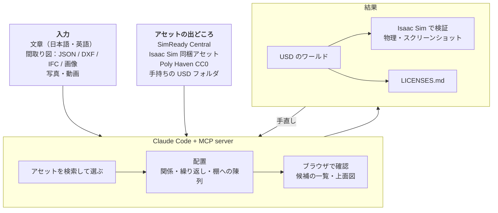
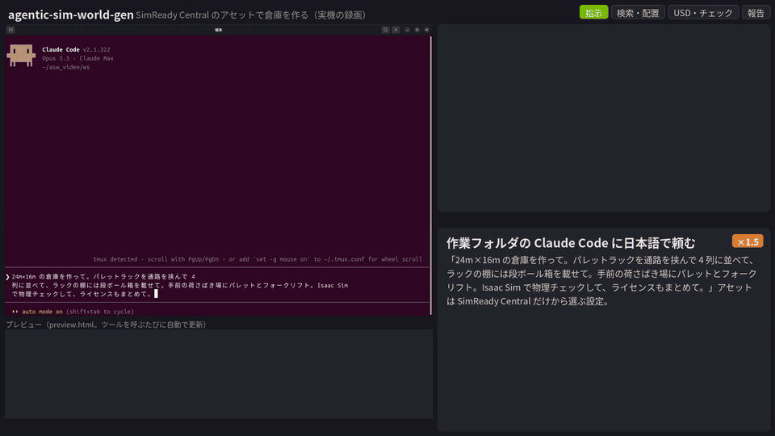

# agentic-sim-world-gen

[English](README.md) | 日本語 | [プロジェクトページ](https://atinfinity.github.io/agentic-sim-world-gen/ja/)

日本語（英語も可）の指示・間取り図・写真から、エージェント（Claude Code）がアセットを選んで配置し、Isaac Sim 用のワールド（USD）を生成するツール。
アセットは [SimReady Central](https://huggingface.co/spaces/nvidia/simready-central)・Isaac Sim 同梱アセット・[Poly Haven](https://polyhaven.com/models) の CC0 モデル・手持ちの USD フォルダから選ぶ。



> [!IMPORTANT]
> NVIDIA の公式の製品ではなく、NVIDIA の後援・承認も受けていない個人のプロジェクトです。Isaac Sim・Omniverse・SimReady・Replicator は NVIDIA Corporation の商標です。

> [!WARNING]
> SimReady Central の検索には、Web の画面が使っている公開されていない API を使っています。非公式で、予告なく変わったり使えなくなったりすることがあります。
> 公式の検索窓口（`search.simready.omniverse.nvidia.com`、`simready-search` パッケージが使うもの）は別の中身（主に Isaac Sim の同梱アセット）を検索していて、Hugging Face 上の SimReady Central のデータセットは返さないため、代わりには使えません。

> [!CAUTION]
> アセットのライセンスはアセットごとに違い、非商用（CC-BY-NC など）の物も選ばれます。シーンごとに書き出す `LICENSES.md` で、使う前に必ず確かめてください。Isaac Sim 同梱アセットは NVIDIA のライセンスで、このリポジトリの Apache-2.0 の対象外です。アセットを同梱した USD を人に渡すと再配布になります。

> [!CAUTION]
> 写真・動画からシーンを作るときは、人が写っている物を使わないでください。

**はじめての方は [Getting Started](docs/getting-started.md)**（clone から Isaac Sim でワールドを開くまで）。

## デモ：倉庫

[](docs/videos/warehouse_demo.mp4)

動作の様子（1 ターンの会話、待ち時間は早送り）：作業フォルダの Claude Code に「24m×16m の倉庫を作って。パレットラックを通路を挟んで 4 列に並べて、ラックの棚には段ボール箱を載せて。
手前の荷さばき場にパレットとフォークリフト。Isaac Sim で物理チェックして、ライセンスもまとめて。」と頼むと、Claude が既定を決めて一度に検索・配置し、
在庫が載ったラックを候補から空のラックに替えて（`select_asset`）棚に段ボール箱を並べる（`set_fill`）。Isaac Sim 6.1 の物理チェックで滑った箱 2 個と動いたフォークリフトを見つけ、
箱の間隔を広げ、フォークリフトは候補を 3 つ試して（座席やハンドルの部品がずれる）歩行型の電動スタッカーに替えて合格させる（221 物体）。
最後に指示との突き合わせ・ライセンス（すべて CC BY 4.0）を報告し、出来上がりを周り 24 方向から見る。
アセットは **SimReady Central だけ**（`AGENTIC_SIM_WORLD_GEN_SOURCES=simready-central`、`AGENTIC_SIM_WORLD_GEN_MDL=0`）、床・壁はこのリポジトリの色とテクスチャ。
Ubuntu の画面の録画（Isaac Sim は開かず、check は headless）。高画質版は [docs/videos/warehouse_demo.mp4](docs/videos/warehouse_demo.mp4)。

使ったアセット（すべて CC BY 4.0。詳細は [LICENSES.md](docs/images/warehouse_LICENSES.md)）：
"sm_rack_h3m_s02_01"・"sm_box_cardboard_b02_01"・"sm_vehicle_forklift_orange_a01_01" by NVIDIA（[nvidia/simready-assets](https://huggingface.co/datasets/nvidia/simready-assets)）、
"pallet" by ForgeCAD（[ForgeCAD/simready-assets](https://huggingface.co/datasets/ForgeCAD/simready-assets)）、
[CC BY 4.0](https://creativecommons.org/licenses/by/4.0/)。

## できること

- **Claude Code の MCP サーバー＋スキル**（63 ツール）。同じ処理を CLI `agentic-sim-world-gen` でも呼べる
- 入力：自然言語（屋内・倉庫・屋外）、間取り図（JSON / DXF / IFC / 画像をなぞる）、写真・部屋を歩いて撮った動画（出典を記録）
- 配置：関係配置（壁際・机の前・隣・上・向き合う）、繰り返し配置（ラック列＋通路）、棚への物の陳列、重なり・はみ出し・ドア前の検査
- 見た目：床・壁のマテリアル（Isaac Sim 同梱の MDL・CC0 の PBR）、照明プリセット、雰囲気（moods）、屋外の地面・道路・建物・空（HDRI）
- 確認：候補のサムネイル一覧・上面配置図（ブラウザのプレビューで動かせる）、Isaac Sim 6.1 で物理チェック＋スクショ（headless か、起動中の Isaac Sim でライブ）
- 合成データ：Replicator で RGB・bbox・セグメンテーション・深度（COCO / KITTI）
- ライセンス：アセットごとに出典・ライセンスを USD と LICENSES.md に記録

該当するアセットが無いときは近い物で代用し、そう報告する（3D の生成はしない）。
手持ちのアセットのフォルダがあれば `local:` で足せる（下の「手持ちの USD フォルダ」）。

## 動作環境

| | 確かめた環境 | 未確認 |
|---|---|---|
| Isaac Sim | 6.1 の pip 版、Ubuntu 24.04、RTX 2080 Ti | バイナリ（スタンドアロン）版、ほかのバージョン、Windows |
| 本体（検索・プレビュー・USD 出力） | Ubuntu 24.04（Python 3.14）、macOS（Apple Silicon、Python 3.12） | Windows |

GPU の無い環境でも検索・プレビュー・USD 出力まではできる（Isaac Sim を使う操作だけが使えない）。
必要な物：Python 3.10 以上と [uv](https://docs.astral.sh/uv/)、[Claude Code](https://claude.com/claude-code)（エージェントとして使うとき）、Isaac Sim 6.1（物理チェック・スクショ・合成データのときだけ）。

## クイックスタート（CLI）

```bash
uv sync --extra usd --extra hf --extra mcp --extra dev
source .venv/bin/activate

agentic-sim-world-gen resolve examples/p0_study_room.json -o out/study   # 検索 → candidates.html・layout.svg
agentic-sim-world-gen compose out/study/scene.resolved.json              # -> out/study/scene.usda
agentic-sim-world-gen check out/study                                    # Isaac Sim で物理チェック＋スクショ（Ubuntu）
```

usd-core は `.venv` にだけ入れる（Isaac Sim の Python には入れない）。Isaac Sim の場所は `ISAACSIM_PATH`（既定 `~/isaacsim`）か
`ISAACSIM_PYTHON`（pip 版の python）、非対話実行には `OMNI_KIT_ACCEPT_EULA=YES`。

## Claude Code から使う（MCP）

リポジトリ直下の `.mcp.json` で `agentic-sim-world-gen` MCP サーバーが登録済み。リポジトリで `claude` を起動し、初回に承認する。
ワールドを作るだけなら `agentic-sim-world-gen workspace <dir>` で作業フォルダを作り、そこで起動する（[Getting Started](docs/getting-started.md) 4）。
別ディレクトリから使う場合：`claude mcp add agentic-sim-world-gen -- /path/to/repo/.venv/bin/agentic-sim-world-gen-mcp`

主なツール（全 63 ツールの引数は [.claude/skills/world-gen/tools.md](.claude/skills/world-gen/tools.md)）：

| ツール | 内容 |
|---|---|
| search_assets | アセット検索：SimReady Central・Isaac 同梱・Poly Haven・手持ちフォルダ（英語クエリ＋類義語、サイズ条件、一致スコアで再ランク） |
| plan_questions | 場所ごとに結果を大きく変える質問と、その既定値（まず既定で叩き台を作り、後で聞く） |
| create_scene | SceneSpec から候補検索＋プレビュー生成 |
| set_purpose | 用途（demo / amr / manipulation / sdg）の既定（密度、ロボットの通路幅など）を当てる |
| open_preview | ブラウザでプレビューを開く（ツールを呼ぶたびに更新。上面図で物を動かす・候補を選ぶ・メモを書ける） |
| get_scene | 状態（候補、選択、配置の問題、プレビューのパス） |
| view_candidates | 候補のサムネイル画像を返す（Claude が見て選ぶ） |
| select_asset / research_object | 候補の差し替え / クエリを変えて再検索 |
| set_layout | 関係で配置（壁際・机の前・隣・上・向き合う）→ 位置/向きを自動計算 |
| set_array | 繰り返し配置（ラック列＋通路、机の列）。ブロックごと layout で配置 |
| set_fill | 棚・冷蔵ケース・ショーケースに商品を並べる（段・幅・列） |
| propose_layouts / choose_layout | 配置の案を 2〜4 つ出して比べる / 1 つ選ぶ |
| set_room | 部屋のサイズ・床/壁（プリセット・色・テクスチャ・MDL）・照明プリセット・天井・ドア/窓（openings）・間取り（plan_file）。屋外の敷地（outdoor・道路/歩道などの areas・建物 buildings・空 sky） |
| import_floor_plan | 間取り図（JSON / DXF / IFC）を読み込み plan.json と plan.svg を出力。IFC の家具（IfcFurniture など）は位置・向き・寸法・種類と物体の下書きとして返す。画像・PDF はエージェントがなぞって JSON にする |
| set_variants / set_screen | アセットのバリアント選択（照明 On/Off、サイネージの `Screen` On/Off など） / サイネージの画面に任意の画像を映す（出典は LICENSES.md に記録） |
| move_object / add_object / remove_object | 手動配置、物の追加・削除（まとめて行う add_objects / move_objects もある） |
| fill_windows | 空いた窓の開口に窓のアセットとカーテン・ブラインドを入れる |
| moods / apply_mood | 場所に合う雰囲気の一覧 / 床・壁・照明をまとめて当てる |
| select_surface / set_tint | 床・壁のマテリアル候補を選ぶ / 物の色を塗り替える |
| set_assumptions / check_request | 決めたこと（指示か推測か）の記録 / 指示の項目ごとに満たしたかを確かめる |
| compose_scene | scene.usda を出力 |
| view_fronts | 各物体を想定した正面から Isaac Sim で描画（向きの確認、Ubuntu のみ。fill の商品は除く、`ids` で絞れる） |
| check_in_isaac | Isaac Sim（headless）で物理チェック＋スクショ（Ubuntu のみ）。`live=true` で起動中の Isaac Sim の画面上で確認、`draft=true` で物理なしの叩き台の描画 |
| set_input / compare_photo | 入力写真の出典・撮影カメラの記録 / 写真と同じ視点で描画して並べる（Ubuntu のみ） |
| fit_photos | 同じ部屋の写真が複数のとき、写真上の目印から部屋の寸法・開口・各カメラを求める |
| extract_frames | 部屋を歩いて撮った動画から、ぶれが少なく見え方の違うコマを 4〜8 枚選び、出典・時刻つきの入力写真にする（ffmpeg が必要） |
| video_poses | 動画のコマの間のカメラの回転（と移動の向き）を測り、fit_photos に渡す |
| place_from_photos / measure_photo | 写真で位置を求めた物をその位置・向きに置く / 写真と寸法を比べる |
| nav_map | ロボット用の 2D 地図（Nav2 の map.pgm＋map.yaml）と、ドアから走れる範囲 |
| make_variants | 完成したシーンのバリエーション（アセット・配置・素材・サイズ）を作る |
| generate_data | Replicator で合成データ（RGB・2D bbox・セグメンテーション・深度、COCO/KITTI も）。カメラ・照明・床壁色をランダム化（Ubuntu のみ） |
| license_report | 使用アセットのライセンス集計・帰属表示・警告、LICENSES.md 出力 |

シーンは `$AGENTIC_SIM_WORLD_GEN_OUT/<name>/`（既定 `~/agentic_sim_world_gen_scenes`）に保存。

## アセット源

`AGENTIC_SIM_WORLD_GEN_SOURCES`（既定 `simready-central,isaac,polyhaven`）。

- `simready-central`：SimReady Central の検索（上の WARNING を参照）。アセット本体は Hugging Face のデータセットから参照する
- `isaac`：同梱の索引 `src/agentic_sim_world_gen/data/isaac_6.1.jsonl.gz` をオフライン検索する（作り直し：`python scripts/build_isaac_index.py --bbox-props`）。
  Isaac アセットをローカルや Nucleus に置いている場合は `ISAAC_ASSETS_ROOT` にそのルート（`Isaac/` の親）を指定。未設定なら公開の URL を参照する
- `polyhaven`：Poly Haven の CC0 3D モデル（同梱の索引で検索し、シーンを合成するときだけ 1k の USD を取得してシーンに写す）
- 床・壁の材質：Isaac Sim 同梱の MDL と CC0 の PBR（ambientCG・Poly Haven）。`AGENTIC_SIM_WORLD_GEN_MDL=0` で MDL を、`AGENTIC_SIM_WORLD_GEN_PBR=0` で PBR を検索しない

同梱の索引（`src/agentic_sim_world_gen/data/*.gz`）はアセットの名前・寸法・URL の一覧で、アセット本体は含まない（出どころは [NOTICE](NOTICE)）。

### 手持ちの USD フォルダ

`AGENTIC_SIM_WORLD_GEN_SOURCES=+local:/data/usd_assets`（既定の検索元に足す）。
`agentic-sim-world-gen index /data/usd_assets --list` で索引を作って中身を確認できる（初回は全ファイルを読むので時間がかかる。
以後は変更分だけ）。ライセンスはフォルダ内の LICENSE / COPYING から推定するので、確実にするにはフォルダに
`agentic-sim-world-gen.json` を置く：`{"license": "CC-BY-4.0", "author": "ACME", "tags": ["kitchen"], "exclude": ["*_lod*.usd"]}`
（近いフォルダの設定が優先）。SimReady 形式のアセットフォルダ（`asset.json` つき）はその情報も読む。

## 間取り図・屋外・ライブモード

間取り図：`agentic-sim-world-gen plan examples/plans/1ldk.json -o out/1ldk_plan`（DXF は `--extra dxf`、
IFC は `--extra ifc` を付けて `uv sync` し直す）。出力の plan.json を `room.plan_file` に指定すると、部屋（ゾーン）ごとに壁際配置でき、
ドア前を空け、USD の壁に開口が開く。形式は `src/agentic_sim_world_gen/scene/plan.py` の docstring。
IFC の家具は BIM の位置・向きのままアセットを置ける。

屋外：`room.outdoor=true` で width×depth が敷地になり、道路・歩道・芝などの areas（ゾーンとして壁際配置に使える。
歩道は縁石の高さ、道路は物を置かない）と建物 buildings（箱）を置ける。照明は sun / overcast / dusk / street_night で、
Isaac Sim 同梱の HDRI を空に使う（自分で用意した HDR は `sky` にパスを渡す）。例：`agentic-sim-world-gen resolve examples/outdoor_yard.json -o out/outdoor_yard`。

ライブモード：Isaac Sim を `--enable isaacsim.code_editor.python_server` 付きで起動しておくと、`agentic-sim-world-gen check out/study --live`（MCP は `live=true`）がその画面でシーンを開いて物理を回し、問題の物を選択状態にする（2 回目以降約 8 秒。headless は毎回約 34 秒）。起動していなければ headless で実行する。接続先は `AGENTIC_SIM_WORLD_GEN_ISAAC_LIVE`（既定 `127.0.0.1:8226`）。
python_server は任意のコードを実行するので、127.0.0.1 以外で待ち受けない。

## テスト

`uv run pytest -q`（オフライン、約 2 分）、`uv run pytest -q -m network`（SimReady Central・Poly Haven の実 API）。

## ドキュメント

| ファイル | 内容 |
|---|---|
| [docs/getting-started.md](docs/getting-started.md) | はじめての方向け：インストールから最初のワールドまで |
| [docs/architecture.md](docs/architecture.md) | 仕組みの説明（全体の流れ・データの形・検索・レイアウト・検証・USD・Isaac Sim・対話・写真から推定を図で） |
| [docs/use-local.md](docs/use-local.md) | 全部手元：画面のある Ubuntu＋RTX の 1 台で使う（ライブモードも） |
| [docs/use-ssh.md](docs/use-ssh.md) | ssh 先：GPU 機は LAN の Ubuntu、手元の Mac などから ssh とブラウザで使う |
| [CLAUDE.md](CLAUDE.md) | このリポジトリで開発するエージェント向けの前提・規約・環境変数 |
| [CONTRIBUTING.md](CONTRIBUTING.md) | 開発への参加 |

手引きの英語版は [docs/en/](docs/en/getting-started.md) にある。

## ライセンス

コードは [Apache License 2.0](LICENSE)（[NOTICE](NOTICE)）。次の物は別の条件：

- **アセット**：このリポジトリには含まない。生成したワールドが参照するアセットは、それぞれのライセンス（シーンの `LICENSES.md`）
- **画像**（`docs/images`・`src/agentic_sim_world_gen/data/moods`）：写っているアセットはそれぞれのライセンス（倉庫のデモは上の CC BY 4.0 の表示）
- **同梱の索引**（`src/agentic_sim_world_gen/data/*.gz`）：名前・寸法・URL の一覧。出どころは [NOTICE](NOTICE)
- **作例の写真**（`examples/photos`）：Wikimedia Commons の CC0（[SOURCES.md](examples/photos/SOURCES.md)）
- **任意の依存**：IFC の読み込み（extra `ifc`）は LGPL-3.0-or-later の [IfcOpenShell](https://ifcopenshell.org/) を使う（同梱せず import するだけ）
- **任意のモデル**（同梱しない。許可したときだけ取得する）：テイスト検査の [SigLIP 2](https://huggingface.co/google/siglip2-so400m-patch14-384)（Apache-2.0）、写真の奥行きの [MoGe-2](https://huggingface.co/Ruicheng/moge-2-vits-normal)（MIT）
