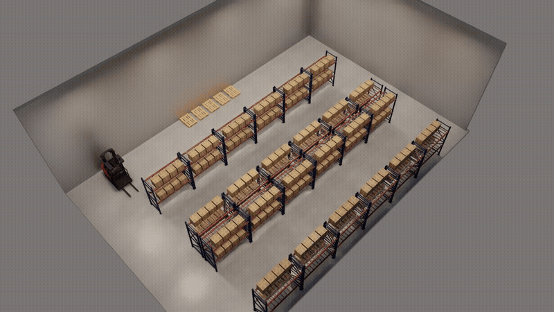

# agentic-sim-world-gen

English | [日本語](README.ja.md) | [Project page](https://atinfinity.github.io/agentic-sim-world-gen/)

An agent (Claude Code) builds an Isaac Sim world (USD) from a description in Japanese or English, a floor plan
or photos: it searches for assets, picks them, lays them out, checks the result with physics in Isaac Sim and
records the license of every asset. Assets come from [SimReady Central](https://huggingface.co/spaces/nvidia/simready-central),
the Isaac Sim bundled assets, [Poly Haven](https://polyhaven.com/models) CC0 models and your own USD folders.

> [!IMPORTANT]
> This is a personal project. It is not an official NVIDIA product and is not sponsored or endorsed by NVIDIA.
> Isaac Sim, Omniverse, SimReady and Replicator are trademarks of NVIDIA Corporation.

> [!WARNING]
> SimReady Central is searched through the unpublished API its web page uses. It is unofficial and may change
> or stop working without notice. The official endpoint (`search.simready.omniverse.nvidia.com`, used by the
> `simready-search` package) indexes a different catalog, mostly the Isaac Sim bundled assets, and does not
> return the SimReady Central datasets on Hugging Face, so it cannot replace this API.

> [!CAUTION]
> Asset licenses differ per asset, and non-commercial ones (e.g. CC-BY-NC) can be picked. Check the
> `LICENSES.md` written for each scene before you use or share it. The Isaac Sim bundled assets are licensed
> by NVIDIA and are not covered by this repository's license; handing out a USD with assets packed in is
> redistribution.

> [!CAUTION]
> Do not use photos or videos that show people as input.

## Demo: a warehouse



A 24 m × 16 m warehouse: 24 pallet racks (4 rows of 6, 3.2 m aisles) stocked with 192 cardboard boxes, 5 pallets
and a forklift (222 objects), from **SimReady Central only** (`AGENTIC_SIM_WORLD_GEN_SOURCES=simready-central`,
`AGENTIC_SIM_WORLD_GEN_MDL=0`), viewed from 24 directions after it passed the physics check in Isaac Sim 6.1.

Assets (all CC BY 4.0, details in [LICENSES.md](docs/images/warehouse_LICENSES.md)): "sm_rack_h3m_s02_01",
"sm_vehicle_forklift_red_b01_01" and "sm_box_cardboard_b02_01" by NVIDIA
([nvidia/simready-assets](https://huggingface.co/datasets/nvidia/simready-assets)), "pallet" by ForgeCAD
([ForgeCAD/simready-assets](https://huggingface.co/datasets/ForgeCAD/simready-assets)),
[CC BY 4.0](https://creativecommons.org/licenses/by/4.0/).

## Features

- **MCP server + skill for Claude Code** (63 tools); the same operations from the CLI `agentic-sim-world-gen`
- Input: text (rooms, warehouses, outdoor sites), floor plans (JSON / DXF / IFC, or traced from an image), photos and walk-through videos
- Layout: relations (against a wall, in front of, next to, on, facing), arrays (rack rows with aisles), stocking shelves, overlap / out-of-room / door clearance checks
- Look: floor and wall materials (Isaac Sim MDL or CC0 PBR), lighting presets, moods, outdoor ground / roads / buildings / sky
- Review: candidate thumbnails and a top-down layout in a browser preview; physics check and screenshots in Isaac Sim 6.1 (headless or live)
- Synthetic data with Replicator: RGB, 2D boxes, segmentation, depth (COCO / KITTI)
- Licenses: source and license of every asset recorded in the USD and in `LICENSES.md`

When no asset fits, a close one is used instead and reported (no 3D generation). Your own asset folders can be
added with `local:`.

## Requirements

| | Tested | Not tested |
|---|---|---|
| Isaac Sim | 6.1 pip install, Ubuntu 24.04, RTX 2080 Ti | the standalone (binary) build, other versions, Windows |
| The rest (search, preview, USD) | Ubuntu 24.04 (Python 3.14), macOS on Apple Silicon (Python 3.12) | Windows |

Python 3.10+ and [uv](https://docs.astral.sh/uv/); [Claude Code](https://claude.com/claude-code) to use it as an
agent; Isaac Sim 6.1 only for the physics check, screenshots and synthetic data. Without a GPU you can still
search, preview and write USD.

## Install

```bash
git clone https://github.com/atinfinity/agentic-sim-world-gen.git
cd agentic-sim-world-gen
uv venv --python 3.11 .venv && uv pip install -e ".[usd,hf,mcp,dev]"
source .venv/bin/activate

agentic-sim-world-gen resolve examples/p0_study_room.json -o out/study   # search -> candidates.html, layout.svg
agentic-sim-world-gen compose out/study/scene.resolved.json              # -> out/study/scene.usda
agentic-sim-world-gen check out/study                                    # physics check in Isaac Sim (Linux)
```

Install usd-core only in this venv, never in Isaac Sim's Python. Point to Isaac Sim with `ISAACSIM_PYTHON`
(pip install) or `ISAACSIM_PATH`, and set `OMNI_KIT_ACCEPT_EULA=YES` to run it non-interactively.

With Claude Code: `.mcp.json` registers the `agentic-sim-world-gen` MCP server and `.claude/skills/world-gen`
is the skill. To only make worlds, create a workspace outside the repository with
`agentic-sim-world-gen workspace <dir>`, start `claude` there and ask, e.g. "Make a 10 m² study with a desk,
a chair and a bookshelf".

## Guides

| Guide | |
|---|---|
| [Getting Started](docs/en/getting-started.md) | from the install to your first world |
| [Everything on one machine](docs/en/use-local.md) | Ubuntu with an RTX GPU and a screen (live mode too) |
| [Over ssh](docs/en/use-ssh.md) | the GPU machine is an Ubuntu box on the LAN; you use ssh and a browser from a Mac or similar |
| [How it works](docs/en/architecture.md) | the flow, data, search, layout, checks, USD, Isaac Sim, the conversation and rooms from photos, with diagrams |

The Japanese versions are in [docs/](docs/getting-started.md).

## License

The code is under the [Apache License 2.0](LICENSE) (see [NOTICE](NOTICE)). Not covered by it:

- **Assets** are not included. A generated world refers to assets that keep their own licenses (the scene's `LICENSES.md`).
- **Images** (`docs/images`, `src/agentic_sim_world_gen/data/moods`) show assets under their own licenses (the demo's attribution is above).
- **Bundled indexes** (`src/agentic_sim_world_gen/data/*.gz`) are lists of names, sizes and URLs; their origin is in [NOTICE](NOTICE).
- **Example photos** (`examples/photos`) are CC0 from Wikimedia Commons ([SOURCES.md](examples/photos/SOURCES.md)).
- **Optional dependency**: IFC import (extra `ifc`) uses [IfcOpenShell](https://ifcopenshell.org/), LGPL-3.0-or-later (imported, not bundled).
- **Optional models** (not bundled; downloaded only when you allow it): [SigLIP 2](https://huggingface.co/google/siglip2-so400m-patch14-384) for the taste check (Apache-2.0), [MoGe-2](https://huggingface.co/Ruicheng/moge-2-vits-normal) for photo depth (MIT).

Contributions: [CONTRIBUTING.md](CONTRIBUTING.md). Security: [SECURITY.md](SECURITY.md).
