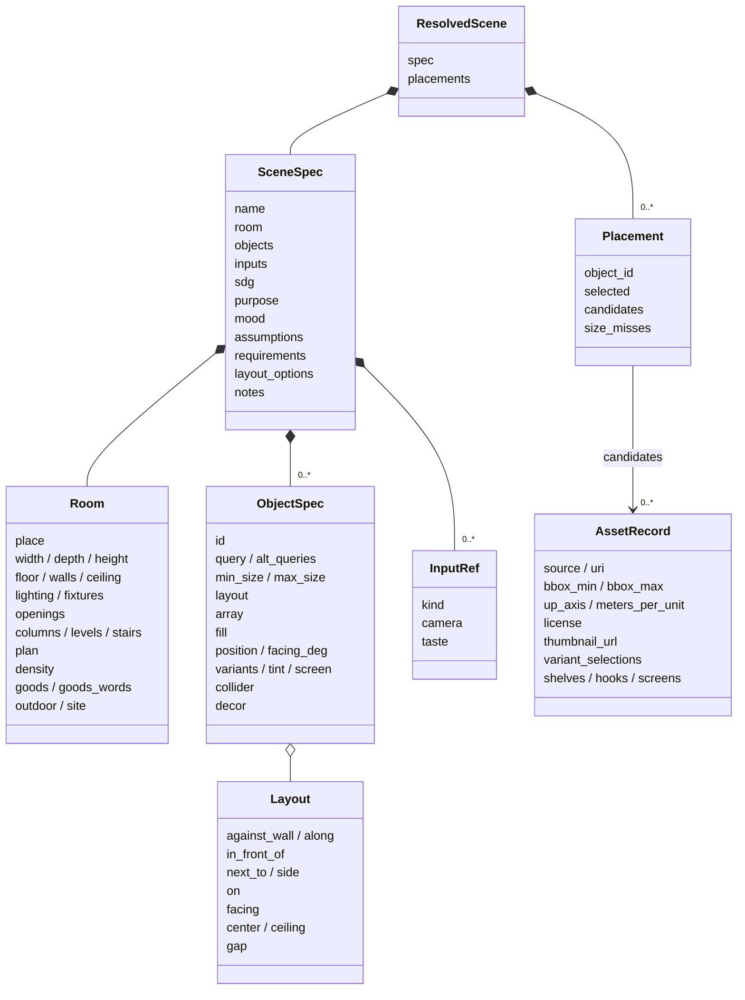
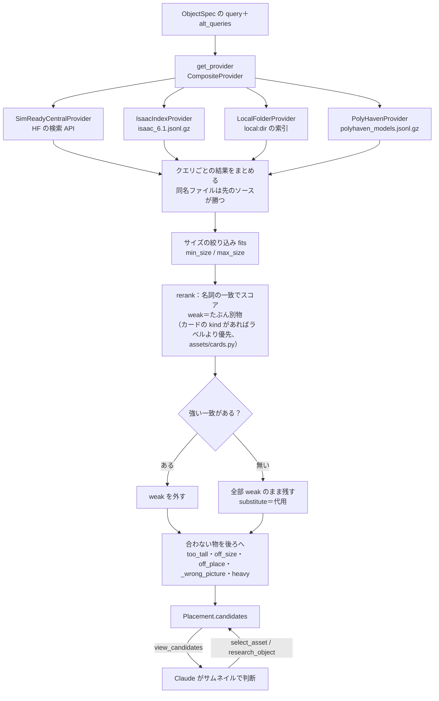
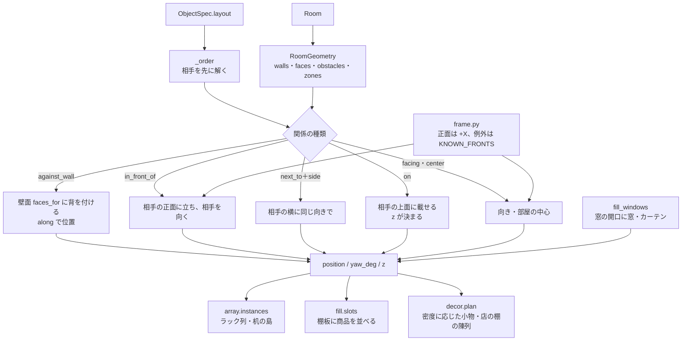
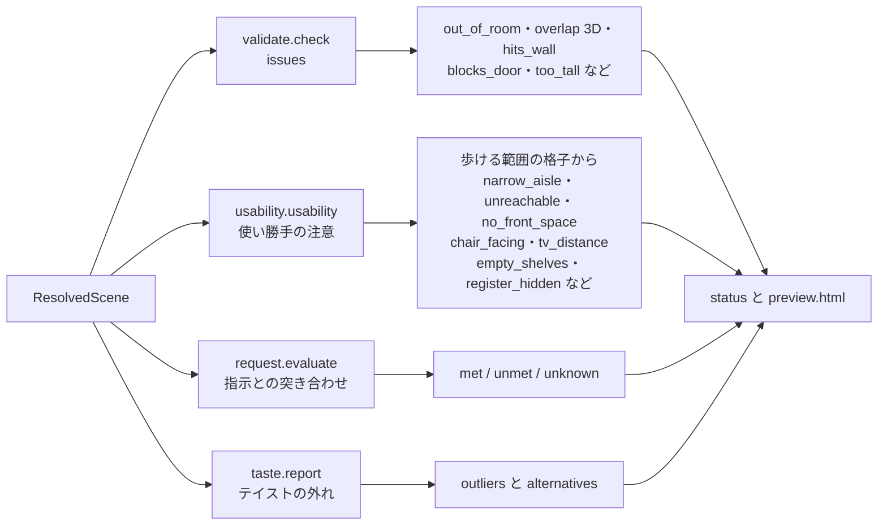
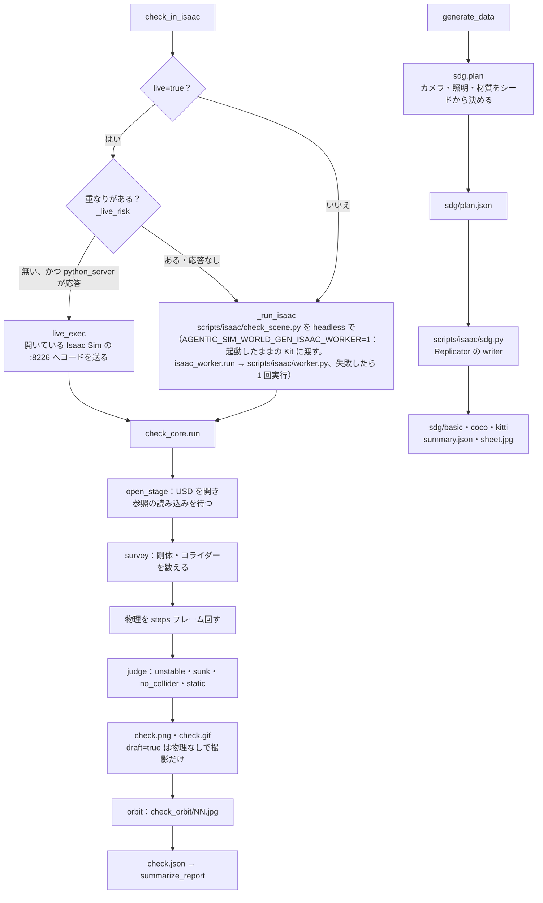
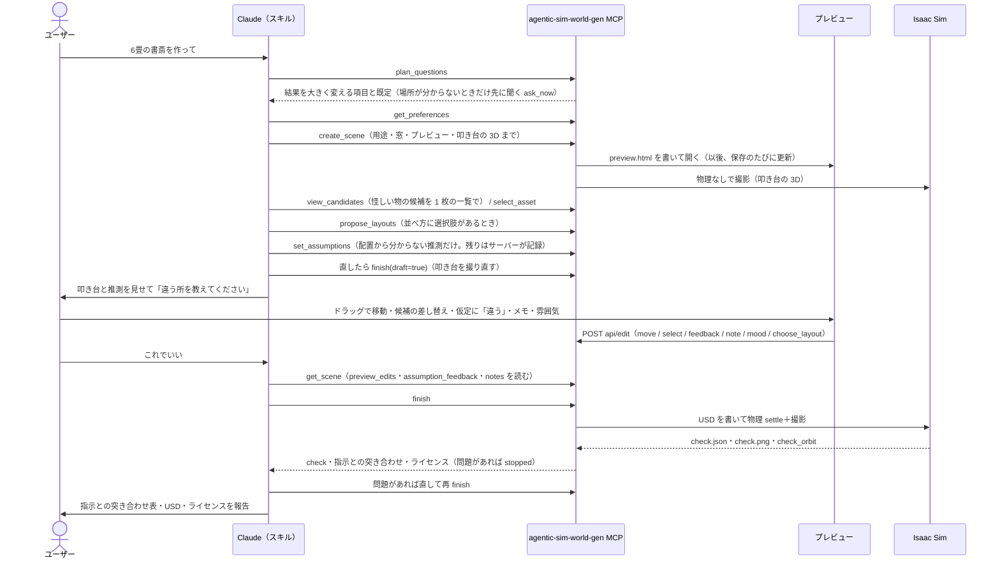
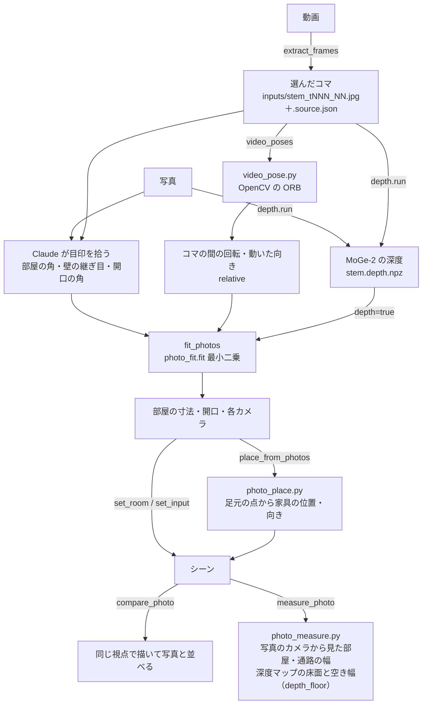

# agentic-sim-world-gen の仕組み

この文書は、コードを開く前に agentic-sim-world-gen 全体の流れをつかむためのものです。
使い方は [getting-started.md](getting-started.md) にあります。

各節は「図 → 短い説明 → 関係するファイル」の順に書いています。図に出てくる名前（関数・ファイル・MCP ツール・prim のパス）はコードにある名前です。

目次

1. [全体の流れ](#1-全体の流れ)
2. [データの形](#2-データの形)
3. [アセット検索](#3-アセット検索)
4. [レイアウト](#4-レイアウト)
5. [検証](#5-検証)
6. [USD の合成](#6-usd-の合成)
7. [Isaac Sim 側](#7-isaac-sim-側)
8. [対話の流れ](#8-対話の流れ)
9. [写真・動画から部屋を推定](#9-写真動画から部屋を推定)

---

## 1. 全体の流れ


どの入力も、いったん **SceneSpec**（部屋と物の指定を書いた JSON）に集まります。
言葉の指示から SceneSpec を書くのは呼び出し側の Claude で、サーバー側に LLM はありません。検索クエリは英語にします（英訳の効果が最も大きい）。
指示に無い項目（広さ・入口・レジの位置など）は、`plan_questions` が場所ごとに返す既定で埋めて叩き台を作り、推測として記録します（[8. 対話の流れ](#8-対話の流れ)）。
広さが指示に無い時は、叩き台を 1 つ作る代わりに広さだけを離した 3 案の上面図を並べて選んでもらえます（`create_scene(drafts="size")`・`propose_drafts`。選んだ値は推測ではなく「選んだ」として記録）。
家・オフィス・学校・研究室では、広さや人数の代わりに「誰が・何人で・何をする場所か」を聞き、広さ・主な家具・数を表から逆算します（`scene/activity.py`・`derive_activity`。逆算した値は根拠「活動から」の推測）。
叩き台に理由の無い「違う」が返った時は、今の案と 1 つの軸（広さ・物の量・雰囲気・配置の型）だけ変えた案を並べて「どちらが近いか」を聞き、2〜3 回で違っていた軸を絞ります（`propose_contrast`・`choose_contrast`）。

`create_scene` が物ごとにアセットを検索して候補を付けたものが **ResolvedScene** で、シーンのディレクトリの `scene.resolved.json` に保存されます。
以後のツール（`set_layout`、`select_asset`、`set_room` …）はこのファイルを読み、変えて、保存します。保存のたびにレイアウトを解き直し、チェックし、プレビューを書き直します（`service._save`）。
このとき、直し方が 1 つに決まる問題（狭い通路・触れている関節付きの椅子・足の無い TV）はサーバーが直します（`_auto_fix`）。検査が `Issue.fixes` に直し方を付け、シーンの写しに当てて解き直し、その問題が消えて新しい問題が 1 つも増えない時だけ採用します。ユーザーが置いた物と、その呼び出しが動かした物は動かしません。直した内容は結果の `auto_fixed`・仮定の「自動で直した」・プレビューの変更履歴に出ます。

ユーザーが合意したら `finish` が USD を書き（`compose_scene`）、Isaac Sim の物理を回して確かめ（`check_in_isaac`）、指示との突き合わせとライセンスの一覧まで 1 回で返します。問題があれば `stopped` で止まるので、直してもう一度 `finish`、という修正ループになります。
同じように `create_scene`（`service.start_scene`）は、作った後に用途の記録・窓の作り込み・プレビューを開く・叩き台の 3D の撮影までを 1 回で進めます（個別のツールも残っています）。

関係するファイル
- [src/agentic_sim_world_gen/service.py](../src/agentic_sim_world_gen/service.py)：CLI と MCP 共通の操作（`create_scene`・`start_scene`・`_save`・`compose_scene`・`check_in_isaac`・`finish` など）
- [src/agentic_sim_world_gen/mcp_server.py](../src/agentic_sim_world_gen/mcp_server.py)：MCP サーバー（ツールは service の関数を呼ぶだけ）
- [src/agentic_sim_world_gen/cli.py](../src/agentic_sim_world_gen/cli.py)：CLI（`agentic-sim-world-gen ...`）
- [.claude/skills/world-gen/SKILL.md](../.claude/skills/world-gen/SKILL.md)：Claude が従う手順

## 2. データの形



- **SceneSpec**：ユーザーの指示そのもの（部屋・物・入力・用途 `purpose`・雰囲気 `mood`・仮定・指示の項目・プレビューのメモ `notes`）。アセットの選択は含まない。
- **Room**：矩形の部屋（`width`・`depth`）か間取り（`plan`）か屋外（`outdoor`）。場所の種類 `place`（home・office・店の種類 `STORE_PLACES` など）、床・壁・照明・開口・柱・段差・密度もここ。表に無い業種の店の商品は `goods`。屋内の部屋の外まわり（歩道・駐車場・隣の建物）は `site`。
- **ObjectSpec**：置きたい物 1 つ。英語の `query` と、置き方を関係で書く `layout`（座標は solve が決める）。同じ物の並びは `array`、棚への陳列は `fill`。密度で自動で足した物は `decor=true`（id は `decor_*`）。
- **ResolvedScene**：SceneSpec ＋ 物ごとの **Placement**（候補アセットの一覧と選んだ番号 `selected`）。
- **AssetRecord**：検索で見つかった 1 つのアセット。bbox・軸・単位・ライセンス・サムネイルなど、配置と合成に要る情報を持つ。

シーンは「`scene.resolved.json` のあるディレクトリ」です。そこにできる主なファイル：

```
<scene>/
  scene.resolved.json   シーンの本体（SceneSpec＋候補＋選択＋計算した位置）
  candidates.html       候補アセットの一覧
  layout.svg            上面の配置図
  preview.html / preview.json   ライブプレビューのページと更新の印
  .history/NNNNNN.json.gz       保存ごとの scene.resolved.json（直近 30 件。取り消し・「ここに戻す」・restore が読む）
  scene.usda            Isaac Sim 用のワールド
  check.json / check.png / check.gif   Isaac Sim の物理チェックの報告とスクショ
  check_orbit/NN.jpg    周りから撮った画像（プレビューで回して見る）
  LICENSES.md           アセット・材質・入力写真のライセンスと帰属表示
  surfaces.json         床・壁・天井の材質の検索結果
  layout_options/       配置案・叩き台 3 案の上面図と summary.json
  taste_pool.json       テイスト検査の比較用の候補
  plan.json / plan.svg  間取り図を読み込んだとき
  inputs/               入力の写真・動画のコマ（出典は <stem>.source.json）
  photo_fit.json / video_poses.json / compare.png   写真・動画から推定したときの結果と見比べ
  nav/                  ロボット用のナビ地図（map.pgm・map.yaml、nav_map）
  variants/             シーンのバリエーション（make_variants）
  sdg/                  合成データ
```

関係するファイル
- [src/agentic_sim_world_gen/scene/spec.py](../src/agentic_sim_world_gen/scene/spec.py)：SceneSpec・Room・ObjectSpec・Layout・ResolvedScene・Placement
- [src/agentic_sim_world_gen/scene/plan.py](../src/agentic_sim_world_gen/scene/plan.py)：開口（Opening）・間取り（FloorPlan）
- [src/agentic_sim_world_gen/assets/record.py](../src/agentic_sim_world_gen/assets/record.py)：AssetRecord
- 出力の説明：[getting-started.md「7. 出力」](getting-started.md#7-出力)

## 3. アセット検索



1. 物ごとに `query` と `alt_queries`（英語の類義語）で、設定されたすべてのソースを検索します。ソースは環境変数 `AGENTIC_SIM_WORLD_GEN_SOURCES` で選びます（既定は SimReady Central・Isaac 同梱・Poly Haven。`+local:<dir>` で既定に足す）。
   1 回の呼び出し（`create_scene`・`add_objects`）の検索は先にまとめて並列に投げ（`service._searching`）、SimReady Central の答えは 1 日 `AGENTIC_SIM_WORLD_GEN_CACHE/search` に残します。
2. サイズ（`min_size` / `max_size`、footprint の長辺・短辺・高さ）で外れる物を落とします。
3. **再ランク**：アセットの class・tags・caption・name に、クエリの最後の名詞（物そのもの）が名詞として出るかで点を付けます。「desk lamp」は机ではなく、「coffee table」は dining table の代わりにならない（weak）。強い一致があれば weak は一覧から外し、全部 weak なら「該当なし＝代用」として残します。
4. 消さずに後ろへ回すもの：天井より上に出る物（`too_tall`）、サイズの指定が無いとき種類の標準サイズ（`assets/sizes.py` の `TYPICAL`）から大きく外れる物（`off_size`。「cardboard box」にパスタの箱）、場所（`Room.place`）に合わない分野のアセット（家に病院のベッド、`off_place`）、絵柄が別の店のもの（ドラッグストアに書店のレジ看板）、大きさの割に面が多すぎる物（`heavy`）。
   全部が代用のときは、種類の表（`assets/kinds.py`、MCP `kind_availability`）で「その種類がどのソースにも無い」（`not_in_catalog`）かを返し、探し直しを止めます。
   足りなかった物はシーンごとに `AGENTIC_SIM_WORLD_GEN_CACHE/missing/` に記録され（`missing.py`、保存のたび）、`agentic-sim-world-gen missing` で多い順に見られます。
5. 最後の判断は Claude が `view_candidates`（サムネイル画像を返す）で行います。メタデータだけでは色・素材・形は分からないためです。

関係するファイル
- [src/agentic_sim_world_gen/assets/providers/base.py](../src/agentic_sim_world_gen/assets/providers/base.py)：`AssetProvider` プロトコル・`fits`
- [src/agentic_sim_world_gen/assets/providers/composite.py](../src/agentic_sim_world_gen/assets/providers/composite.py)・[simready_central.py](../src/agentic_sim_world_gen/assets/providers/simready_central.py)・[isaac_index.py](../src/agentic_sim_world_gen/assets/providers/isaac_index.py)・[local_folder.py](../src/agentic_sim_world_gen/assets/providers/local_folder.py)・[polyhaven.py](../src/agentic_sim_world_gen/assets/providers/polyhaven.py)
- [src/agentic_sim_world_gen/assets/sizes.py](../src/agentic_sim_world_gen/assets/sizes.py)：`TYPICAL`（種類ごとの標準サイズ）・[kinds.py](../src/agentic_sim_world_gen/assets/kinds.py)：種類の表
- [src/agentic_sim_world_gen/assets/rerank.py](../src/agentic_sim_world_gen/assets/rerank.py)：`rerank`・`score`・`noun_last`
- [src/agentic_sim_world_gen/assets/cards.py](../src/agentic_sim_world_gen/assets/cards.py)：アセットごとのカード（`of`・`physics_issue`・`brief`）。データは `src/agentic_sim_world_gen/data/asset_cards.jsonl.gz`、作り直しは `scripts/build_asset_cards.py`
- [src/agentic_sim_world_gen/assets/domain.py](../src/agentic_sim_world_gen/assets/domain.py)：`off_place`
- [src/agentic_sim_world_gen/service.py](../src/agentic_sim_world_gen/service.py)：`_find_candidates`・`_wrong_picture`・`research_object`

## 4. レイアウト



- **RoomGeometry** は、矩形の部屋も間取りも屋外も同じ形にします：壁（中心線と厚さ）、壁面（物が背を付けられる内側の面。ドアで切られる）、障害物（壁本体・ドア前・柱 `columns`・段差 `levels`・階段・天井の梁や照明器具）、ゾーン（間取りの部屋）。段差の上に中心がある物は、ソルバがその高さに載せます。`site` があれば外まわりの面（部屋の外壁・エリアの辺・建物）とエリア・建物の障害物も持ちます（外の物は zone が `outside` かエリア ID）。
- **solve** は `layout` の関係（`against_wall`・`in_front_of`・`next_to`・`on`・`facing`・`center`・`gap`）から位置・向き・高さを決めます。机を先に、椅子を後に、という順番は `_order` が決めます。保存のたびに解き直すので、アセットを差し替えてサイズが変わっても追従します。`move_object` で手で動かした物は `layout` が消えて座標のままになります。
- **正面の規約**：アセットの正面は +X（Isaac Sim 6.1 で約 40 点を 4 方向から描いて確認）。例外は `KNOWN_FRONTS`・`KNOWN_FRONT_PATTERNS`、手持ちのフォルダは agentic-sim-world-gen.json の `front`、物ごとには `front_offset_deg`。手で向きを決めるときは `facing_deg`（0＝東、90＝北）。
- **繰り返し**：`array` はブロック全体を 1 つの物として置き、検証・プレビュー・USD ではユニット（`<id>.r<row>c<col>`）に展開します。
- **陳列**：`fill` は什器のジオメトリから見つけた棚板（`assets/shelves.py`）に商品を並べます。
- **小物**：`Room.density`（sparse / normal / lived_in）に応じて、机に本、ソファの前にラグ、のような小物 `decor_*` を `create_scene` が足します。問題が増える置き方は捨てます（`service._apply_density`）。
- **店の陳列**：店（`shop` と `STORE_PLACES` の 25 種：コンビニ・スーパー・ドラッグストア・書店・パン屋・自転車店・家具店など）では、同じ仕組みで空いている什器に商品を `fill` で並べます。商品は店の種類ごとの表（`decor.PRODUCTS`、冷蔵ケースは `COLD_PRODUCTS`、フックは `HANG`）から選び、隣の什器とは違う商品から始めます。表に無い業種は `Room.goods`（商品の英語の検索語）・`goods_words`（業種の語）で、その語を名乗る商品だけを並べます（`decor.fits_goods`）。店の広さ・入口・レジなどの既定は `plan_questions` の表（`questions.STORE_SIZES`）。
- **窓**：窓の開口は壁の穴なので、`fill_windows` が窓のアセット `win_<id>`（開口に合わせて伸ばす `fit_scale`、店の幅 1.8 m 以上の窓はショーウィンドウ）と、家ではカーテン `curtain_<id>` を足します。

`layout.svg`（上面図、矢印が正面）：


関係するファイル
- [src/agentic_sim_world_gen/layout/room.py](../src/agentic_sim_world_gen/layout/room.py)：`RoomGeometry`・`Wall`・`Face`・`Obstacle`
- [src/agentic_sim_world_gen/layout/solver.py](../src/agentic_sim_world_gen/layout/solver.py)：`solve`
- [src/agentic_sim_world_gen/layout/frame.py](../src/agentic_sim_world_gen/layout/frame.py)：正面方向（`asset_front_deg`・`yaw_for_facing`）
- [src/agentic_sim_world_gen/layout/array.py](../src/agentic_sim_world_gen/layout/array.py)・[fill.py](../src/agentic_sim_world_gen/layout/fill.py)・[assets/shelves.py](../src/agentic_sim_world_gen/assets/shelves.py)
- [src/agentic_sim_world_gen/scene/decor.py](../src/agentic_sim_world_gen/scene/decor.py)：`plan`・`PRODUCTS`・`fits_goods`
- [src/agentic_sim_world_gen/scene/columns.py](../src/agentic_sim_world_gen/scene/columns.py)・[levels.py](../src/agentic_sim_world_gen/scene/levels.py)・[fixtures.py](../src/agentic_sim_world_gen/scene/fixtures.py)：柱・床の一部の仕上げ、段差・階段、天井の照明器具・梁
- [src/agentic_sim_world_gen/preview/layout2d.py](../src/agentic_sim_world_gen/preview/layout2d.py)：layout.svg

## 5. 検証



4 種類の検査があり、強さが違います。

| 検査 | 何を見るか | 扱い |
|---|---|---|
| 静的チェック `validate.check` | 部屋からのはみ出し、物どうしの重なり（足元の多角形の SAT ＋高さの範囲＝3D）、壁の中・ドアの前、天井より高い | **issues**。0 件になるまで直す |
| 使い勝手 `usability` | 床を格子にしてドアから歩ける範囲を求め、棚・レジなどの前に立てるか、通路幅が場所に足りるか（用途 `purpose` が amr ならロボットの幅）。通路の幅は距離変換の地図 1 枚（`AisleMap`）から求め、最も狭い所の幅と場所を narrow_aisle に書き、layout.svg に中心線を幅の色で塗る。椅子と机・テレビの向きと距離、窓をふさぐ背の高い物、店の空の棚・入口から見えないレジ | 警告。理由があれば残してよい |
| 指示との突き合わせ `request.evaluate` | 指示を項目に分け、壁際・隣・個数・向き・ゾーン・上に載る、を配置から計測 | `check_request`。報告の前に必ず回す |
| テイスト `taste.report` | 選んだアセットのサムネイルを SigLIP2 で埋め込み、1 つだけ見た目が浮いている物を探す | 警告。勝手に差し替えない |

椅子が机の下に入るのは奥行きの 60% まで許しますが（`tuck_pair`）、ソルバは自動では差し込みません。重なったまま物理を回すと PhysX が爆発するためです。

関係するファイル
- [src/agentic_sim_world_gen/layout/validate.py](../src/agentic_sim_world_gen/layout/validate.py)：`check`・`Issue`・`overlap_depth`
- [src/agentic_sim_world_gen/layout/usability.py](../src/agentic_sim_world_gen/layout/usability.py)：`usability`・`AisleMap`・`aisle_map`
- [src/agentic_sim_world_gen/layout/widths.py](../src/agentic_sim_world_gen/layout/widths.py)：`edt`（距離変換）・`widest`（入口からの最も広い道）・`narrowest`・`ridge`（中心線）。usability・nav（`routes`）・layout2d が共有
- [src/agentic_sim_world_gen/layout/request.py](../src/agentic_sim_world_gen/layout/request.py)：`evaluate`・`summary`
- [src/agentic_sim_world_gen/taste.py](../src/agentic_sim_world_gen/taste.py)：`report`・`analyze`

## 6. USD の合成


- ステージは **Z-up、メートル**（metersPerUnit=1）、defaultPrim は `/World`。部屋の内側は x∈[0, width]、y∈[0, depth]、床の上面が z=0。
- 物は `/World/Objects/<id>`（Xform）の子 `Asset` にアセットを参照します。参照を子に置くのは、アセット自身のルートの変換（cm のアセットの scale 0.01 など）を消さないためです。
- 外側の Xform の xformOps は次の順です：`translate`（位置）→ `rotateZ`（yaw）→ `scale`（アセットの metersPerUnit）→ `rotateX:upAxis`（Y-up のアセットだけ 90°）→ `translate:pivot`（bbox 底面の中心を原点へ）。
- customData `agentic_sim_world_gen:source`・`agentic_sim_world_gen:uri`・`agentic_sim_world_gen:license`・`agentic_sim_world_gen:label`・`agentic_sim_world_gen:origin`（入手先と版）・`agentic_sim_world_gen:facing_deg` を物の prim に書きます。ライセンスの一覧は `license_report` が `LICENSES.md` にまとめます。
- 物理：アセットの `PhysX` バリアントを `Enabled` にすると、SimReady のアセットに剛体とコライダーが付きます。物理の無いアセット（`collider` が auto で該当する物か box）には、bbox と同じ大きさの見えない固定の箱 `Collider` を付けます。床・壁は静的なコライダーと摩擦のマテリアルを持ちます。
- 床・壁・天井の見た目は `Looks` の下のマテリアル（UsdPreviewSurface、テクスチャ、MDL）です。材質は名前のプリセット（`scene/looks.py`）か、Isaac Sim 同梱の MDL（`materials.py`）と CC0 の PBR（ambientCG・Poly Haven、`pbr.py`）の索引から `select_surface` で選びます。見本の画像から床・壁・照明をまとめて選ぶのが `moods` / `apply_mood`（`scene/moods.py`）です。
- 物の色は `tint`（`usd/tint.py`）で、アセットのファイルを変えずにシーンの側からマテリアルの色を上書きします。

関係するファイル
- [src/agentic_sim_world_gen/usd/compose.py](../src/agentic_sim_world_gen/usd/compose.py)：`compose`・`build_room`・`build_site`・`_add_asset`・`add_box_collider`・`build_inputs`
- [src/agentic_sim_world_gen/usd/look.py](../src/agentic_sim_world_gen/usd/look.py)：マテリアルと照明（`build_lights`）
- [src/agentic_sim_world_gen/materials.py](../src/agentic_sim_world_gen/materials.py)・[pbr.py](../src/agentic_sim_world_gen/pbr.py)・[scene/moods.py](../src/agentic_sim_world_gen/scene/moods.py)：床・壁の材質の検索、雰囲気の見本
- [src/agentic_sim_world_gen/usd/door.py](../src/agentic_sim_world_gen/usd/door.py)・[screen.py](../src/agentic_sim_world_gen/usd/screen.py)：自動ドア、画面に画像
- [src/agentic_sim_world_gen/license.py](../src/agentic_sim_world_gen/license.py)・[origin.py](../src/agentic_sim_world_gen/origin.py)：ライセンスと入手先

## 7. Isaac Sim 側



Isaac Sim は Ubuntu（RTX）機にだけあり、agentic-sim-world-gen 本体（usd-core を使う Python）とは別のプロセスで動きます。agentic-sim-world-gen から Isaac Sim へは「スクリプトを Isaac Sim の Python で実行する」か「起動中の Isaac Sim にコードを送る」のどちらかです。

- **headless**：`check_scene.py` が自分で `SimulationApp` を立ち上げて `check_core.run` を呼びます。Isaac Sim の Python は `ISAACSIM_PYTHON`（pip 版）か `ISAACSIM_PATH` の python.sh。
- **ライブモード**：`--enable isaacsim.code_editor.python_server` で起動した Isaac Sim に同じ `check_core` のコードを送り、ユーザーの画面でシーンを開いて物理を回し、問題の物を選択状態にします。物が重なっているシーンは、GUI の PhysX を止めてしまうので headless に回します。
- **check の中身**：物理を回す前後で剛体の位置を比べ、動いた・倒れた（`unstable`）、床に沈んだ（`sunk`）、当たり判定が無い（`no_collider`）、動かない固定物（`static`）を報告します。そのあと部屋を 24 方向から撮り、プレビューで回して見られるようにします。
- **結果**：`summarize_report` が物体 ID ごとの要約にし、`check_in_isaac` が `verdict`（`passed` / `needs_fix` / `draft` / `failed`）を付けます。`draft=true` は物理を回さず、叩き台の 3D を撮るだけです。
- **ほかの Isaac Sim の処理**：`view_fronts`（`front_views.py`、各物を想定した正面から撮る。撮らない物を非アクティブにしたレイヤー `front_views_stage.usda` を開くので、撮る物のアセットだけを読む）、`compare_photo`（`render_view.py`、写真と同じ視点で描く）、`nav_map(isaac=true)`（`nav_map.py`、Isaac Sim の Occupancy Map）も同じく Isaac Sim の Python で動かします。
- **合成データ（SDG）**：カメラ位置・照明・材質の割り当ては Python 側（`sdg.plan`）がシードから決めて `sdg/plan.json` に書き、Isaac 側の `scripts/isaac/sdg.py` はそれを当てて Replicator の writer を回すだけです。ラベルは compose が prim に付けた UsdSemantics を使います。

`check_orbit` の回り込み画像：


関係するファイル
- [scripts/isaac/check_scene.py](../scripts/isaac/check_scene.py)・[check_core.py](../scripts/isaac/check_core.py)・[view.py](../scripts/isaac/view.py)・[front_views.py](../scripts/isaac/front_views.py)・[nav_map.py](../scripts/isaac/nav_map.py)
- [src/agentic_sim_world_gen/service.py](../src/agentic_sim_world_gen/service.py)：`check_in_isaac`・`live_exec`・`summarize_report`・`generate_data`
- [src/agentic_sim_world_gen/sdg.py](../src/agentic_sim_world_gen/sdg.py)・[scripts/isaac/sdg.py](../scripts/isaac/sdg.py)

## 8. 対話の流れ



スキル（SKILL.md）が Claude に決めている手順です。

1. **既定で叩き台**：`plan_questions` が場所ごとの質問表から、指示にまだ書かれていない項目と既定を返します。先には聞かず、既定で作って推測として記録します。先に聞くのは、場所が分からないとき（`ask_now`）と「先に質問して」と言われたとき（`ask_first`）、それに後からの手直しが大きい 2 項目：用途がロボット（amr / manipulation）で機体の大きさが書かれていないとき、実在の場所（「うちの店」）の依頼で図面・写真が付いていないとき、だけです。質問表が無い場所（病院・学校・駅など。`plan_questions` が `gallery` を返す）では、`show_gallery` が作例（`examples/`）と過去のシーンの上面図を並べたページ（`gallery.html`）を出し、選ばれた物の SceneSpec を `start_from_example` が叩き台にします。引き継いだ寸法・場所・仕上げ・什器は「作例「…」から」の推測として記録します（`gallery.py`）。
2. **作成**：`get_preferences` で前回までの好みを読み、`create_scene`。続けて `set_purpose`（用途から密度・通路幅などの既定を決める、`scene/purpose.py`）と `fill_windows`。仮定どうしが食い違えば（6 畳に 8 人掛けの机、ロボットより狭い通路など、`scene/conflicts.py`）叩き台を撮らずに `conflicts` を返し、どちらを優先するかを 1 問だけ聞きます（おまかせなら広い方に合わせて報告）。
3. **候補の確認**：プレビューは `create_scene` が開きます。怪しい候補（代用・弱い一致・寸法や置き場所が合わない物）は `view_candidates` が 1 枚の一覧画像で返すので、見て差し替えます。
4. **配置**：issues が 0 になるまで直し、使い勝手の注意を見ます。並べ方そのものが選択肢なら `propose_layouts` で 2〜3 案。
5. **叩き台を見せる**：部屋の 5 項目と物ごとの仮定はサーバーが配置から記録するので（`_auto_assumptions`）、`set_assumptions` には配置から分からない推測だけを書きます。3D は `create_scene` が撮っていて（直した後は `finish(draft=true)`）、推測したところを先に見せて止まります（「おまかせ」なら止まらない）。
6. **check**：合意したら `finish`（USD → check → 指示との突き合わせ → ライセンス）。
7. **突き合わせ**：`check_request` で指示の各項目を計測。
8. **報告**：突き合わせ表・USD のパス・選んだアセット（代用を明記）・ライセンス。

ユーザーはチャットだけでなくプレビューのページでも操作できます。layout.svg の物のドラッグ・回転、候補カードのクリックでの差し替え、「仮定」表の「違う」、配置案の「この案にする」、雰囲気の見本の選択は、プレビューサーバーの `api/edit` から service の関数を呼んでシーンに反映されます。上面図や check の 3D をダブルクリックして書くメモ（「ここにライトを」）はシーンを変えずに残し（`notes.py`）、Claude が `resolve_notes` で返事をして消します。次のターンの Claude はツールの結果の status にある `preview_edits`・`assumption_feedback`・`notes` でそれを知ります。

プレビューサーバーは MCP サーバーのプロセスの中のスレッドで、`127.0.0.1:8765`（`AGENTIC_SIM_WORLD_GEN_PREVIEW`。使用中ならそのフォルダで前に使った番号か次の空き番号）で、シーンの親フォルダ（ふつう `AGENTIC_SIM_WORLD_GEN_OUT`）の下を配ります。ページは 1 秒ごとに `preview.json` を見て、変わった部分だけを書き換えます。書き込みにはページに埋めたトークンと loopback からの接続が要ります。

ユーザーが直した値（`correction=true` の `set_room`・`set_layout`・`set_array`・`select_asset`、プレビューでの差し替え）は好みとして記録され、2 つ以上のシーンで同じなら次からの既定になります。

関係するファイル
- [.claude/skills/world-gen/SKILL.md](../.claude/skills/world-gen/SKILL.md)：手順の全文
- [src/agentic_sim_world_gen/scene/questions.py](../src/agentic_sim_world_gen/scene/questions.py)：`plan_questions`
- [src/agentic_sim_world_gen/scene/purpose.py](../src/agentic_sim_world_gen/scene/purpose.py)：用途（demo / amr / manipulation / sdg）からの既定
- [src/agentic_sim_world_gen/scene/conflicts.py](../src/agentic_sim_world_gen/scene/conflicts.py)：食い違う仮定の検出（床の占有・天井高・ロボットの通路幅・人数と席数）。status の `conflicts`、あれば `create_scene` は叩き台を撮らない
- [src/agentic_sim_world_gen/gallery.py](../src/agentic_sim_world_gen/gallery.py)：作例と過去のシーンの一覧（`entries`・`rank`）、ページ（`write_page`）、引き継いだ値（`inherited`）。作例の上面図は `scripts/make_gallery.py` で `data/gallery/` に作る
- [src/agentic_sim_world_gen/preferences.py](../src/agentic_sim_world_gen/preferences.py)：`observe`・`apply`
- [src/agentic_sim_world_gen/preview/server.py](../src/agentic_sim_world_gen/preview/server.py)：`serve`・`edit`（op move / select / try / feedback / choose_layout / mood / note）・`api/gallery/pick`（ギャラリーで選んだ作例）
- [src/agentic_sim_world_gen/notes.py](../src/agentic_sim_world_gen/notes.py)：プレビューのメモの場所を言葉にする
- [src/agentic_sim_world_gen/preview/page.py](../src/agentic_sim_world_gen/preview/page.py)・[changes.py](../src/agentic_sim_world_gen/preview/changes.py)：ページと変更履歴

## 9. 写真・動画から部屋を推定



部屋を箱とみなし、写真ごとに見えている目印（部屋の角、壁と床の線、ドア・窓の角、複数の写真に写る共有点）の画素を Claude が拾います。`fit_photos` は、部屋の幅・奥行き・開口の位置・各カメラの位置と向き・視野角を未知数にして、目印の再投影の誤差を最小にします（純 Python の Levenberg–Marquardt）。尺度は壁の高さで決まります。天井の目印が無ければカメラの高さ（`eye_height`）で決めます。

動画の場合はまず `extract_frames` が見え方の変わる所のくっきりしたコマを選び、`video_poses` がコマの間でカメラがどれだけ回ったかを測って `fit_photos` に足します。測り方は OpenCV の ORB 特徴です。単眼の深度（MoGe-2）を足すと、壁を 1〜2 面しか写さない写真でも寸法が決まりやすくなります。

結果は `set_room` と `set_input`（カメラ）でシーンに入れます。写真で家具の足元を拾っていれば、`place_from_photos` が選んだアセットの footprint をその点に当てはめて位置と向きを決めます。写真上で物を囲んだ矩形（`outlines`）も渡すと、アセットの箱を当てはめたカメラで写真に投影し、足元の画素と矩形に合うように位置を詰めます（`photo_refine.py`）。最後に `compare_photo` で同じ視点から描いて写真と見比べ、`measure_photo` で部屋と通路の幅を写真と数値で比べます。通路をまたぐ画素の組を `aisle_pair` で指すと、その幅が配置の目標になります（`SceneSpec.photo_aisle`。配列の通路、`usability.photo_aisle` を通した歩行幅・広すぎの判定、status の `photo_aisle` の比）。写真に写った寸法の分かる物（棚 1 台・ドア・床タイルなど）の画素を `known` で渡すと、その物を物差しにした幅とカメラの高さも出します。

関係するファイル
- [src/agentic_sim_world_gen/photo_fit.py](../src/agentic_sim_world_gen/photo_fit.py)：`fit`（結果の `scale` ＝ 縮尺の根拠の一覧は `_scale_evidence`）・`FitRequest`・`PointObs`・`LineObs`・`SurfaceObs`・`RelativePose`
- [src/agentic_sim_world_gen/video.py](../src/agentic_sim_world_gen/video.py)：`extract`（コマ抜き）
- [src/agentic_sim_world_gen/video_pose.py](../src/agentic_sim_world_gen/video_pose.py)：`relative_poses`（ORB でコマの間の回転・動いた向き）
- [src/agentic_sim_world_gen/photo_refine.py](../src/agentic_sim_world_gen/photo_refine.py)：`refine`（箱の投影と足元・輪郭の画素の差を最小化）
- [src/agentic_sim_world_gen/photo_place.py](../src/agentic_sim_world_gen/photo_place.py)・[photo_measure.py](../src/agentic_sim_world_gen/photo_measure.py)：写真から家具の位置、写真との幅の比較（幅には誤差の幅を付ける）。[photo_vanish.py](../src/agentic_sim_world_gen/photo_vanish.py)：写真の縦の線の消失点からカメラのピッチ・ロール
- [src/agentic_sim_world_gen/depth.py](../src/agentic_sim_world_gen/depth.py)・[scripts/depth/moge_depth.py](../scripts/depth/moge_depth.py)：単眼の深度
- [src/agentic_sim_world_gen/inputs.py](../src/agentic_sim_world_gen/inputs.py)：入力の出典（`<stem>.source.json`）
- [scripts/isaac/render_view.py](../scripts/isaac/render_view.py)：写真と同じ視点で描く
