# agentic-sim-world-genの仕組み

この文書は、コードを開く前にagentic-sim-world-gen全体の流れをつかむためのものです。
使い方は[getting-started.md](getting-started.md)にあります。

各節は「図 → 短い説明 → 関係するファイル」の順に書いています。図に出てくる名前（関数・ファイル・MCPツール・primのパス）はコードにある名前です。

目次

1. [全体の流れ](#1-全体の流れ)
2. [データの形](#2-データの形)
3. [アセット検索](#3-アセット検索)
4. [レイアウト](#4-レイアウト)
5. [検証](#5-検証)
6. [USDの合成](#6-usdの合成)
7. [Isaac Sim側](#7-isaac-sim側)
8. [対話の流れ](#8-対話の流れ)
9. [写真・動画から部屋を推定](#9-写真動画から部屋を推定)

---

## 1. 全体の流れ

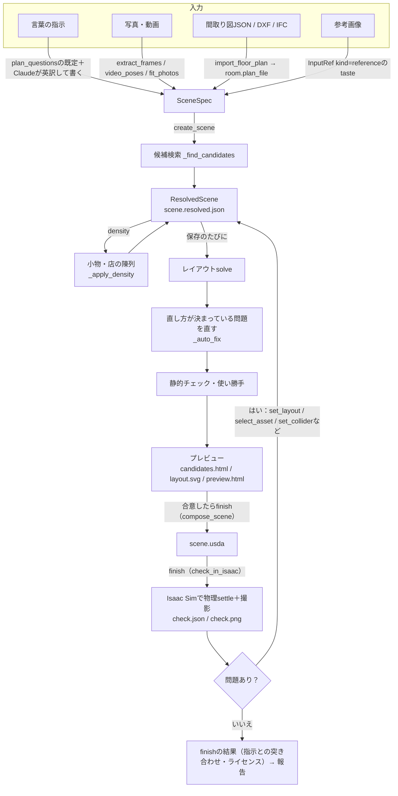

### 入力からSceneSpecへ

どの入力も、いったん**SceneSpec**（部屋と物の指定を書いたJSON）に集まります。
言葉の指示からSceneSpecを書くのは呼び出し側のClaudeで、サーバー側にLLMはありません。検索クエリは英語で書きます（英訳が検索の精度に最も効く）。

指示に無い項目（広さ・入口・レジの位置など）は、`plan_questions`が場所ごとに返す既定で埋めて叩き台を作り、推測として記録します（[8. 対話の流れ](#8-対話の流れ)）。
既定で埋める代わりに、次の3つの進め方もあります。

| こんなとき | 進め方 | 名前 | 記録のされ方 |
|---|---|---|---|
| 広さが指示に無い | 叩き台を1つ作る代わりに、広さだけを変えた3案の上面図を並べて選んでもらう | `create_scene(drafts="size")`・`propose_drafts` | 推測ではなく「選んだ」 |
| 家・オフィス・学校・研究室 | 広さや人数ではなく「誰が・何人で・何をする場所か」を聞き、広さ・主な家具・数を表から逆算する | `scene/activity.py`の`derive_activity` | 根拠「活動から」の推測 |
| 叩き台に理由の無い「違う」が返った | 今の案と1つの軸（広さ・物の量・雰囲気・配置の型）だけを変えた案を並べて「どちらが近いか」を聞き、2〜3回で違っていた軸を絞る | `propose_contrast`・`choose_contrast` | |

### ResolvedSceneと保存のたびの処理

`create_scene`が物ごとにアセットを検索して候補を付けたものが**ResolvedScene**で、シーンのディレクトリの`scene.resolved.json`に保存されます。
以後のツール（`set_layout`、`select_asset`、`set_room` …）はどれも、このファイルを読んで変えて保存します。保存（`service._save`）のたびに次を行います。

1. レイアウトを解き直す（`solve`）。
2. 直し方が1つに決まる問題をサーバーが直す（`_auto_fix`）。対象は、狭い通路（`narrow_aisle`）、近すぎる関節付きの椅子どうし（`too_close`）、足の無いTV（`tips_over`）です。
   検査が`Issue.fixes`に付けた直し方をシーンの写しに当てて解き直し、その問題が消えて新しい問題が1つも増えない時だけ採用します。ユーザーが置いた物と、その呼び出しが動かした物は動かしません。
   直した内容は、結果の`auto_fixed`、仮定の「自動で直した」、プレビューの変更履歴に出ます。
3. 静的チェックと使い勝手の検査をする（[5. 検証](#5-検証)）。
4. プレビューを書き直す。

### create_sceneとfinish

よく続けて呼ぶ処理は、1回の呼び出しにまとめてあります（個別のツールも残っています）。

- `create_scene`（MCPツール。中身は`service.start_scene`）：シーンを作った後、用途の記録（`purpose`）・窓の作り込み（`windows`）・プレビューを開く（`preview`）・叩き台の3Dの撮影（`draft`）まで進めます。`skip`で一部を飛ばせます。
- `finish`：ユーザーが合意した後の仕上げです。USDを書き（`compose_scene`）、Isaac Simの物理を回して確かめ（`check_in_isaac`）、指示との突き合わせとライセンスの一覧まで返します。
  問題があれば`stopped`で止まるので、直してもう一度`finish`を呼びます。これが修正ループです。

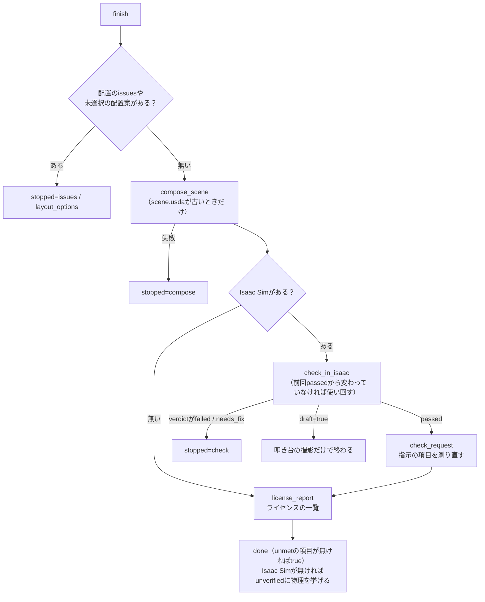

関係するファイル
- [src/agentic_sim_world_gen/service.py](https://github.com/atinfinity/agentic-sim-world-gen/blob/main/src/agentic_sim_world_gen/service.py)：CLIとMCP共通の操作（`create_scene`・`start_scene`・`_save`・`compose_scene`・`check_in_isaac`・`finish`など）
- [src/agentic_sim_world_gen/mcp_server.py](https://github.com/atinfinity/agentic-sim-world-gen/blob/main/src/agentic_sim_world_gen/mcp_server.py)：MCPサーバー（ツールはserviceの関数を呼ぶだけ）
- [src/agentic_sim_world_gen/cli.py](https://github.com/atinfinity/agentic-sim-world-gen/blob/main/src/agentic_sim_world_gen/cli.py)：CLI（`agentic-sim-world-gen ...`）
- [.claude/skills/world-gen/SKILL.md](https://github.com/atinfinity/agentic-sim-world-gen/blob/main/.claude/skills/world-gen/SKILL.md)：Claudeが従う手順

## 2. データの形

図には主な項目だけを載せています（全項目は`scene/spec.py`と`assets/record.py`）。

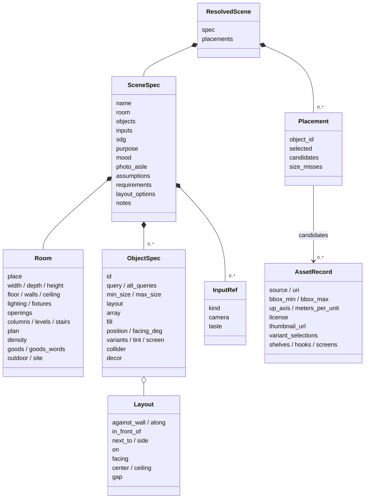

| クラス | 中身 |
|---|---|
| **SceneSpec** | ユーザーの指示そのもの。部屋・物・入力・用途`purpose`・雰囲気`mood`・仮定・指示の項目・プレビューのメモ`notes`。アセットの選択は含まない |
| **Room** | 矩形の部屋（`width`・`depth`）、間取り（`plan`）、屋外（`outdoor`）のどれか。場所の種類`place`（home・office・店の種類`STORE_PLACES`など）、床・壁・照明・開口・柱・段差・密度もここに持つ。表に無い業種の店の商品は`goods`、屋内の部屋の外まわり（歩道・駐車場・隣の建物）は`site` |
| **ObjectSpec** | 置きたい物1つ。英語の`query`と、置き方を関係で書く`layout`（座標はsolveが決める）。同じ物の並びは`array`、棚への陳列は`fill`。密度に応じて自動で足した物は`decor=true`（idは`decor_*`） |
| **ResolvedScene** | SceneSpecに、物ごとの**Placement**（候補アセットの一覧と、選んだ候補の番号`selected`）を足したもの |
| **AssetRecord** | 検索で見つかったアセット1つ。bbox・軸・単位・ライセンス・サムネイルなど、配置と合成に要る情報を持つ |

シーンとは「`scene.resolved.json`のあるディレクトリ」のことです。そこにできる主なファイル：

```
<scene>/
  scene.resolved.json   シーンの本体（SceneSpec＋候補＋選択＋計算した位置）
  candidates.html       候補アセットの一覧
  layout.svg            上面の配置図
  preview.html / preview.json   ライブプレビューのページと更新の印
  .history/NNNNNN.json.gz       保存ごとの scene.resolved.json（直近 30 件。取り消し・「ここに戻す」・restore が読む）
  scene.usda            Isaac Sim 用のワールド
  check.json / check.png / check.gif   Isaac Sim の物理チェックの報告とスクショ
  check_orbit/NN.jpg    周りから撮った画像（プレビューで回して見る）
  LICENSES.md           アセット・材質・入力写真のライセンスと帰属表示
  surfaces.json         床・壁・天井の材質の検索結果
  layout_options/       配置案・叩き台 3 案の上面図と summary.json
  taste_pool.json       テイスト検査の比較用の候補
  plan.json / plan.svg  間取り図を読み込んだとき
  inputs/               入力の写真・動画のコマ（出典は <stem>.source.json）
  photo_fit.json / video_poses.json / compare.png   写真・動画から推定したときの結果と見比べ
  nav/                  ロボット用のナビ地図（map.pgm・map.yaml、nav_map）
  variants/             シーンのバリエーション（make_variants）
  sdg/                  合成データ
```

関係するファイル
- [src/agentic_sim_world_gen/scene/spec.py](https://github.com/atinfinity/agentic-sim-world-gen/blob/main/src/agentic_sim_world_gen/scene/spec.py)：SceneSpec・Room・ObjectSpec・Layout・ResolvedScene・Placement
- [src/agentic_sim_world_gen/scene/plan.py](https://github.com/atinfinity/agentic-sim-world-gen/blob/main/src/agentic_sim_world_gen/scene/plan.py)：開口（Opening）・間取り（FloorPlan）
- [src/agentic_sim_world_gen/assets/record.py](https://github.com/atinfinity/agentic-sim-world-gen/blob/main/src/agentic_sim_world_gen/assets/record.py)：AssetRecord
- 出力の説明：[getting-started.md「7. 出力」](getting-started.md#7-出力)

## 3. アセット検索

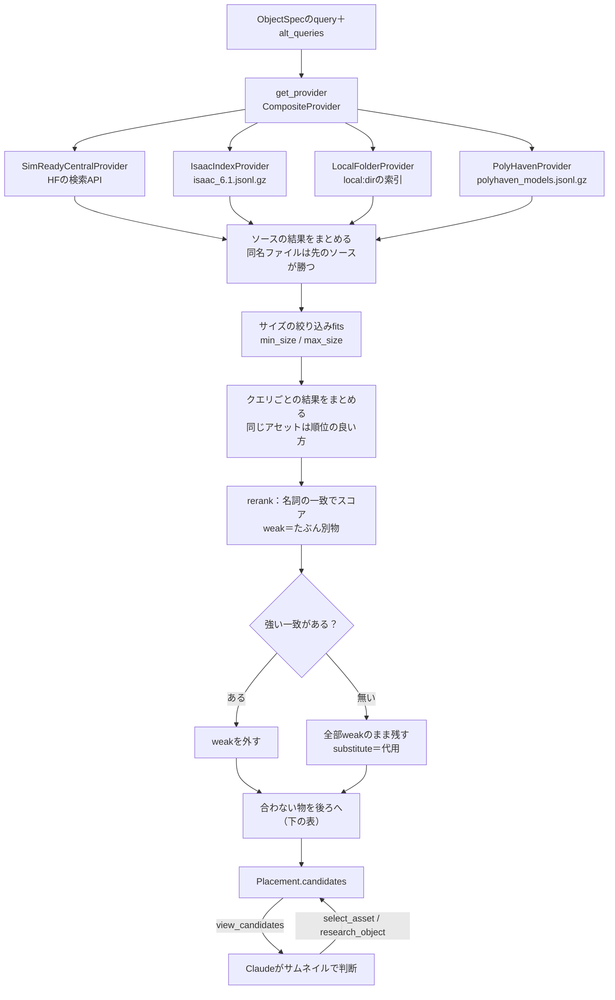

1. **検索**：物ごとに`query`と`alt_queries`（英語の類義語）で、設定されたすべてのソースを検索します。
   ソースは環境変数`AGENTIC_SIM_WORLD_GEN_SOURCES`で選びます（既定はSimReady Central・Isaac同梱・Poly Haven。`+local:<dir>`で既定に足す）。
   1回の呼び出し（`create_scene`・`add_objects`）で要る検索は先にまとめて並列に投げます（`service._searching`）。SimReady Centralの答えは`AGENTIC_SIM_WORLD_GEN_CACHE/search`に1日残します。
2. **サイズ**：`min_size` / `max_size`（footprintの長辺・短辺・高さ）から外れる物を落とします（`fits`）。アセットの向きには依りません。

   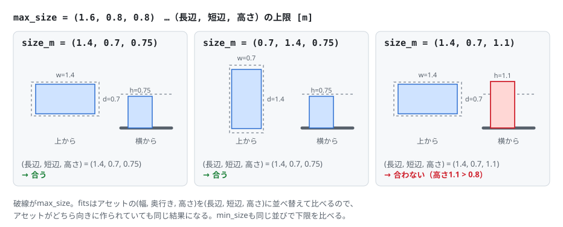
3. **再ランク**（`rerank`）：クエリの最後の名詞（物そのもの）が、アセットのclass・tags・caption・nameに名詞として出るかで点を付けます。
   たとえば「desk lamp」は机ではなく、「coffee table」はdining tableの代わりにならない（どちらもweak）。アセットのカード（`assets/cards.py`）に見て確かめた種類`kind`があれば、ラベルよりそちらを使います。
   強い一致が1つでもあればweakは一覧から外し、全部weakなら「該当なし＝代用」として残します。
4. **後ろへ回す**：合わない物も消さずに、次の表の上の行ほど後ろへ回します。

   | 印 | どんな物か | 例 |
   |---|---|---|
   | `too_tall` | 天井より上に出る | |
   | `off_size` | サイズの指定が無いとき、種類の標準サイズ（`assets/sizes.py`の`TYPICAL`）から大きく外れる | 「cardboard box」にパスタの箱 |
   | `off_place` | 場所（`Room.place`）に合わない分野のアセット（`assets/domain.py`） | 家に病院のベッド |
   | カードの`physics_issue` | 自分の落下テストに失敗したアセット | |
   | `heavy` | 大きさの割に面が多すぎる | |
   | `_wrong_picture` | 絵柄が別の店のもの。並びの段ではなく、スコアを少し下げるだけ（`PICTURE_PENALTY`） | ドラッグストアに書店のレジ看板 |

5. **見つからない時**：全部が代用のときは、種類の表（`assets/kinds.py`、MCP `kind_availability`）を引いて、その種類がどのソースにも無いか（`not_in_catalog`）を返し、探し直しを止めます。
   全部weakでサイズの指定があるときは、サイズで落とした強い一致を`Placement.size_misses`に挙げます（指定を広げる手がかり）。
   足りなかった物は保存のたびにシーンごとに`AGENTIC_SIM_WORLD_GEN_CACHE/missing/`へ記録され（`missing.py`）、`agentic-sim-world-gen missing`で多い順に見られます。
6. **最後の判断**：Claudeが`view_candidates`（サムネイル画像を返す）で決めます。メタデータだけでは色・素材・形が分からないためです。

関係するファイル
- [src/agentic_sim_world_gen/assets/providers/base.py](https://github.com/atinfinity/agentic-sim-world-gen/blob/main/src/agentic_sim_world_gen/assets/providers/base.py)：`AssetProvider`プロトコル・`fits`
- [src/agentic_sim_world_gen/assets/providers/composite.py](https://github.com/atinfinity/agentic-sim-world-gen/blob/main/src/agentic_sim_world_gen/assets/providers/composite.py)・[simready_central.py](https://github.com/atinfinity/agentic-sim-world-gen/blob/main/src/agentic_sim_world_gen/assets/providers/simready_central.py)・[isaac_index.py](https://github.com/atinfinity/agentic-sim-world-gen/blob/main/src/agentic_sim_world_gen/assets/providers/isaac_index.py)・[local_folder.py](https://github.com/atinfinity/agentic-sim-world-gen/blob/main/src/agentic_sim_world_gen/assets/providers/local_folder.py)・[polyhaven.py](https://github.com/atinfinity/agentic-sim-world-gen/blob/main/src/agentic_sim_world_gen/assets/providers/polyhaven.py)
- [src/agentic_sim_world_gen/assets/sizes.py](https://github.com/atinfinity/agentic-sim-world-gen/blob/main/src/agentic_sim_world_gen/assets/sizes.py)：`TYPICAL`（種類ごとの標準サイズ）・[kinds.py](https://github.com/atinfinity/agentic-sim-world-gen/blob/main/src/agentic_sim_world_gen/assets/kinds.py)：種類の表
- [src/agentic_sim_world_gen/assets/rerank.py](https://github.com/atinfinity/agentic-sim-world-gen/blob/main/src/agentic_sim_world_gen/assets/rerank.py)：`rerank`・`score`・`noun_last`
- [src/agentic_sim_world_gen/assets/cards.py](https://github.com/atinfinity/agentic-sim-world-gen/blob/main/src/agentic_sim_world_gen/assets/cards.py)：アセットごとのカード（`of`・`physics_issue`・`brief`）。データは`src/agentic_sim_world_gen/data/asset_cards.jsonl.gz`、作り直しは`scripts/build_asset_cards.py`
- [src/agentic_sim_world_gen/assets/domain.py](https://github.com/atinfinity/agentic-sim-world-gen/blob/main/src/agentic_sim_world_gen/assets/domain.py)：`off_place`
- [src/agentic_sim_world_gen/service.py](https://github.com/atinfinity/agentic-sim-world-gen/blob/main/src/agentic_sim_world_gen/service.py)：`get_provider`・`_find_candidates`・`_wrong_picture`・`research_object`

## 4. レイアウト

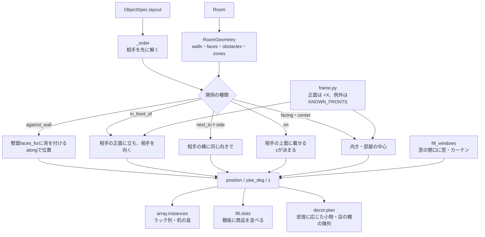

**RoomGeometry**は、矩形の部屋も間取りも屋外も同じ形で表します。

| 要素 | 中身 |
|---|---|
| 壁`walls` | 中心線と厚さ |
| 壁面`faces` | 物が背を付けられる内側の面。ドアの前は障害物（空き）で避ける |
| 障害物`obstacles` | 壁本体・ドアの前・柱`columns`・段差`levels`・階段・天井の梁や照明器具 |
| ゾーン`zones` | 間取りの部屋 |
| 外まわり（`site`があるとき） | 部屋の外壁・エリアの辺・建物の面と、エリア・建物の障害物。外の物のzoneは`outside`かエリアのID |

段差の上に中心がある物は、ソルバがその段差の高さに載せます。

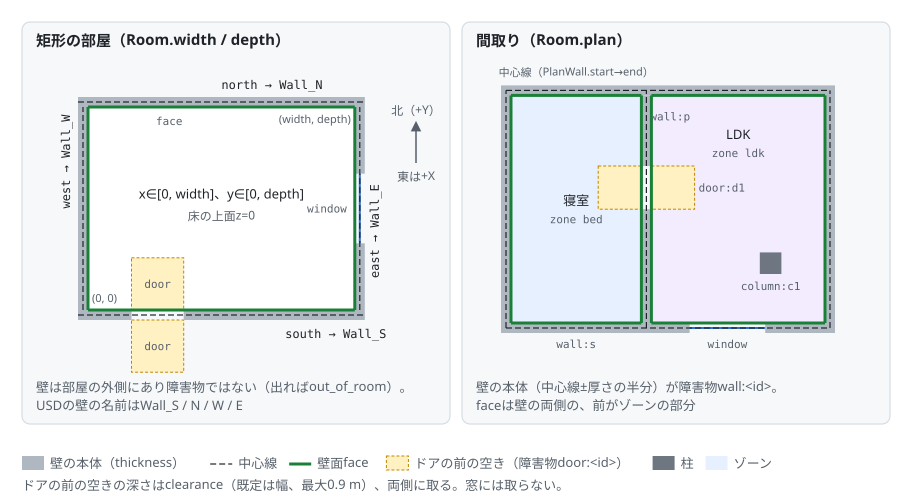

- **solve**：`layout`の関係（`against_wall`・`in_front_of`・`next_to`・`on`・`facing`・`center`・`gap`）から位置・向き・高さを決めます。「机を先に、椅子を後に」という解く順は`_order`が決めます。
  保存のたびに解き直すので、アセットを差し替えてサイズが変わっても配置が追従します。`move_object`で手で動かした物は`layout`が消え、座標のままになります。
- **正面の規約**：アセットの正面は+Xです（Isaac Sim 6.1で、約40点を4方向から描いて確認）。
  例外は`KNOWN_FRONTS`・`KNOWN_FRONT_PATTERNS`に、手持ちのフォルダならagentic-sim-world-gen.jsonの`front`に、物ごとなら`front_offset_deg`に書きます。手で向きを決めるときは`facing_deg`（0＝東＝+X、90＝北＝+Y）。
- **繰り返し**：`array`はブロック全体を1つの物として置き、検証・プレビュー・USDではユニット（`<id>.r<row>c<col>`）に展開します。
- **陳列**：`fill`は、什器のジオメトリから見つけた棚板（`assets/shelves.py`）に商品を並べます。
- **小物**：`Room.density`（sparse / normal / lived_in）に応じて、机に本、ソファの前にラグ、のような小物`decor_*`を`create_scene`が足します。問題が増える置き方は捨てます（`service._apply_density`）。
- **店の陳列**：店（`shop`と`STORE_PLACES`の25種：コンビニ・スーパー・ドラッグストア・書店・パン屋・自転車店・家具店など）では、同じ仕組みで空いている什器に商品を`fill`で並べます。
  商品は店の種類ごとの表（`decor.PRODUCTS`。冷蔵ケースは`COLD_PRODUCTS`、フックは`HANG`）から選び、隣の什器とは違う商品から始めます。
  表に無い業種では、`Room.goods`（商品の英語の検索語）・`goods_words`（業種の語）を名乗る商品だけを並べます（`decor.fits_goods`）。店の広さ・入口・レジなどの既定は`plan_questions`の表（`questions.STORE_SIZES`）にあります。
- **窓**：窓の開口は壁の穴でしかないので、`fill_windows`が窓のアセット`win_<id>`を足します。窓は開口に合わせて伸ばし（`fit_scale`）、店の幅1.8 m以上の窓はショーウィンドウにします。家ではカーテン`curtain_<id>`も足します（`covers`でブラインドにもできる）。

`layout.svg`（上面図、矢印が正面）：

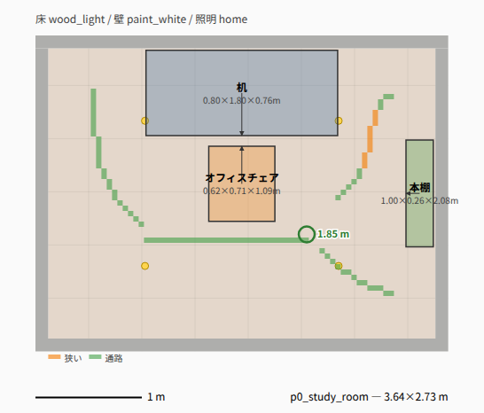

関係するファイル
- [src/agentic_sim_world_gen/layout/room.py](https://github.com/atinfinity/agentic-sim-world-gen/blob/main/src/agentic_sim_world_gen/layout/room.py)：`RoomGeometry`・`Wall`・`Face`・`Obstacle`
- [src/agentic_sim_world_gen/layout/solver.py](https://github.com/atinfinity/agentic-sim-world-gen/blob/main/src/agentic_sim_world_gen/layout/solver.py)：`solve`
- [src/agentic_sim_world_gen/layout/frame.py](https://github.com/atinfinity/agentic-sim-world-gen/blob/main/src/agentic_sim_world_gen/layout/frame.py)：正面方向（`asset_front_deg`・`yaw_for_facing`）
- [src/agentic_sim_world_gen/layout/array.py](https://github.com/atinfinity/agentic-sim-world-gen/blob/main/src/agentic_sim_world_gen/layout/array.py)・[fill.py](https://github.com/atinfinity/agentic-sim-world-gen/blob/main/src/agentic_sim_world_gen/layout/fill.py)・[assets/shelves.py](https://github.com/atinfinity/agentic-sim-world-gen/blob/main/src/agentic_sim_world_gen/assets/shelves.py)
- [src/agentic_sim_world_gen/scene/decor.py](https://github.com/atinfinity/agentic-sim-world-gen/blob/main/src/agentic_sim_world_gen/scene/decor.py)：`plan`・`PRODUCTS`・`fits_goods`
- [src/agentic_sim_world_gen/scene/columns.py](https://github.com/atinfinity/agentic-sim-world-gen/blob/main/src/agentic_sim_world_gen/scene/columns.py)・[levels.py](https://github.com/atinfinity/agentic-sim-world-gen/blob/main/src/agentic_sim_world_gen/scene/levels.py)・[fixtures.py](https://github.com/atinfinity/agentic-sim-world-gen/blob/main/src/agentic_sim_world_gen/scene/fixtures.py)：柱・床の一部の仕上げ、段差・階段、天井の照明器具・梁
- [src/agentic_sim_world_gen/preview/layout2d.py](https://github.com/atinfinity/agentic-sim-world-gen/blob/main/src/agentic_sim_world_gen/preview/layout2d.py)：layout.svg

## 5. 検証

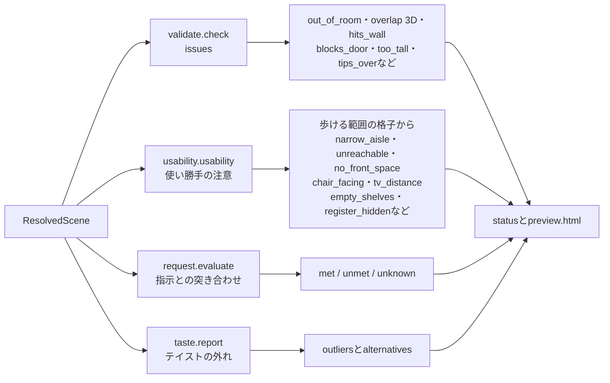

検査は4種類あり、扱いの強さが違います。

| 検査 | 何を見るか | 扱い |
|---|---|---|
| 静的チェック`validate.check` | 部屋からのはみ出し、物どうしの重なり（足元の多角形のSAT＋高さの範囲＝3D）、壁の中・ドアの前、天井より高い | **issues**。0件になるまで直す |
| 使い勝手`usability` | 歩ける範囲・通路幅・物の前に立てるか・向きと距離（下の箇条書き） | 警告。理由があれば残してよい |
| 指示との突き合わせ`request.evaluate` | 指示を項目に分け、壁際・隣・個数・向き・ゾーン・上に載る、を配置から測る | `check_request`。報告の前に必ず回す |
| テイスト`taste.report` | 選んだアセットのサムネイルをSigLIP2で埋め込み、1つだけ見た目が浮いている物を探す | 警告。勝手に差し替えない |

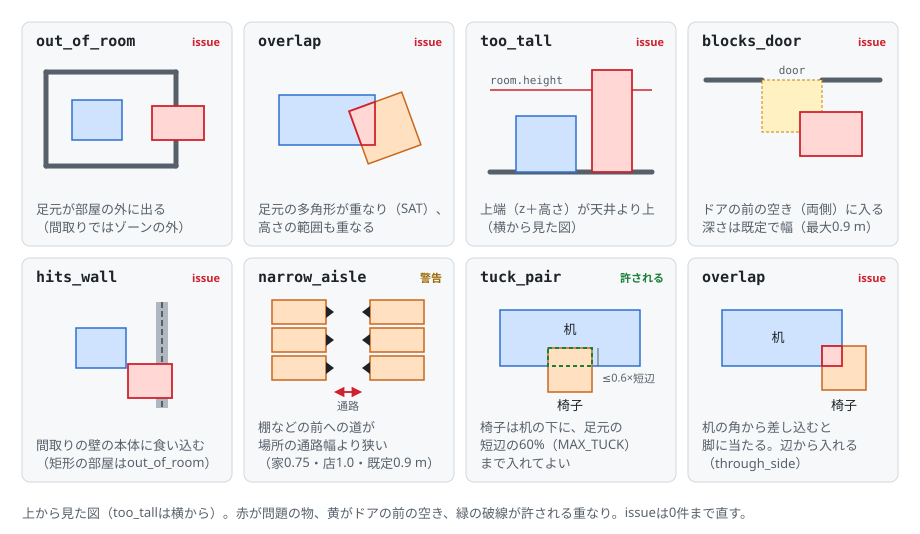

使い勝手の検査の中身：
- 床を格子にし、ドアから歩ける範囲を求めます。そこから、棚・レジなどの前に立てるかを見ます。
- 通路幅が場所に足りるかを見ます（用途`purpose`がamrならロボットの幅）。通路の幅は距離変換の地図1枚（`AisleMap`）から求め、最も狭い所の幅と場所を`narrow_aisle`に書きます。layout.svgには通路の中心線を幅に応じた色で描きます（赤＝通れない、橙＝狭い、緑＝通路、青＝広い）。
- 椅子と机・テレビの向きと距離、窓をふさぐ背の高い物、店の空の棚、入口から見えないレジも見ます。

椅子が机の下に入る重なりは、椅子の足元の短辺の60%まで許します（`tuck_pair`・`MAX_TUCK`）。ただしソルバは自分では差し込みません（差し込むのは`gap`を負にしたときだけ）。机の下に脚を入れる空間があるかはbboxから分からず、重なったまま物理を回すとPhysXが爆発するためです。

関係するファイル
- [src/agentic_sim_world_gen/layout/validate.py](https://github.com/atinfinity/agentic-sim-world-gen/blob/main/src/agentic_sim_world_gen/layout/validate.py)：`check`・`Issue`・`overlap_depth`
- [src/agentic_sim_world_gen/layout/usability.py](https://github.com/atinfinity/agentic-sim-world-gen/blob/main/src/agentic_sim_world_gen/layout/usability.py)：`usability`・`AisleMap`・`aisle_map`
- [src/agentic_sim_world_gen/layout/widths.py](https://github.com/atinfinity/agentic-sim-world-gen/blob/main/src/agentic_sim_world_gen/layout/widths.py)：`edt`（距離変換）・`widest`（入口からの最も広い道）・`narrowest`・`ridge`（中心線）。usability・nav（`routes`）・layout2dが共有
- [src/agentic_sim_world_gen/layout/request.py](https://github.com/atinfinity/agentic-sim-world-gen/blob/main/src/agentic_sim_world_gen/layout/request.py)：`evaluate`・`summary`
- [src/agentic_sim_world_gen/taste.py](https://github.com/atinfinity/agentic-sim-world-gen/blob/main/src/agentic_sim_world_gen/taste.py)：`report`・`analyze`

## 6. USDの合成

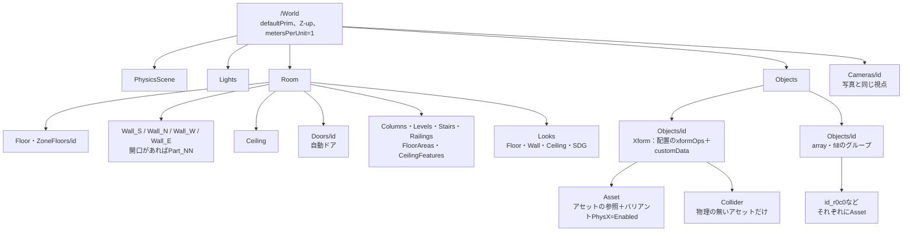

### 座標の規約

ステージは**Z-up、メートル**（metersPerUnit=1）で、defaultPrimは`/World`です。矩形の部屋の内側はx∈[0, width]、y∈[0, depth]で、床の上面がz=0です。

```
  y (北)
  ↑
depth ┌──────────── Wall_N ────────────┐
  │   │                                │
  │ Wall_W      部屋の内側           Wall_E
  │   │         床の上面z=0            │
  │   │                                │
  0   └──────────── Wall_S ────────────┘
      0 ─────────────────────────── width → x (東)

  facing_deg：0＝東（+X）、90＝北（+Y）。zは上向き
```

### 物のprimとxformOps

物は`/World/Objects/<id>`（Xform）の子`Asset`からアセットを参照します。参照を子に置くのは、アセット自身のルートの変換（cmのアセットのscale 0.01など）を消さないためです。外側のXformにxformOpOrderを書くと、同じprimに付いた参照のルートの変換は上書きされてしまいます。

外側のXformのxformOpsは、xformOpOrderでは下の図の「primの形」の順に並びます。点に効くのは逆の順（右から）で、アセットの点はまずpivotを原点へ動かされ、最後に部屋の中の位置へ移ります（図の1→6）。

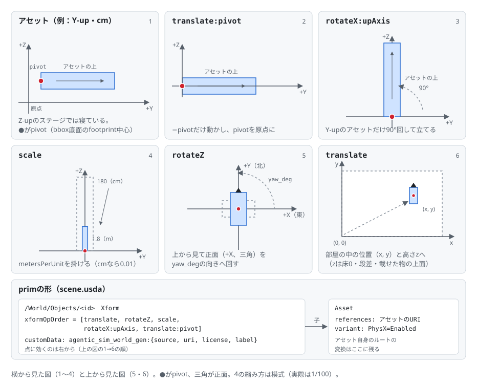

式で書くと`p' = translate · rotateZ(yaw) · scale(mpu) · rotateX(90°, Y-upのとき) · (p − pivot)`です。
このほか、開口に合わせて伸ばす窓・カーテンには`rotateZ`の直後に`scale:fit`が、寝かせて陳列する商品（`fill.lay_flat`）には`layFlat`の一連のopsが入ります。

`array`・`fill`の物は`/World/Objects/<id>`がグループになり、その下のユニット（arrayは`<id>_r<row>c<col>`、fillは`<id>_<unit>_l<level>_<col>_<row>`）がそれぞれ上と同じ形で`Asset`を持ちます。

### 出典・物理・見た目

- **出典**：物のprimのcustomDataに、`agentic_sim_world_gen:source`・`agentic_sim_world_gen:uri`・`agentic_sim_world_gen:license`・`agentic_sim_world_gen:label`・`agentic_sim_world_gen:origin`（入手先と版）・`agentic_sim_world_gen:facing_deg`を書きます。ライセンスの一覧は`license_report`が`LICENSES.md`にまとめます。
- **物理**：アセットの`PhysX`バリアントを`Enabled`にすると、SimReadyのアセットに剛体とコライダーが付きます。
  物理の無いアセットには、bboxと同じ大きさの見えない固定の箱`Collider`を付けます（`collider`が`box`のとき、または`auto`で物理の無いことが分かっているとき）。床・壁は静的なコライダーと摩擦のマテリアルを持ちます。
- **床・壁・天井の見た目**：`Looks`の下のマテリアル（UsdPreviewSurface、テクスチャ、MDL）です。
  材質は、名前のプリセット（`scene/looks.py`）か、索引（Isaac Sim同梱のMDLの`materials.py`、CC0のPBR＝ambientCG・Poly Havenの`pbr.py`）から`select_surface`で選びます。見本の画像から床・壁・照明をまとめて選ぶのが`moods` / `apply_mood`（`scene/moods.py`）です。
- **物の色**：`tint`（`usd/tint.py`）で、アセットのファイルを変えずにシーンの側からマテリアルの色を上書きします。

関係するファイル
- [src/agentic_sim_world_gen/usd/compose.py](https://github.com/atinfinity/agentic-sim-world-gen/blob/main/src/agentic_sim_world_gen/usd/compose.py)：`compose`・`build_room`・`build_site`・`_add_asset`・`add_box_collider`・`build_inputs`
- [src/agentic_sim_world_gen/usd/look.py](https://github.com/atinfinity/agentic-sim-world-gen/blob/main/src/agentic_sim_world_gen/usd/look.py)：マテリアルと照明（`build_lights`）
- [src/agentic_sim_world_gen/materials.py](https://github.com/atinfinity/agentic-sim-world-gen/blob/main/src/agentic_sim_world_gen/materials.py)・[pbr.py](https://github.com/atinfinity/agentic-sim-world-gen/blob/main/src/agentic_sim_world_gen/pbr.py)・[scene/moods.py](https://github.com/atinfinity/agentic-sim-world-gen/blob/main/src/agentic_sim_world_gen/scene/moods.py)：床・壁の材質の検索、雰囲気の見本
- [src/agentic_sim_world_gen/usd/door.py](https://github.com/atinfinity/agentic-sim-world-gen/blob/main/src/agentic_sim_world_gen/usd/door.py)・[screen.py](https://github.com/atinfinity/agentic-sim-world-gen/blob/main/src/agentic_sim_world_gen/usd/screen.py)：自動ドア、画面に画像
- [src/agentic_sim_world_gen/license.py](https://github.com/atinfinity/agentic-sim-world-gen/blob/main/src/agentic_sim_world_gen/license.py)・[origin.py](https://github.com/atinfinity/agentic-sim-world-gen/blob/main/src/agentic_sim_world_gen/origin.py)：ライセンスと入手先

## 7. Isaac Sim側

Isaac SimはUbuntu（RTX）機にだけあり、agentic-sim-world-gen本体（usd-coreを使うPython）とは別のプロセスで動きます。
agentic-sim-world-genからIsaac Simを使う方法は、「スクリプトをIsaac SimのPythonで実行する」か「起動中のIsaac Simにコードを送る」かの2つです。

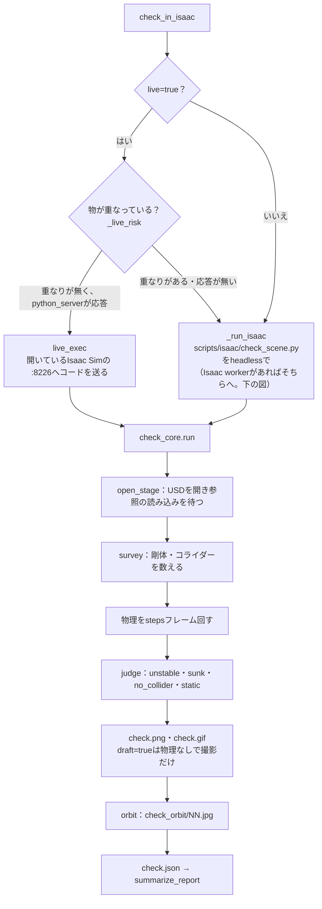

- **headless**：`check_scene.py`が自分で`SimulationApp`を立ち上げ、`check_core.run`を呼びます。Isaac SimのPythonは`ISAACSIM_PYTHON`（pip版）か、`ISAACSIM_PATH`のpython.shです。
- **ライブモード**：`--enable isaacsim.code_editor.python_server`で起動したIsaac Simに、同じ`check_core`のコードを送ります。ユーザーの画面でシーンを開いて物理を回し、問題の物を選択状態にします。
  物が重なっているシーンはheadlessに回します。重なった物がPhysXで爆発すると、GUIのIsaac SimのGPU物理がそのセッションの間止まってしまうためです。
- **checkの中身**：物理を回す前後で剛体の位置を比べ、動いた・倒れた（`unstable`）、床に沈んだ（`sunk`）、当たり判定が無い（`no_collider`）、動かない固定物（`static`）を報告します。そのあと部屋を24方向から撮り、プレビューで回して見られるようにします。
- **結果**：`summarize_report`が物体IDごとの要約にし、`check_in_isaac`が`verdict`（`passed` / `needs_fix` / `draft` / `failed`）を付けます。`draft=true`は物理を回さず、叩き台の3Dを撮るだけです。

### Isaac worker

Kitの起動はdraftのcheckの約40 sのほとんどを占めます。`AGENTIC_SIM_WORLD_GEN_ISAAC_WORKER=1`にすると、最初の呼び出しで起動したheadlessのIsaac Sim（`scripts/isaac/worker.py`）を起動したままにし、以後の`check_scene.py`・`front_views.py`・`render_view.py`をそこで続けて実行します。
既定は切です（待っている間もKit 1つがGPUメモリを数GB持つため）。

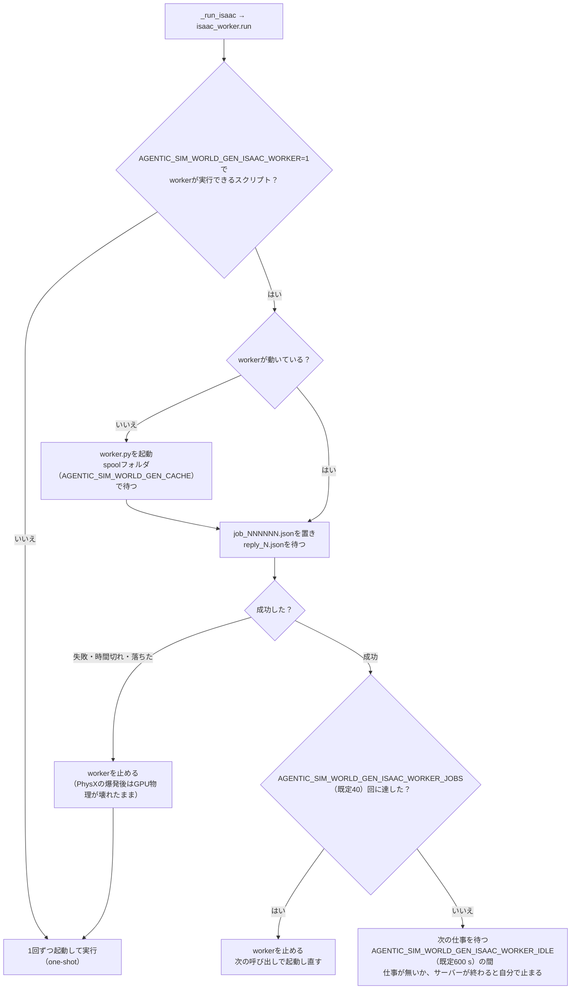

workerは仕事ごとにステージを閉じ、その仕事のフォルダのレイヤーを読み直すので、前の仕事のものは残りません。どちらの方法で動いたかは結果の`isaac`（`mode`が`worker`か`one-shot`）に出ます。

### ほかのIsaac Simの処理

- `view_fronts`（`front_views.py`）：各物を想定した正面から撮ります。撮らない物を非アクティブにしたレイヤー`front_views_stage.usda`を開くので、撮る物のアセットだけを読みます。
- `compare_photo`（`render_view.py`）：写真と同じ視点で描きます。
- `nav_map(isaac=true)`（`nav_map.py`）：Isaac SimのOccupancy Mapでナビ地図を作ります。

どれもcheckと同じく、Isaac SimのPythonで動かします。

### 合成データ（SDG）

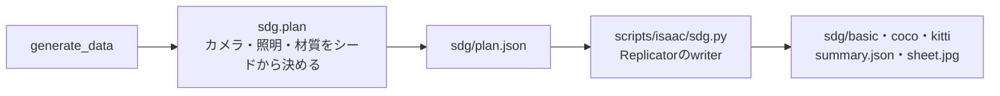

カメラ位置・照明・材質の割り当てはPython側（`sdg.plan`）がシードから決めて`sdg/plan.json`に書きます。Isaac側の`scripts/isaac/sdg.py`は、それを当ててReplicatorのwriterを回すだけです。ラベルはcomposeがprimに付けたUsdSemanticsを使います。

`check_orbit`の回り込み画像：

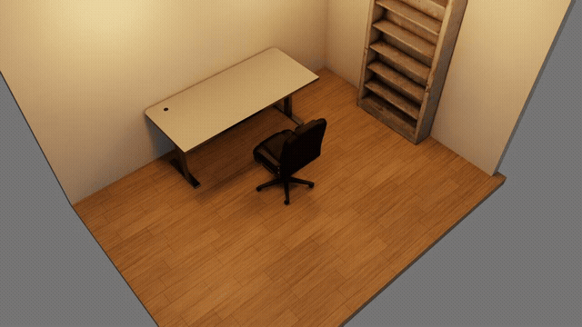

関係するファイル
- [scripts/isaac/check_scene.py](https://github.com/atinfinity/agentic-sim-world-gen/blob/main/scripts/isaac/check_scene.py)・[check_core.py](https://github.com/atinfinity/agentic-sim-world-gen/blob/main/scripts/isaac/check_core.py)・[view.py](https://github.com/atinfinity/agentic-sim-world-gen/blob/main/scripts/isaac/view.py)・[front_views.py](https://github.com/atinfinity/agentic-sim-world-gen/blob/main/scripts/isaac/front_views.py)・[nav_map.py](https://github.com/atinfinity/agentic-sim-world-gen/blob/main/scripts/isaac/nav_map.py)・[worker.py](https://github.com/atinfinity/agentic-sim-world-gen/blob/main/scripts/isaac/worker.py)
- [src/agentic_sim_world_gen/service.py](https://github.com/atinfinity/agentic-sim-world-gen/blob/main/src/agentic_sim_world_gen/service.py)：`check_in_isaac`・`live_exec`・`summarize_report`・`generate_data`
- [src/agentic_sim_world_gen/isaac_worker.py](https://github.com/atinfinity/agentic-sim-world-gen/blob/main/src/agentic_sim_world_gen/isaac_worker.py)：`run`（起動したままのIsaac Simに仕事を渡す）
- [src/agentic_sim_world_gen/sdg.py](https://github.com/atinfinity/agentic-sim-world-gen/blob/main/src/agentic_sim_world_gen/sdg.py)・[scripts/isaac/sdg.py](https://github.com/atinfinity/agentic-sim-world-gen/blob/main/scripts/isaac/sdg.py)

## 8. 対話の流れ

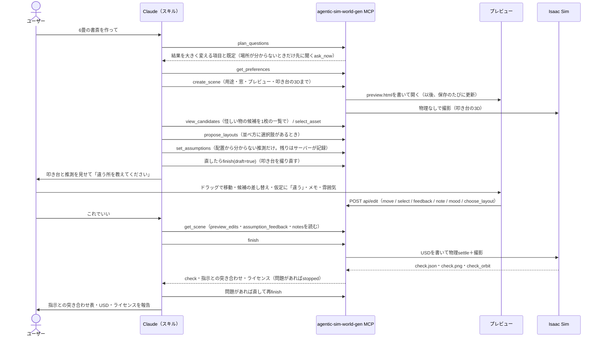

スキル（SKILL.md）がClaudeに指示している手順です。

1. **既定で叩き台**：`plan_questions`が場所ごとの質問表から、指示にまだ書かれていない項目と既定を返します。先には聞かず、既定で作って推測として記録します。
   先に聞くのは次の場合だけです。
   - 場所が分からないとき（`ask_now`）
   - 「先に質問して」と言われたとき（`ask_first`）
   - 後からの手直しが大きい2項目：用途がロボット（amr / manipulation）で機体の大きさが書かれていないとき、実在の場所（「うちの店」）の依頼で図面・写真が付いていないとき

   質問表が無い場所（病院・学校・駅など。`plan_questions`が`gallery`を返す）では、`show_gallery`が作例（`examples/`）と過去のシーンの上面図を並べたページ（`gallery.html`）を出し、選ばれた物のSceneSpecを`start_from_example`が叩き台にします。引き継いだ寸法・場所・仕上げ・什器は「作例「…」から」の推測として記録します（`gallery.py`）。
2. **作成**：`get_preferences`で前回までの好みを読み、`create_scene`を呼びます。`create_scene`は続けて用途の既定（`set_purpose`。密度・通路幅などを用途から決める、`scene/purpose.py`）と窓（`fill_windows`）まで進めます。
   仮定どうしが食い違えば（6畳に8人掛けの机、ロボットより狭い通路など。`scene/conflicts.py`）、叩き台を撮らずに`conflicts`を返します。Claudeはどちらを優先するかを1問だけ聞きます（おまかせなら広い方に合わせて報告）。
3. **候補の確認**：プレビューは`create_scene`が開きます。怪しい候補（代用・弱い一致・寸法や置き場所が合わない物）は`view_candidates`が1枚の一覧画像で返すので、見て差し替えます。
4. **配置**：issuesが0になるまで直し、使い勝手の注意を見ます。並べ方そのものが選択肢なら`propose_layouts`で2〜3案を出します。
5. **叩き台を見せる**：部屋の5項目と物ごとの仮定はサーバーが配置から記録します（`_auto_assumptions`）。そのため`set_assumptions`には、配置から分からない推測だけを書きます。
   3Dは`create_scene`が撮っています（直した後は`finish(draft=true)`で撮り直す）。推測したところを先に見せて止まります（「おまかせ」なら止まらない）。
6. **check**：合意したら`finish`（USD → check → 指示との突き合わせ → ライセンス）。
7. **突き合わせ**：`check_request`で指示の各項目を測ります。
8. **報告**：突き合わせ表・USDのパス・選んだアセット（代用を明記）・ライセンス。

### プレビューのページ

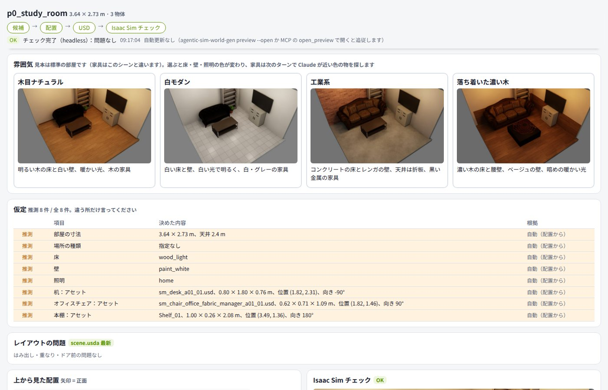

ユーザーはチャットだけでなく、プレビューのページでも操作できます。ページでの操作は、プレビューサーバーの`api/edit`からserviceの関数を呼んでシーンに反映されます。

| ページでの操作 | `api/edit`のop |
|---|---|
| layout.svgの物のドラッグ・回転 | `try`（動かしている途中の検査）・`move` |
| 候補カードのクリックでの差し替え | `select` |
| 「仮定」表の「違う」 | `feedback` |
| 配置案の「この案にする」 | `choose_layout` |
| 雰囲気の見本の選択・取り消し | `mood`・`mood_undo` |
| メモの書き込み・削除 | `note`・`note_delete` |
| 取り消し・削除・複製・密度・部屋・照明 | `restore`・`remove`・`duplicate`・`density`・`room`・`light` |

上面図やcheckの3Dをダブルクリックして書くメモ（「ここにライトを」）は、シーンを変えずに残ります（`notes.py`）。Claudeが`resolve_notes`で返事をすると消えます。
次のターンのClaudeは、ツールの結果のstatusにある`preview_edits`・`assumption_feedback`・`notes`でページでの操作を知ります。

プレビューサーバーは、MCPサーバーのプロセスの中のスレッドです。
- 待ち受け：`127.0.0.1:8765`（`AGENTIC_SIM_WORLD_GEN_PREVIEW`）。使用中なら、そのフォルダで前に使った番号か、次の空き番号を使います。
- 配るもの：シーンの親フォルダ（ふつう`AGENTIC_SIM_WORLD_GEN_OUT`）の下。
- 更新：ページが1秒ごとに`preview.json`を見て、変わった部分だけを書き換えます。
- 書き込みの条件：ページに埋めたトークンと、loopbackからの接続。

ユーザーが直した値（`correction=true`の`set_room`・`set_layout`・`set_array`・`select_asset`、プレビューでの差し替え）は好みとして記録されます。2つ以上のシーンで同じ値（数値なら同じ向きの変化）になった項目は、次からの既定になります。

関係するファイル
- [.claude/skills/world-gen/SKILL.md](https://github.com/atinfinity/agentic-sim-world-gen/blob/main/.claude/skills/world-gen/SKILL.md)：手順の全文
- [src/agentic_sim_world_gen/scene/questions.py](https://github.com/atinfinity/agentic-sim-world-gen/blob/main/src/agentic_sim_world_gen/scene/questions.py)：`plan_questions`
- [src/agentic_sim_world_gen/scene/purpose.py](https://github.com/atinfinity/agentic-sim-world-gen/blob/main/src/agentic_sim_world_gen/scene/purpose.py)：用途（demo / amr / manipulation / sdg）からの既定
- [src/agentic_sim_world_gen/scene/conflicts.py](https://github.com/atinfinity/agentic-sim-world-gen/blob/main/src/agentic_sim_world_gen/scene/conflicts.py)：食い違う仮定の検出（床の占有・天井高・ロボットの通路幅・人数と席数）。statusの`conflicts`。あれば`create_scene`は叩き台を撮らない
- [src/agentic_sim_world_gen/gallery.py](https://github.com/atinfinity/agentic-sim-world-gen/blob/main/src/agentic_sim_world_gen/gallery.py)：作例と過去のシーンの一覧（`entries`・`rank`）、ページ（`write_page`）、引き継いだ値（`inherited`）。作例の上面図は`scripts/make_gallery.py`で`data/gallery/`に作る
- [src/agentic_sim_world_gen/preferences.py](https://github.com/atinfinity/agentic-sim-world-gen/blob/main/src/agentic_sim_world_gen/preferences.py)：`observe`・`apply`
- [src/agentic_sim_world_gen/preview/server.py](https://github.com/atinfinity/agentic-sim-world-gen/blob/main/src/agentic_sim_world_gen/preview/server.py)：`serve`・`edit`（上の表のop）・`api/gallery/pick`（ギャラリーで選んだ作例）
- [src/agentic_sim_world_gen/notes.py](https://github.com/atinfinity/agentic-sim-world-gen/blob/main/src/agentic_sim_world_gen/notes.py)：プレビューのメモの場所を言葉にする
- [src/agentic_sim_world_gen/preview/page.py](https://github.com/atinfinity/agentic-sim-world-gen/blob/main/src/agentic_sim_world_gen/preview/page.py)・[changes.py](https://github.com/atinfinity/agentic-sim-world-gen/blob/main/src/agentic_sim_world_gen/preview/changes.py)：ページと変更履歴

## 9. 写真・動画から部屋を推定

流れは2段です。まず写真・動画から部屋の寸法とカメラを推定し（`fit_photos`）、次にその結果をシーンに入れて、家具の位置を決めたり写真と見比べたりします。

### 部屋とカメラの推定

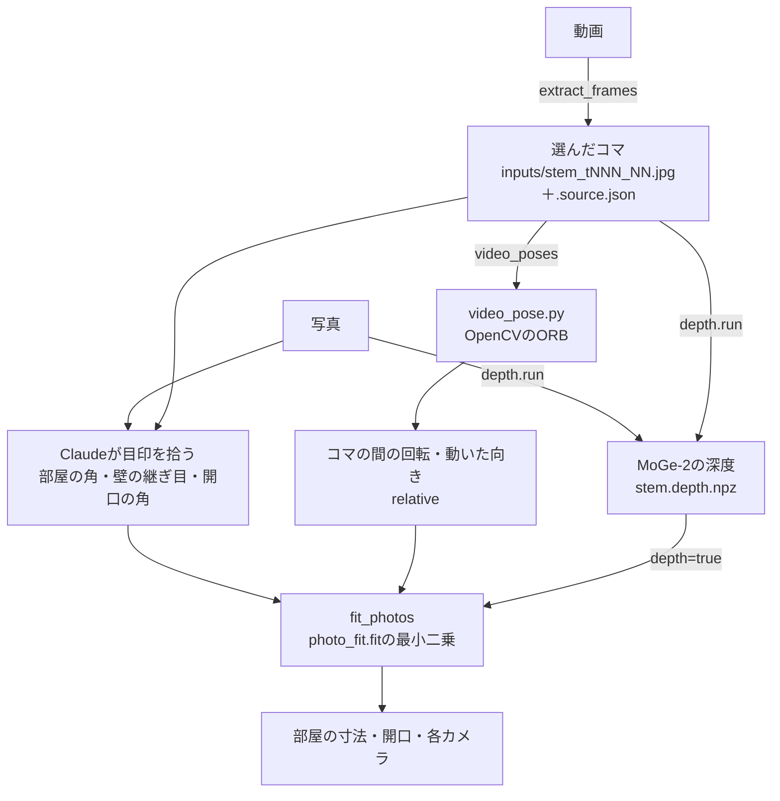

部屋を箱とみなし、写真ごとに見えている目印（部屋の角、壁と床の線、ドア・窓の角、複数の写真に写る共有点）の画素をClaudeが拾います。
`fit_photos`は、部屋の幅・奥行き・開口の位置・各カメラの位置と向き・視野角を未知数にして、目印の再投影の誤差を最小にします（純PythonのLevenberg–Marquardt）。
尺度は壁の高さで決まります。天井の目印が無ければ、カメラの高さ（`eye_height`）で決めます。

動画の場合は、まず`extract_frames`が、見え方の変わる所のくっきりしたコマを選びます。次に`video_poses`がコマの間でカメラがどれだけ回ったかを測り（OpenCVのORB特徴、`video_pose.py`）、`fit_photos`に足します。
単眼の深度（MoGe-2）を足すと、壁を1〜2面しか写さない写真でも寸法が決まりやすくなります。

### シーンに入れて確かめる

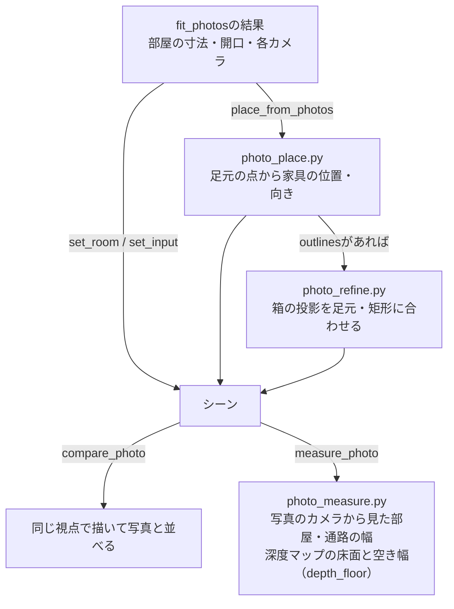

1. 結果は`set_room`と`set_input`（カメラ）でシーンに入れます。
2. 写真で家具の足元を拾っていれば、`place_from_photos`が、選んだアセットのfootprintをその点に当てはめて位置と向きを決めます。
   写真上で物を囲んだ矩形（`outlines`）も渡すと、アセットの箱を推定したカメラで写真に投影し、足元の画素と矩形に合うように位置を詰めます（`photo_refine.py`）。
3. `compare_photo`で同じ視点から描いて写真と見比べ、`measure_photo`で部屋と通路の幅を写真と数値で比べます。
   - 通路をまたぐ画素の組を`aisle_pair`で指すと、その幅が配置の目標（`SceneSpec.photo_aisle`）になります。使われるのは、配列の通路、`usability.photo_aisle`を通した歩行幅・広すぎの判定、statusの`photo_aisle`の比です。
   - 寸法の分かる物（棚1台・ドア・床タイルなど）が写っていれば、その画素を`known`で渡します。その物を物差しにした幅とカメラの高さも出します。

関係するファイル
- [src/agentic_sim_world_gen/photo_fit.py](https://github.com/atinfinity/agentic-sim-world-gen/blob/main/src/agentic_sim_world_gen/photo_fit.py)：`fit`（結果の`scale`＝ 縮尺の根拠の一覧は`_scale_evidence`）・`FitRequest`・`PointObs`・`LineObs`・`SurfaceObs`・`RelativePose`
- [src/agentic_sim_world_gen/video.py](https://github.com/atinfinity/agentic-sim-world-gen/blob/main/src/agentic_sim_world_gen/video.py)：`extract`（コマ抜き）
- [src/agentic_sim_world_gen/video_pose.py](https://github.com/atinfinity/agentic-sim-world-gen/blob/main/src/agentic_sim_world_gen/video_pose.py)：`relative_poses`（ORBでコマの間の回転・動いた向き）
- [src/agentic_sim_world_gen/photo_refine.py](https://github.com/atinfinity/agentic-sim-world-gen/blob/main/src/agentic_sim_world_gen/photo_refine.py)：`refine`（箱の投影と足元・輪郭の画素の差を最小化）
- [src/agentic_sim_world_gen/photo_place.py](https://github.com/atinfinity/agentic-sim-world-gen/blob/main/src/agentic_sim_world_gen/photo_place.py)・[photo_measure.py](https://github.com/atinfinity/agentic-sim-world-gen/blob/main/src/agentic_sim_world_gen/photo_measure.py)：写真から家具の位置、写真との幅の比較（幅には誤差の幅を付ける）。[photo_vanish.py](https://github.com/atinfinity/agentic-sim-world-gen/blob/main/src/agentic_sim_world_gen/photo_vanish.py)：写真の縦の線の消失点からカメラのピッチ・ロール
- [src/agentic_sim_world_gen/depth.py](https://github.com/atinfinity/agentic-sim-world-gen/blob/main/src/agentic_sim_world_gen/depth.py)・[scripts/depth/moge_depth.py](https://github.com/atinfinity/agentic-sim-world-gen/blob/main/scripts/depth/moge_depth.py)：単眼の深度
- [src/agentic_sim_world_gen/inputs.py](https://github.com/atinfinity/agentic-sim-world-gen/blob/main/src/agentic_sim_world_gen/inputs.py)：入力の出典（`<stem>.source.json`）
- [scripts/isaac/render_view.py](https://github.com/atinfinity/agentic-sim-world-gen/blob/main/scripts/isaac/render_view.py)：写真と同じ視点で描く
