# How agentic-sim-world-gen works

This document gives you the overall flow of agentic-sim-world-gen before you open the code.
For how to use it, see [getting-started.md](getting-started.md).

Each section goes "diagram → short explanation → related files". Names in the diagrams (functions, files, MCP tools, prim paths) are the names used in the code.

Contents

1. [Overall flow](#1-overall-flow)
2. [Data](#2-data)
3. [Asset search](#3-asset-search)
4. [Layout](#4-layout)
5. [Checks](#5-checks)
6. [Composing the USD](#6-composing-the-usd)
7. [The Isaac Sim side](#7-the-isaac-sim-side)
8. [The conversation](#8-the-conversation)
9. [Rooms from photos and videos](#9-rooms-from-photos-and-videos)

---

## 1. Overall flow

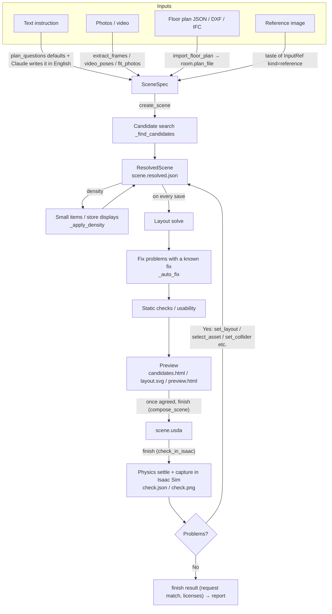

Every input first goes into a **SceneSpec** (a JSON that describes the room and the objects).
The calling Claude writes the SceneSpec from the text instruction. The server has no LLM. Search queries are in English (translating to English helps the most).
Items the instruction leaves out (size, entrance, checkout position, etc.) are filled with the per-place defaults that `plan_questions` returns. This gives a first draft, and the filled values are recorded as guesses (see [8. The conversation](#8-the-conversation)).
When the instruction gives no size, instead of one draft the user can pick from three top views that differ only in size (`create_scene(drafts="size")`, `propose_drafts`). The picked value is recorded as "chosen", not as a guess.
For homes, offices, schools and labs, it asks "who uses the place, how many people, and for what" instead of size or headcount, and derives the size, main furniture and counts from a table (`scene/activity.py`, `derive_activity`). Derived values are guesses with the reason "from activity".
When the user says a draft is "wrong" without a reason, it shows the current draft next to one that changes a single axis (size, amount of objects, mood, layout pattern) and asks "which is closer?". In 2–3 rounds this narrows down the axis that was off (`propose_contrast`, `choose_contrast`).

`create_scene` searches assets for each object and attaches candidates. The result is the **ResolvedScene**, saved as `scene.resolved.json` in the scene directory.
Later tools (`set_layout`, `select_asset`, `set_room` …) read this file, change it and save it. Every save re-solves the layout, runs the checks and rewrites the preview (`service._save`).
At that point the server fixes problems that have exactly one fix (a narrow aisle, articulated chairs that touch, a TV with no stand) (`_auto_fix`). The checks attach fixes to `Issue.fixes`. The server applies them to a copy of the scene and re-solves, and keeps the result only if the problem is gone and no new problem appears. It does not move objects the user placed or objects the current call moved. The fixes show up in the result's `auto_fixed`, in the "auto-fixed" assumptions and in the preview's change history.

Once the user agrees, `finish` writes the USD (`compose_scene`), runs Isaac Sim physics to check it (`check_in_isaac`), and returns the request match and the license list, all in one call. If there is a problem it stops with `stopped`. You fix it and call `finish` again; that is the fix loop.
In the same way, `create_scene` (`service.start_scene`) goes on after creating the scene to record the purpose, build the windows, open the preview and capture the draft 3D, all in one call (the individual tools still exist).

Related files
- [src/agentic_sim_world_gen/service.py](https://github.com/atinfinity/agentic-sim-world-gen/blob/main/src/agentic_sim_world_gen/service.py): operations shared by the CLI and MCP (`create_scene`, `start_scene`, `_save`, `compose_scene`, `check_in_isaac`, `finish`, etc.)
- [src/agentic_sim_world_gen/mcp_server.py](https://github.com/atinfinity/agentic-sim-world-gen/blob/main/src/agentic_sim_world_gen/mcp_server.py): MCP server (the tools only call service functions)
- [src/agentic_sim_world_gen/cli.py](https://github.com/atinfinity/agentic-sim-world-gen/blob/main/src/agentic_sim_world_gen/cli.py): CLI (`agentic-sim-world-gen ...`)
- [.claude/skills/world-gen/SKILL.md](https://github.com/atinfinity/agentic-sim-world-gen/blob/main/.claude/skills/world-gen/SKILL.md): the procedure Claude follows

## 2. Data

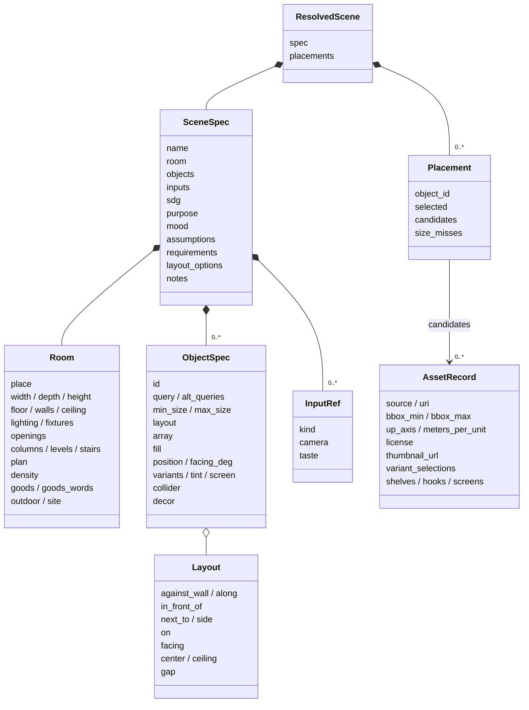

- **SceneSpec**: the user's instruction itself (room, objects, inputs, purpose `purpose`, mood `mood`, assumptions, request items, preview notes `notes`). It does not include the asset choices.
- **Room**: a rectangular room (`width`, `depth`), a floor plan (`plan`) or outdoors (`outdoor`). The kind of place `place` (home, office, store kinds `STORE_PLACES`, etc.), floor, walls, lighting, openings, columns, level changes and density also live here. Goods for store types not in the table go in `goods`. The surroundings of an indoor room (sidewalk, parking lot, neighboring buildings) go in `site`.
- **ObjectSpec**: one object to place. An English `query`, and a `layout` that describes placement as relations (the solver decides the coordinates). A row of the same object is `array`; stocking shelves is `fill`. Objects added automatically by density have `decor=true` (id `decor_*`).
- **ResolvedScene**: the SceneSpec plus a **Placement** per object (the list of candidate assets and the chosen index `selected`).
- **AssetRecord**: one asset found by search. It holds what placement and composition need: bbox, axis, units, license, thumbnail, etc.

A scene is "the directory that contains `scene.resolved.json`". The main files created there:

```
<scene>/
  scene.resolved.json   the scene itself (SceneSpec + candidates + choices + computed positions)
  candidates.html       list of candidate assets
  layout.svg            top-view layout
  preview.html / preview.json   live preview page and its update marker
  .history/NNNNNN.json.gz       scene.resolved.json per save (last 30; read by undo, "go back here" and restore)
  scene.usda            the world for Isaac Sim
  check.json / check.png / check.gif   Isaac Sim physics check report and screenshots
  check_orbit/NN.jpg    images taken around the room (orbit them in the preview)
  LICENSES.md           licenses and attributions for assets, materials and input photos
  surfaces.json         search results for floor, wall and ceiling materials
  layout_options/       top views of layout options and the 3 drafts, plus summary.json
  taste_pool.json       candidates compared by the taste check
  plan.json / plan.svg  when a floor plan was imported
  inputs/               input photos and video frames (source in <stem>.source.json)
  photo_fit.json / video_poses.json / compare.png   results of estimating from photos/video, and the side-by-side
  nav/                  navigation map for robots (map.pgm, map.yaml, nav_map)
  variants/             scene variations (make_variants)
  sdg/                  synthetic data
```

Related files
- [src/agentic_sim_world_gen/scene/spec.py](https://github.com/atinfinity/agentic-sim-world-gen/blob/main/src/agentic_sim_world_gen/scene/spec.py): SceneSpec, Room, ObjectSpec, Layout, ResolvedScene, Placement
- [src/agentic_sim_world_gen/scene/plan.py](https://github.com/atinfinity/agentic-sim-world-gen/blob/main/src/agentic_sim_world_gen/scene/plan.py): openings (Opening), floor plans (FloorPlan)
- [src/agentic_sim_world_gen/assets/record.py](https://github.com/atinfinity/agentic-sim-world-gen/blob/main/src/agentic_sim_world_gen/assets/record.py): AssetRecord
- Description of the output: [getting-started.md "7. Output"](getting-started.md#7-output)

## 3. Asset search

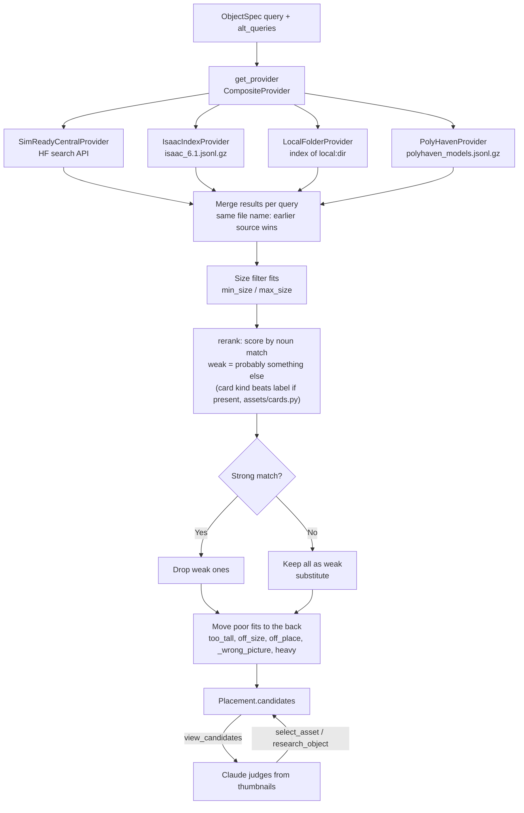

1. For each object, it searches every configured source with `query` and `alt_queries` (English synonyms). The environment variable `AGENTIC_SIM_WORLD_GEN_SOURCES` picks the sources (default: SimReady Central, Isaac bundled assets, Poly Haven; `+local:<dir>` adds to the default).
   All searches in one call (`create_scene`, `add_objects`) are sent up front in parallel (`service._searching`). SimReady Central answers are kept for one day in `AGENTIC_SIM_WORLD_GEN_CACHE/search`.
2. Size (`min_size` / `max_size`: footprint long side, short side, height) drops objects that do not fit.
3. **Rerank**: an asset scores by whether the last noun of the query (the object itself) appears as a noun in its class, tags, caption or name. A "desk lamp" is not a desk, and a "coffee table" does not stand in for a dining table (weak). If there is a strong match, weak ones are removed from the list. If all are weak, they stay as "no match = substitute".
4. Moved to the back, not removed: objects taller than the ceiling (`too_tall`); when no size is given, objects far from the typical size of their kind (`TYPICAL` in `assets/sizes.py`) (`off_size`; a pasta box for "cardboard box"); assets from a field that does not fit the place (`Room.place`) (a hospital bed in a home, `off_place`); artwork that belongs to another store (a bookstore checkout sign in a drugstore); objects with too many faces for their size (`heavy`).
   When everything is a substitute, the kind table (`assets/kinds.py`, MCP `kind_availability`) tells whether that kind exists in no source (`not_in_catalog`), so the search is not retried.
   Missing objects are recorded per scene in `AGENTIC_SIM_WORLD_GEN_CACHE/missing/` (`missing.py`, on every save). `agentic-sim-world-gen missing` lists them, most frequent first.
5. Claude makes the final call with `view_candidates` (returns thumbnail images). Metadata alone does not tell color, material or shape.

Related files
- [src/agentic_sim_world_gen/assets/providers/base.py](https://github.com/atinfinity/agentic-sim-world-gen/blob/main/src/agentic_sim_world_gen/assets/providers/base.py): `AssetProvider` protocol, `fits`
- [src/agentic_sim_world_gen/assets/providers/composite.py](https://github.com/atinfinity/agentic-sim-world-gen/blob/main/src/agentic_sim_world_gen/assets/providers/composite.py), [simready_central.py](https://github.com/atinfinity/agentic-sim-world-gen/blob/main/src/agentic_sim_world_gen/assets/providers/simready_central.py), [isaac_index.py](https://github.com/atinfinity/agentic-sim-world-gen/blob/main/src/agentic_sim_world_gen/assets/providers/isaac_index.py), [local_folder.py](https://github.com/atinfinity/agentic-sim-world-gen/blob/main/src/agentic_sim_world_gen/assets/providers/local_folder.py), [polyhaven.py](https://github.com/atinfinity/agentic-sim-world-gen/blob/main/src/agentic_sim_world_gen/assets/providers/polyhaven.py)
- [src/agentic_sim_world_gen/assets/sizes.py](https://github.com/atinfinity/agentic-sim-world-gen/blob/main/src/agentic_sim_world_gen/assets/sizes.py): `TYPICAL` (typical size per kind), [kinds.py](https://github.com/atinfinity/agentic-sim-world-gen/blob/main/src/agentic_sim_world_gen/assets/kinds.py): the kind table
- [src/agentic_sim_world_gen/assets/rerank.py](https://github.com/atinfinity/agentic-sim-world-gen/blob/main/src/agentic_sim_world_gen/assets/rerank.py): `rerank`, `score`, `noun_last`
- [src/agentic_sim_world_gen/assets/cards.py](https://github.com/atinfinity/agentic-sim-world-gen/blob/main/src/agentic_sim_world_gen/assets/cards.py): per-asset cards (`of`, `physics_issue`, `brief`). Data is in `src/agentic_sim_world_gen/data/asset_cards.jsonl.gz`; rebuild with `scripts/build_asset_cards.py`
- [src/agentic_sim_world_gen/assets/domain.py](https://github.com/atinfinity/agentic-sim-world-gen/blob/main/src/agentic_sim_world_gen/assets/domain.py): `off_place`
- [src/agentic_sim_world_gen/service.py](https://github.com/atinfinity/agentic-sim-world-gen/blob/main/src/agentic_sim_world_gen/service.py): `_find_candidates`, `_wrong_picture`, `research_object`

## 4. Layout

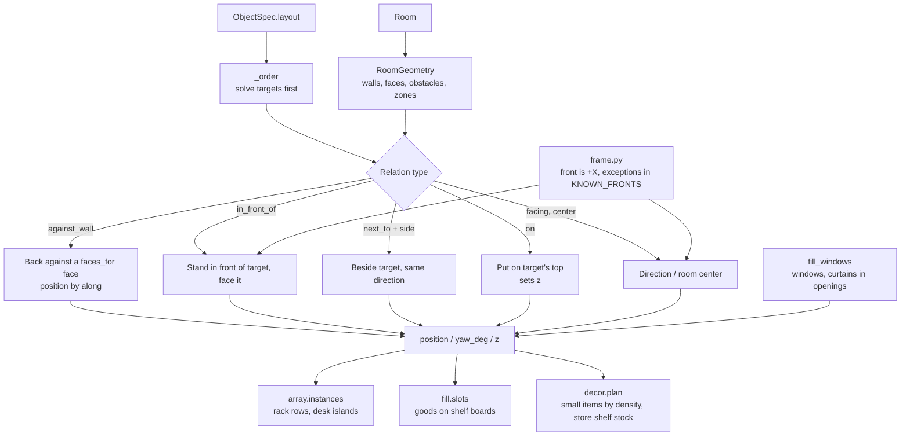

- **RoomGeometry** gives rectangular rooms, floor plans and outdoor scenes the same shape: walls (centerline and thickness), faces (inner surfaces an object can put its back against; doors cut them), obstacles (wall bodies, space in front of doors, columns `columns`, level changes `levels`, stairs, ceiling beams and light fixtures) and zones (rooms of a floor plan). An object whose center is on a raised level is placed at that height by the solver. With `site`, it also has outside faces (the room's exterior walls, area edges, buildings) and obstacles for areas and buildings (outside objects have zone `outside` or an area ID).
- **solve** decides position, direction and height from the `layout` relations (`against_wall`, `in_front_of`, `next_to`, `on`, `facing`, `center`, `gap`). `_order` decides the order, e.g. desk first, then chair. Because it re-solves on every save, it follows size changes when an asset is swapped. An object moved by hand with `move_object` loses its `layout` and keeps its coordinates.
- **Front convention**: an asset's front is +X (checked in Isaac Sim 6.1 by rendering about 40 assets from 4 directions). Exceptions are in `KNOWN_FRONTS` and `KNOWN_FRONT_PATTERNS`; for your own folders, `front` in agentic-sim-world-gen.json; per object, `front_offset_deg`. To set a direction by hand, use `facing_deg` (0 = east, 90 = north).
- **Repetition**: `array` places the whole block as one object, and expands it into units (`<id>.r<row>c<col>`) for checks, preview and USD.
- **Displays**: `fill` puts goods on the shelf boards found in the fixture's geometry (`assets/shelves.py`).
- **Small items**: depending on `Room.density` (sparse / normal / lived_in), `create_scene` adds small items `decor_*`, like books on a desk or a rug in front of a sofa. Placements that add problems are discarded (`service._apply_density`).
- **Store displays**: in stores (`shop` and the 25 kinds in `STORE_PLACES`: convenience store, supermarket, drugstore, bookstore, bakery, bike shop, furniture store, etc.), the same mechanism stocks empty fixtures with goods via `fill`. Goods come from per-store tables (`decor.PRODUCTS`, `COLD_PRODUCTS` for refrigerated cases, `HANG` for hooks), and each fixture starts with different goods from its neighbor. For store types not in the table, `Room.goods` (English search terms for goods) and `goods_words` (words for the trade) place only goods that carry those words (`decor.fits_goods`). Defaults for store size, entrance, checkout, etc. are in the `plan_questions` table (`questions.STORE_SIZES`).
- **Windows**: a window opening is a hole in the wall, so `fill_windows` adds a window asset `win_<id>` (stretched to the opening with `fit_scale`; in stores, windows 1.8 m or wider become shop windows) and, in homes, a curtain `curtain_<id>`.

`layout.svg` (top view; arrows show the front):

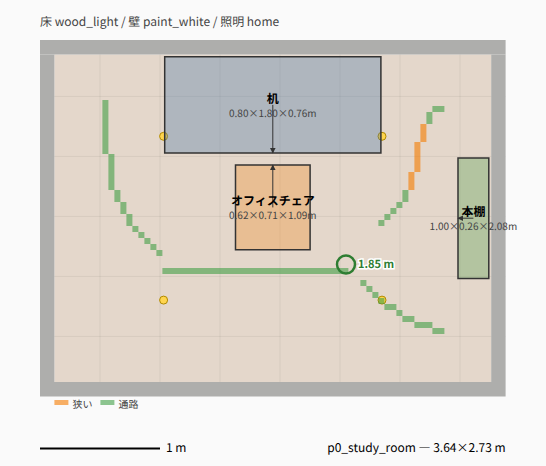

Related files
- [src/agentic_sim_world_gen/layout/room.py](https://github.com/atinfinity/agentic-sim-world-gen/blob/main/src/agentic_sim_world_gen/layout/room.py): `RoomGeometry`, `Wall`, `Face`, `Obstacle`
- [src/agentic_sim_world_gen/layout/solver.py](https://github.com/atinfinity/agentic-sim-world-gen/blob/main/src/agentic_sim_world_gen/layout/solver.py): `solve`
- [src/agentic_sim_world_gen/layout/frame.py](https://github.com/atinfinity/agentic-sim-world-gen/blob/main/src/agentic_sim_world_gen/layout/frame.py): front direction (`asset_front_deg`, `yaw_for_facing`)
- [src/agentic_sim_world_gen/layout/array.py](https://github.com/atinfinity/agentic-sim-world-gen/blob/main/src/agentic_sim_world_gen/layout/array.py), [fill.py](https://github.com/atinfinity/agentic-sim-world-gen/blob/main/src/agentic_sim_world_gen/layout/fill.py), [assets/shelves.py](https://github.com/atinfinity/agentic-sim-world-gen/blob/main/src/agentic_sim_world_gen/assets/shelves.py)
- [src/agentic_sim_world_gen/scene/decor.py](https://github.com/atinfinity/agentic-sim-world-gen/blob/main/src/agentic_sim_world_gen/scene/decor.py): `plan`, `PRODUCTS`, `fits_goods`
- [src/agentic_sim_world_gen/scene/columns.py](https://github.com/atinfinity/agentic-sim-world-gen/blob/main/src/agentic_sim_world_gen/scene/columns.py), [levels.py](https://github.com/atinfinity/agentic-sim-world-gen/blob/main/src/agentic_sim_world_gen/scene/levels.py), [fixtures.py](https://github.com/atinfinity/agentic-sim-world-gen/blob/main/src/agentic_sim_world_gen/scene/fixtures.py): columns and partial floor finishes, level changes and stairs, ceiling light fixtures and beams
- [src/agentic_sim_world_gen/preview/layout2d.py](https://github.com/atinfinity/agentic-sim-world-gen/blob/main/src/agentic_sim_world_gen/preview/layout2d.py): layout.svg

## 5. Checks

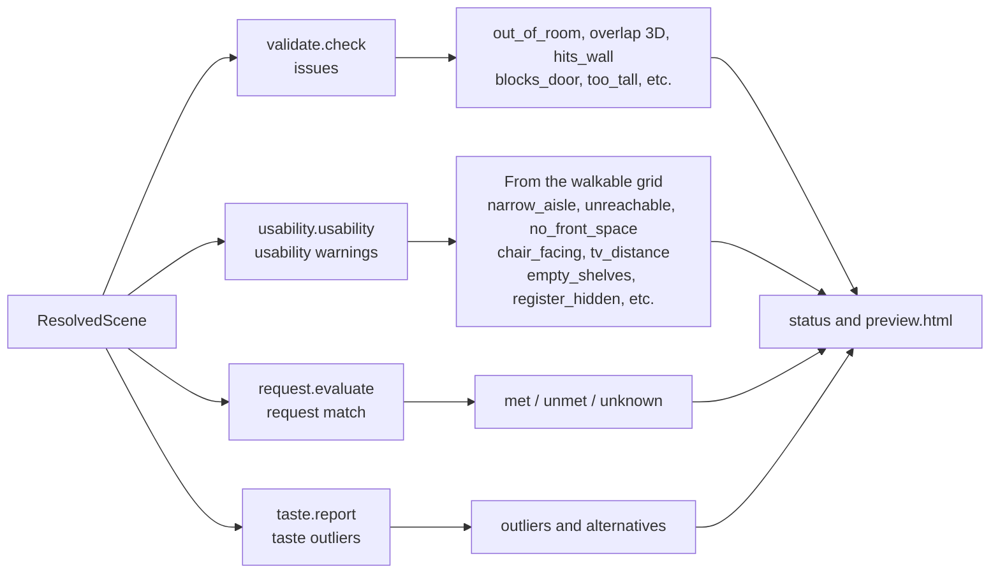

There are four kinds of checks, with different weight.

| Check | What it looks at | Handling |
|---|---|---|
| Static check `validate.check` | Sticking out of the room, overlap between objects (SAT on footprint polygons + height range = 3D), inside a wall or in front of a door, taller than the ceiling | **issues**. Fix until there are 0 |
| Usability `usability` | Puts the floor on a grid, finds the area walkable from the door, and checks whether you can stand in front of shelves, checkouts, etc. and whether aisles are wide enough for the place (the robot's width if the purpose `purpose` is amr). Aisle width comes from one distance-transform map (`AisleMap`); the narrowest width and its location go into narrow_aisle, and layout.svg draws the centerline colored by width. Direction and distance of chairs to desks and TVs, tall objects blocking windows, empty store shelves, a checkout not visible from the entrance | Warning. May stay if there is a reason |
| Request match `request.evaluate` | Splits the instruction into items and measures against the wall, next to, count, direction, zone and on top of from the layout | `check_request`. Always run before reporting |
| Taste `taste.report` | Embeds thumbnails of the chosen assets with SigLIP2 and looks for a single object that looks out of place | Warning. Never swapped automatically |

A chair may go under a desk up to 60% of its depth (`tuck_pair`), but the solver does not tuck it in automatically. Running physics with overlaps makes PhysX explode.

Related files
- [src/agentic_sim_world_gen/layout/validate.py](https://github.com/atinfinity/agentic-sim-world-gen/blob/main/src/agentic_sim_world_gen/layout/validate.py): `check`, `Issue`, `overlap_depth`
- [src/agentic_sim_world_gen/layout/usability.py](https://github.com/atinfinity/agentic-sim-world-gen/blob/main/src/agentic_sim_world_gen/layout/usability.py): `usability`, `AisleMap`, `aisle_map`
- [src/agentic_sim_world_gen/layout/widths.py](https://github.com/atinfinity/agentic-sim-world-gen/blob/main/src/agentic_sim_world_gen/layout/widths.py): `edt` (distance transform), `widest` (widest path from the entrance), `narrowest`, `ridge` (centerline). Shared by usability, nav (`routes`) and layout2d
- [src/agentic_sim_world_gen/layout/request.py](https://github.com/atinfinity/agentic-sim-world-gen/blob/main/src/agentic_sim_world_gen/layout/request.py): `evaluate`, `summary`
- [src/agentic_sim_world_gen/taste.py](https://github.com/atinfinity/agentic-sim-world-gen/blob/main/src/agentic_sim_world_gen/taste.py): `report`, `analyze`

## 6. Composing the USD

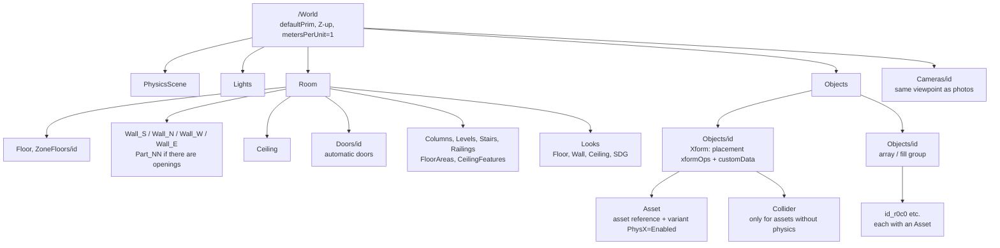

- The stage is **Z-up, meters** (metersPerUnit=1), defaultPrim `/World`. The room interior is x∈[0, width], y∈[0, depth], with the floor's top surface at z=0.
- Each object references its asset in a child `Asset` of `/World/Objects/<id>` (Xform). The reference sits on the child so the asset's own root transform (e.g. scale 0.01 for a cm asset) is kept.
- The outer Xform's xformOps are in this order: `translate` (position) → `rotateZ` (yaw) → `scale` (the asset's metersPerUnit) → `rotateX:upAxis` (90° for Y-up assets only) → `translate:pivot` (moves the bbox bottom center to the origin).
- The customData `agentic_sim_world_gen:source`, `agentic_sim_world_gen:uri`, `agentic_sim_world_gen:license`, `agentic_sim_world_gen:label`, `agentic_sim_world_gen:origin` (where it came from and version) and `agentic_sim_world_gen:facing_deg` are written on the object prim. `license_report` collects the license list into `LICENSES.md`.
- Physics: setting the asset's `PhysX` variant to `Enabled` gives SimReady assets a rigid body and colliders. Assets without physics (`collider` auto where it applies, or box) get an invisible fixed box `Collider` the size of the bbox. Floor and walls have static colliders and a friction material.
- The look of floor, walls and ceiling is a material under `Looks` (UsdPreviewSurface, textures, MDL). Materials come from named presets (`scene/looks.py`) or, via `select_surface`, from the indexes of Isaac Sim's bundled MDL (`materials.py`) and CC0 PBR (ambientCG, Poly Haven, `pbr.py`). `moods` / `apply_mood` (`scene/moods.py`) pick floor, walls and lighting together from a sample image.
- Object colors use `tint` (`usd/tint.py`), which overrides material colors from the scene side without changing the asset files.

Related files
- [src/agentic_sim_world_gen/usd/compose.py](https://github.com/atinfinity/agentic-sim-world-gen/blob/main/src/agentic_sim_world_gen/usd/compose.py): `compose`, `build_room`, `build_site`, `_add_asset`, `add_box_collider`, `build_inputs`
- [src/agentic_sim_world_gen/usd/look.py](https://github.com/atinfinity/agentic-sim-world-gen/blob/main/src/agentic_sim_world_gen/usd/look.py): materials and lighting (`build_lights`)
- [src/agentic_sim_world_gen/materials.py](https://github.com/atinfinity/agentic-sim-world-gen/blob/main/src/agentic_sim_world_gen/materials.py), [pbr.py](https://github.com/atinfinity/agentic-sim-world-gen/blob/main/src/agentic_sim_world_gen/pbr.py), [scene/moods.py](https://github.com/atinfinity/agentic-sim-world-gen/blob/main/src/agentic_sim_world_gen/scene/moods.py): searching floor and wall materials, mood samples
- [src/agentic_sim_world_gen/usd/door.py](https://github.com/atinfinity/agentic-sim-world-gen/blob/main/src/agentic_sim_world_gen/usd/door.py), [screen.py](https://github.com/atinfinity/agentic-sim-world-gen/blob/main/src/agentic_sim_world_gen/usd/screen.py): automatic doors, images on screens
- [src/agentic_sim_world_gen/license.py](https://github.com/atinfinity/agentic-sim-world-gen/blob/main/src/agentic_sim_world_gen/license.py), [origin.py](https://github.com/atinfinity/agentic-sim-world-gen/blob/main/src/agentic_sim_world_gen/origin.py): licenses and sources

## 7. The Isaac Sim side

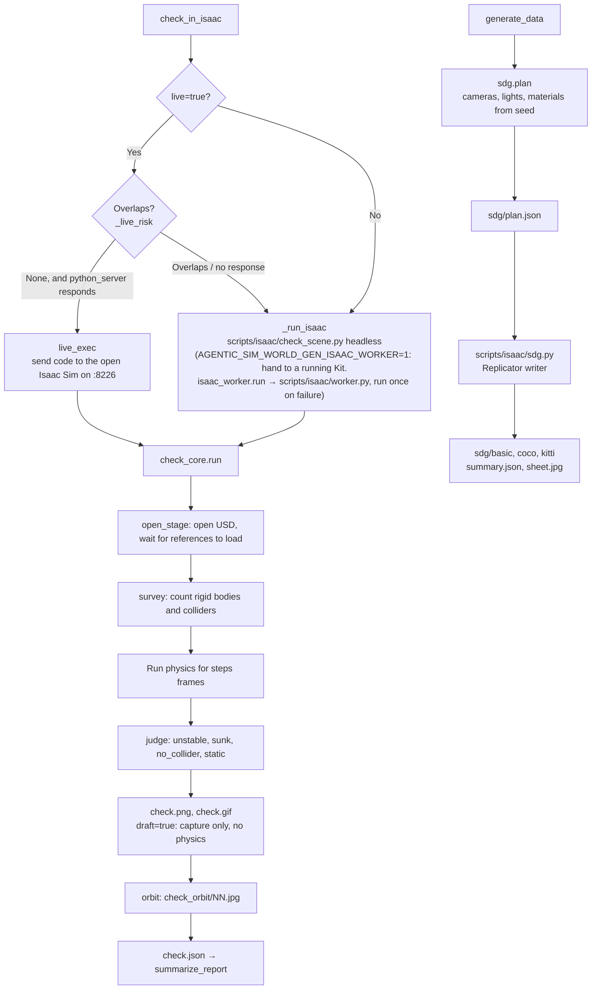

Isaac Sim exists only on the Ubuntu (RTX) machine and runs in a separate process from agentic-sim-world-gen itself (Python using usd-core). agentic-sim-world-gen reaches Isaac Sim in one of two ways: it runs a script with Isaac Sim's Python, or it sends code to a running Isaac Sim.

- **Headless**: `check_scene.py` starts its own `SimulationApp` and calls `check_core.run`. Isaac Sim's Python is `ISAACSIM_PYTHON` (pip install) or python.sh under `ISAACSIM_PATH`.
- **Live mode**: sends the same `check_core` code to an Isaac Sim started with `--enable isaacsim.code_editor.python_server`. It opens the scene on the user's screen, runs physics and selects the problem objects. Scenes with overlapping objects go to headless instead, because they stall PhysX in the GUI.
- **What check does**: compares rigid body positions before and after physics, and reports objects that moved or fell (`unstable`), sank into the floor (`sunk`), have no collision (`no_collider`) or are fixed and do not move (`static`). Then it photographs the room from 24 directions so you can orbit it in the preview.
- **Result**: `summarize_report` summarizes per object ID, and `check_in_isaac` adds a `verdict` (`passed` / `needs_fix` / `draft` / `failed`). `draft=true` skips physics and only captures the draft 3D.
- **Other Isaac Sim jobs**: `view_fronts` (`front_views.py`; photographs each object from its assumed front. It opens a layer `front_views_stage.usda` with the other objects deactivated, so only the assets being photographed are loaded), `compare_photo` (`render_view.py`; renders from the same viewpoint as a photo) and `nav_map(isaac=true)` (`nav_map.py`; Isaac Sim's Occupancy Map) also run with Isaac Sim's Python.
- **Synthetic data (SDG)**: the Python side (`sdg.plan`) decides camera positions, lighting and material assignments from a seed and writes them to `sdg/plan.json`. On the Isaac side, `scripts/isaac/sdg.py` only applies them and runs the Replicator writer. Labels use the UsdSemantics that compose put on the prims.

`check_orbit` orbit images:

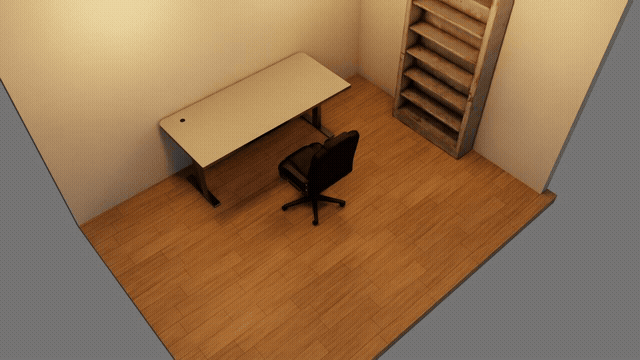

Related files
- [scripts/isaac/check_scene.py](https://github.com/atinfinity/agentic-sim-world-gen/blob/main/scripts/isaac/check_scene.py), [check_core.py](https://github.com/atinfinity/agentic-sim-world-gen/blob/main/scripts/isaac/check_core.py), [view.py](https://github.com/atinfinity/agentic-sim-world-gen/blob/main/scripts/isaac/view.py), [front_views.py](https://github.com/atinfinity/agentic-sim-world-gen/blob/main/scripts/isaac/front_views.py), [nav_map.py](https://github.com/atinfinity/agentic-sim-world-gen/blob/main/scripts/isaac/nav_map.py)
- [src/agentic_sim_world_gen/service.py](https://github.com/atinfinity/agentic-sim-world-gen/blob/main/src/agentic_sim_world_gen/service.py): `check_in_isaac`, `live_exec`, `summarize_report`, `generate_data`
- [src/agentic_sim_world_gen/sdg.py](https://github.com/atinfinity/agentic-sim-world-gen/blob/main/src/agentic_sim_world_gen/sdg.py), [scripts/isaac/sdg.py](https://github.com/atinfinity/agentic-sim-world-gen/blob/main/scripts/isaac/sdg.py)

## 8. The conversation

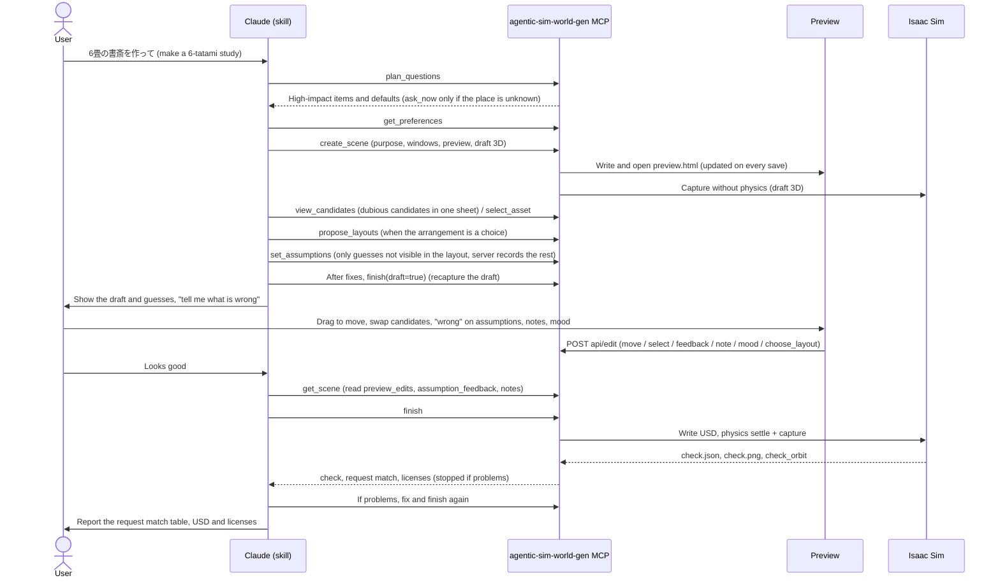

The skill (SKILL.md) sets this procedure for Claude.

1. **Draft from defaults**: `plan_questions` returns, from a per-place question table, the items the instruction does not cover yet, with defaults. It does not ask first. It builds with the defaults and records them as guesses. It asks first only when the place is unknown (`ask_now`), when the user said "ask me first" (`ask_first`), and for two items that are costly to change later: when the purpose is a robot (amr / manipulation) and the robot size is not given, and when the request is for a real place ("our store") with no drawing or photo attached. For places with no question table (hospital, school, station, etc.; `plan_questions` returns `gallery`), `show_gallery` shows a page (`gallery.html`) with examples (`examples/`) and top views of past scenes, and `start_from_example` makes the chosen one's SceneSpec the draft. Inherited dimensions, place, finishes and fixtures are recorded as guesses "from example '…'" (`gallery.py`).
2. **Create**: `get_preferences` reads earlier preferences, then `create_scene`. Next come `set_purpose` (sets defaults such as density and aisle width from the purpose, `scene/purpose.py`) and `fill_windows`. If assumptions conflict (an 8-seat table in a 6-tatami room (about 10 m²), an aisle narrower than the robot, etc., `scene/conflicts.py`), it returns `conflicts` without capturing the draft, and asks one question about which to prioritize (if the user leaves it to Claude, it goes with the larger one and reports).
3. **Check candidates**: `create_scene` opens the preview. For dubious candidates (substitutes, weak matches, objects with wrong size or place), `view_candidates` returns one sheet image; Claude looks and swaps.
4. **Layout**: fix until there are 0 issues, then review the usability warnings. If the arrangement itself is a choice, `propose_layouts` gives 2–3 options.
5. **Show the draft**: the server records the room's 5 items and per-object assumptions from the layout (`_auto_assumptions`), so `set_assumptions` gets only guesses the layout does not show. `create_scene` has already captured the 3D (after fixes, `finish(draft=true)`). Claude shows the guessed parts first and stops (it does not stop if the user said "leave it to you").
6. **check**: once agreed, `finish` (USD → check → request match → licenses).
7. **Request match**: `check_request` measures each item of the instruction.
8. **Report**: the match table, USD path, chosen assets (substitutes marked) and licenses.

Users can work in the preview page as well as in chat. Dragging and rotating objects in layout.svg, clicking a candidate card to swap, "wrong" in the assumptions table, "use this option" on a layout option, and picking a mood sample all call service functions through the preview server's `api/edit` and update the scene. Notes written by double-clicking the top view or the check 3D ("a light here") are kept without changing the scene (`notes.py`). Claude answers them with `resolve_notes`, which clears them. On the next turn Claude learns about all this from `preview_edits`, `assumption_feedback` and `notes` in the status of the tool results.

The preview server is a thread inside the MCP server process. It listens on `127.0.0.1:8765` (`AGENTIC_SIM_WORLD_GEN_PREVIEW`; if in use, the port used before for that folder or the next free one) and serves the parent folder of the scenes (usually `AGENTIC_SIM_WORLD_GEN_OUT`). The page checks `preview.json` every second and rewrites only the parts that changed. Writes need the token embedded in the page and a loopback connection.

Values the user corrected (`set_room`, `set_layout`, `set_array`, `select_asset` with `correction=true`, and swaps in the preview) are recorded as preferences. If they match across 2 or more scenes, they become the default from then on.

Related files
- [.claude/skills/world-gen/SKILL.md](https://github.com/atinfinity/agentic-sim-world-gen/blob/main/.claude/skills/world-gen/SKILL.md): the full procedure
- [src/agentic_sim_world_gen/scene/questions.py](https://github.com/atinfinity/agentic-sim-world-gen/blob/main/src/agentic_sim_world_gen/scene/questions.py): `plan_questions`
- [src/agentic_sim_world_gen/scene/purpose.py](https://github.com/atinfinity/agentic-sim-world-gen/blob/main/src/agentic_sim_world_gen/scene/purpose.py): defaults from the purpose (demo / amr / manipulation / sdg)
- [src/agentic_sim_world_gen/scene/conflicts.py](https://github.com/atinfinity/agentic-sim-world-gen/blob/main/src/agentic_sim_world_gen/scene/conflicts.py): detects conflicting assumptions (floor occupancy, ceiling height, robot aisle width, people vs. seats). `conflicts` in the status; if present, `create_scene` does not capture the draft
- [src/agentic_sim_world_gen/gallery.py](https://github.com/atinfinity/agentic-sim-world-gen/blob/main/src/agentic_sim_world_gen/gallery.py): list of examples and past scenes (`entries`, `rank`), the page (`write_page`), inherited values (`inherited`). Top views of the examples are built into `data/gallery/` by `scripts/make_gallery.py`
- [src/agentic_sim_world_gen/preferences.py](https://github.com/atinfinity/agentic-sim-world-gen/blob/main/src/agentic_sim_world_gen/preferences.py): `observe`, `apply`
- [src/agentic_sim_world_gen/preview/server.py](https://github.com/atinfinity/agentic-sim-world-gen/blob/main/src/agentic_sim_world_gen/preview/server.py): `serve`, `edit` (op move / select / try / feedback / choose_layout / mood / note), `api/gallery/pick` (example chosen in the gallery)
- [src/agentic_sim_world_gen/notes.py](https://github.com/atinfinity/agentic-sim-world-gen/blob/main/src/agentic_sim_world_gen/notes.py): describes the location of preview notes in words
- [src/agentic_sim_world_gen/preview/page.py](https://github.com/atinfinity/agentic-sim-world-gen/blob/main/src/agentic_sim_world_gen/preview/page.py), [changes.py](https://github.com/atinfinity/agentic-sim-world-gen/blob/main/src/agentic_sim_world_gen/preview/changes.py): the page and change history

## 9. Rooms from photos and videos

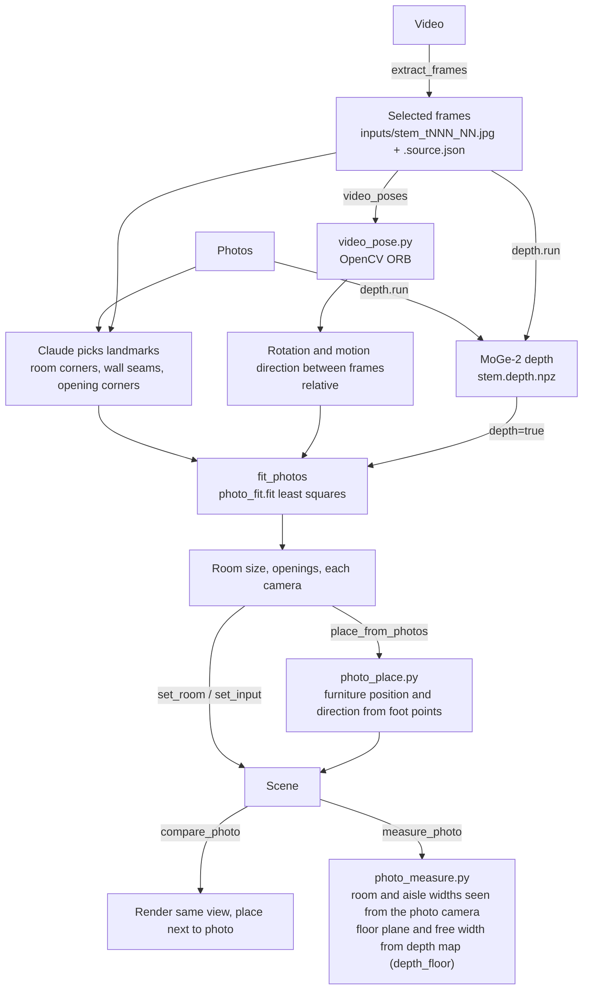

The room is treated as a box. For each photo, Claude picks the pixels of visible landmarks (room corners, wall-floor lines, door and window corners, points shared across photos). `fit_photos` takes the room width and depth, opening positions, and each camera's position, direction and field of view as unknowns, and minimizes the reprojection error of the landmarks (pure-Python Levenberg–Marquardt). The wall height sets the scale. If there are no ceiling landmarks, the camera height (`eye_height`) sets it.

For video, `extract_frames` first selects sharp frames where the view changes. `video_poses` measures how much the camera rotated between frames and adds that to `fit_photos`. It uses OpenCV ORB features. Adding monocular depth (MoGe-2) helps fix the dimensions even for photos that show only 1–2 walls.

The result goes into the scene with `set_room` and `set_input` (cameras). If foot points of furniture were picked in the photos, `place_from_photos` fits the chosen asset's footprint to those points to set position and direction. If you also pass rectangles around objects in the photo (`outlines`), it projects the asset's box into the photo with the fitted camera and refines the position to match the foot pixels and the rectangle (`photo_refine.py`). Finally, `compare_photo` renders from the same viewpoint to compare with the photo, and `measure_photo` compares room and aisle widths with the photo in numbers. Pointing at a pixel pair across an aisle with `aisle_pair` makes that width a layout target (`SceneSpec.photo_aisle`: array aisles, the walking-width and too-wide checks through `usability.photo_aisle`, and the ratio `photo_aisle` in the status). Passing the pixels of an object of known size in the photo (one shelf unit, a door, floor tiles, etc.) with `known` also gives widths and the camera height using that object as a ruler.

Related files
- [src/agentic_sim_world_gen/photo_fit.py](https://github.com/atinfinity/agentic-sim-world-gen/blob/main/src/agentic_sim_world_gen/photo_fit.py): `fit` (the result's `scale` = the list of scale evidence, from `_scale_evidence`), `FitRequest`, `PointObs`, `LineObs`, `SurfaceObs`, `RelativePose`
- [src/agentic_sim_world_gen/video.py](https://github.com/atinfinity/agentic-sim-world-gen/blob/main/src/agentic_sim_world_gen/video.py): `extract` (frame extraction)
- [src/agentic_sim_world_gen/video_pose.py](https://github.com/atinfinity/agentic-sim-world-gen/blob/main/src/agentic_sim_world_gen/video_pose.py): `relative_poses` (rotation and motion direction between frames with ORB)
- [src/agentic_sim_world_gen/photo_refine.py](https://github.com/atinfinity/agentic-sim-world-gen/blob/main/src/agentic_sim_world_gen/photo_refine.py): `refine` (minimizes the pixel difference between the projected box and the foot points and outline)
- [src/agentic_sim_world_gen/photo_place.py](https://github.com/atinfinity/agentic-sim-world-gen/blob/main/src/agentic_sim_world_gen/photo_place.py), [photo_measure.py](https://github.com/atinfinity/agentic-sim-world-gen/blob/main/src/agentic_sim_world_gen/photo_measure.py): furniture positions from photos, width comparison with photos (widths come with an error range). [photo_vanish.py](https://github.com/atinfinity/agentic-sim-world-gen/blob/main/src/agentic_sim_world_gen/photo_vanish.py): camera pitch and roll from the vanishing point of vertical lines in the photo
- [src/agentic_sim_world_gen/depth.py](https://github.com/atinfinity/agentic-sim-world-gen/blob/main/src/agentic_sim_world_gen/depth.py), [scripts/depth/moge_depth.py](https://github.com/atinfinity/agentic-sim-world-gen/blob/main/scripts/depth/moge_depth.py): monocular depth
- [src/agentic_sim_world_gen/inputs.py](https://github.com/atinfinity/agentic-sim-world-gen/blob/main/src/agentic_sim_world_gen/inputs.py): input sources (`<stem>.source.json`)
- [scripts/isaac/render_view.py](https://github.com/atinfinity/agentic-sim-world-gen/blob/main/scripts/isaac/render_view.py): renders from the same viewpoint as a photo
