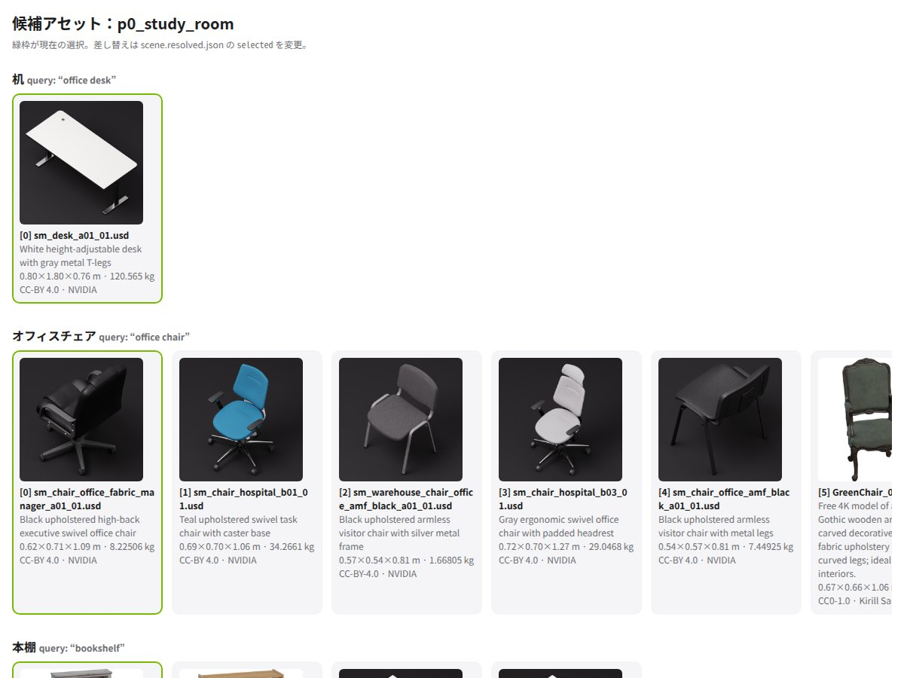
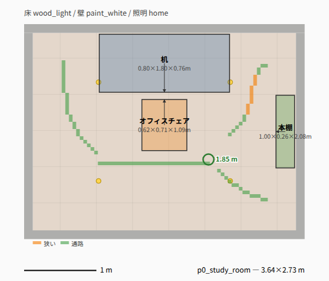
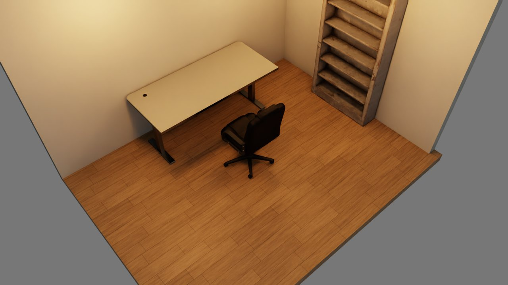
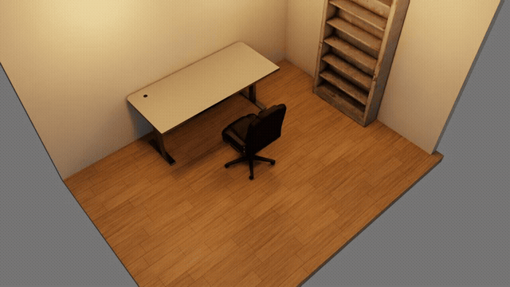
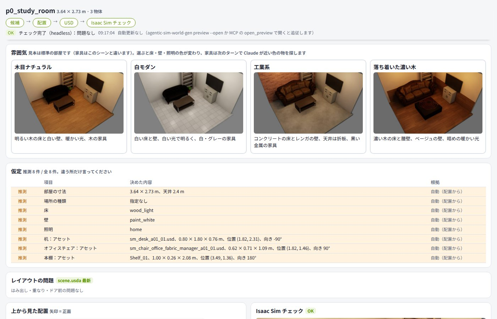

# Getting Started

From `git clone` to opening your first world in Isaac Sim (about 15 minutes, not counting the Isaac Sim install).

## 0. Where to run it

There are two setups, depending on where Isaac Sim and Claude Code run. In both, Isaac Sim, Claude Code and agentic-sim-world-gen live on the GPU machine. Your own PC is only a browser for the preview (in setup 1 it is the same machine).

| Setup | GPU machine | What you see locally | Live mode | Guide |
|---|---|---|---|---|
| 1. All local | Your own Ubuntu + RTX machine (with a display) | The Isaac Sim window, the preview, the terminal | Available | [use-local.md](use-local.md) |
| 2. Over ssh | An Ubuntu + RTX machine on the LAN, etc. (no display needed) | The ssh terminal and the preview in a browser (`ssh -L`) | Not available (headless) | [use-ssh.md](use-ssh.md) |

If unsure: pick 1 if you work in front of the GPU machine, 2 if you use it from a Mac or another PC. The sections below apply to both setups (install, environment variables, workflow, output).

## 1. Requirements

| | Used for |
|---|---|
| Ubuntu + RTX GPU, Isaac Sim 6.1 (tested with the pip version; the standalone `python.sh` is untested) | Physics checks, screenshots, photo comparison, synthetic data |
| Python 3.10 or later, [uv](https://docs.astral.sh/uv/) | agentic-sim-world-gen itself (search, preview, USD output) |
| [Claude Code](https://claude.com/claude-code) | Building scenes from natural-language instructions (MCP server + skill) |
| ffmpeg (optional; Ubuntu `apt install ffmpeg`, Mac `brew install ffmpeg`) | Extracting frames from videos (`extract_frames`) |

On a Mac or PC without a GPU you can still search, preview and write USD. Only the operations that need Isaac Sim fail, with "Isaac Sim not found".

## 2. Install

```bash
git clone https://github.com/atinfinity/agentic-sim-world-gen.git
cd agentic-sim-world-gen
uv venv --python 3.11 .venv
uv pip install -e ".[usd,hf,mcp,dev]"     # for floor plans too: ".[usd,hf,mcp,dev,dxf,ifc]"
source .venv/bin/activate
pytest -q                                  # offline tests (about 2 minutes)
```

**Install usd-core only into `.venv`.** Do not pip install anything into Isaac Sim's Python (`python.sh` or the pip version's venv).
Isaac Sim ships its own pxr, and mixing the two breaks it.

## 3. Environment variables

| Variable | Default | Description |
|---|---|---|
| `ISAACSIM_PATH` | `~/isaacsim` | Folder of the standalone Isaac Sim (untested), where `python.sh` lives |
| `ISAACSIM_PYTHON` | none | Python of the pip-version Isaac Sim venv (takes priority over `ISAACSIM_PATH` when set) |
| `OMNI_KIT_ACCEPT_EULA` | none | `YES` accepts the NVIDIA Omniverse EULA (required to run Isaac Sim non-interactively) |
| `AGENTIC_SIM_WORLD_GEN_OUT` | `~/agentic_sim_world_gen_scenes` | Where scenes made through MCP (Claude Code) are saved |
| `AGENTIC_SIM_WORLD_GEN_EXAMPLES` | `examples/` in the repository | Folder of SceneSpecs shown in the example gallery (`show_gallery`) |
| `AGENTIC_SIM_WORLD_GEN_SOURCES` | `simready-central,isaac,polyhaven` | Asset sources. `+local:/data/usd` adds your own folder to the defaults (a list without `+` replaces the defaults; `default` means the 3 defaults). `polyhaven` (Poly Haven CC0 models) is fetched only when used |
| `AGENTIC_SIM_WORLD_GEN_POLYHAVEN_INDEX` | bundled index | Replacement for the Poly Haven model index (rebuild with `scripts/build_polyhaven_models_index.py`) |
| `AGENTIC_SIM_WORLD_GEN_MDL` | `1` | `0` stops using Isaac Sim's bundled MDL for floor, wall and ceiling materials (CC0 PBR or plain colors only). Use it together with removing `isaac` from `AGENTIC_SIM_WORLD_GEN_SOURCES` when rendering images that must not show bundled assets |
| `ISAAC_ASSETS_ROOT` | public S3 | Root of the Isaac Sim bundled assets if you keep them locally or on Nucleus (the parent of `Isaac/`) |
| `AGENTIC_SIM_WORLD_GEN_ISAAC_LIVE` | `127.0.0.1:8226` | Address for live check ([use-local.md "Live mode"](use-local.md#live-mode-this-setup-only)) |
| `AGENTIC_SIM_WORLD_GEN_PREVIEW` | `127.0.0.1:8765` | HTTP server for the preview. If the port is in use, it takes the port that folder used before, or the next free one (remembered per folder in `~/.cache/agentic-sim-world-gen/preview_ports.json`) |
| `AGENTIC_SIM_WORLD_GEN_BROWSER` | `xdg-open` / `open` | Command that opens the preview (e.g. `chromium --app={url}`). In a shell without a display it does not open anything and returns the URL |

Example (pip version):

```bash
export ISAACSIM_PYTHON=~/isaacsim_venv/bin/python
export OMNI_KIT_ACCEPT_EULA=YES
```

## 4. Your first world with Claude Code

Create a workspace folder and start Claude Code in it:

```bash
agentic-sim-world-gen workspace ~/agentic-sim-world-gen-ws     # .mcp.json, the world-gen skill (a link into the repository), a short CLAUDE.md, a hook that keeps the reply language after compaction
cd ~/agentic-sim-world-gen-ws && claude
```

Starting `claude` inside the repository also works, but then it reads the repository's development notes (CLAUDE.md) on every turn.
That costs more and compaction comes sooner. Create the workspace outside the repository (creating it inside is an error). Scenes go to `~/agentic-sim-world-gen-ws/scenes`
(change with `--out` or `AGENTIC_SIM_WORLD_GEN_OUT`). You can add environment variables for the MCP server, e.g. `--env AGENTIC_SIM_WORLD_GEN_SOURCES=simready-central,isaac,local:/path`
(Claude Code's own environment variables are passed through too). `--allow-tools` skips the permission prompts for agentic-sim-world-gen tools. `--model sonnet` sets the Claude Code model for this folder (for building with a cheaper model; output quality has not been compared yet). The skill is a link, so `git pull` updates it
(`--copy-skill` makes a copy instead). Use `--force` to recreate the workspace.

On first start, approve the `agentic-sim-world-gen` MCP server in `.mcp.json` (the world-gen skill loads automatically). Then just ask:

> Make a 10 m² study. A desk and a chair, and a bookshelf against the wall.

Japanese works too, e.g. 「6畳の書斎を作って。机と椅子、壁際に本棚」 (the same request).

Claude goes through these steps (answer its questions if it asks; 2–3 minutes, about $1 in API cost per run):

1. Anything not in the request (size, floor, lighting, etc.) gets a default; it does not ask up front (`plan_questions`)
2. Turns the room and furniture into a SceneSpec and searches assets with English queries plus synonyms (`create_scene`). The preview also opens in the browser here
3. Looks at candidate thumbnails and picks (`view_candidates`). If nothing fits, it substitutes something close and says so
4. Places objects by relation (against the wall, in front of the desk, etc.). Checks overlaps and out-of-bounds
5. Writes the USD (`compose_scene`), shows a draft rendered without physics, and asks what is wrong (`draft` of `check_in_isaac`).
   Say "go all the way to the end" and it does not stop
6. Physics check and screenshots in Isaac Sim (`check_in_isaac`). If anything fell over or sank, it fixes it and checks again
7. Verifies each item of the request (`check_request`) and collects the licenses of the assets used (`license_report` → LICENSES.md).
   `create_scene` runs everything up to the draft in step 5 in one call; `finish` runs steps 5–7 in one call

The scene is created in `$AGENTIC_SIM_WORLD_GEN_OUT/<name>/`. You can open the intermediate previews in a browser:

| candidates.html (candidate list; green frame = selected) | layout.svg (top-down layout; arrows show the front) |
|---|---|
|  |  |

Screenshot from check (check.png):



After physics settles, check photographs the room from 24 directions around it (check_orbit/; adds about 6 seconds; `orbit=0` / `--orbit 0` skips it).
On the preview page you can rotate this view by dragging (or with the ← → keys):



preview.html (`agentic-sim-world-gen preview --open` / MCP `open_preview`) updates in place on every change (no reload, so no flicker).
Asset candidates are one row per object (selected thumbnail, asset name, license badge, badges for substitutions and placement problems),
and only the object currently being worked on is expanded. "Needs review only" (要確認のみ; the preview UI is in Japanese) filters to objects with a substitution, unknown license, non-commercial license or placement problem.
"Change history" (変更履歴) lists the operations done on this scene (newest first, up to 200; there is no undo).
Each operation notes what changed and how (asset, position and orientation, room size, floor/wall/lighting, number of placement problems) in Japanese,
and the changes from the latest operation also appear at the top of the page. Objects that moved along because of a relation (such as the chair in front of the desk) are listed too.
The check result shows as an "OK" (green) / "Needs fix" (要修正, red) badge.



(After asking Claude Code 「6畳の書斎を作って。机と椅子、壁際に本棚を置いて」 (make a 10 m² study; a desk and a chair, and put a bookshelf against the wall) and finishing the Isaac Sim check. The "Match against the request", "Mood" and "Assumptions" sections at the top of the page are omitted.)

You can keep refining with requests like "move the bookshelf to the wall opposite the window" or "swap the chair for a black one".

How to open the finished world in Isaac Sim, and "live mode", which runs check in the Isaac Sim window you already have open, are in [use-local.md](use-local.md#4-your-first-world).
How to open the preview over ssh (`ssh -L`) is in [use-ssh.md](use-ssh.md#3-your-first-world).

## 5. The same from the CLI

You can call the same processing without Claude Code by writing the SceneSpec (JSON) yourself.

```bash
agentic-sim-world-gen search "office chair" --limit 5                 # search only
agentic-sim-world-gen resolve examples/p0_study_room.json -o out/study
#   out/study/scene.resolved.json  scene with candidates (selected and position are editable)
#   out/study/candidates.html      candidate list
#   out/study/layout.svg           layout drawing
agentic-sim-world-gen preview out/study/scene.resolved.json            # rebuild the preview after editing
agentic-sim-world-gen preview out/study --open                         # open preview.html in the browser; auto-updates on every change
agentic-sim-world-gen compose out/study/scene.resolved.json            # -> out/study/scene.usda
agentic-sim-world-gen check out/study                                  # physics + screenshots in headless Isaac Sim (about 35 seconds)
agentic-sim-world-gen licenses out/study                               # -> out/study/LICENSES.md
```

`agentic-sim-world-gen check` runs `scripts/isaac/check_scene.py` with Isaac Sim's python. To call it directly:

```bash
~/isaacsim/python.sh scripts/isaac/check_scene.py out/study/scene.usda \
    --screenshot out/study/check.png --report out/study/check.json [--gif out/study/check.gif]
```

The SceneSpec format is in `src/agentic_sim_world_gen/scene/spec.py`; examples are in `examples/`.

## 6. Other inputs

| Input | Example | Details |
|---|---|---|
| Floor plan (JSON / DXF / IFC) | `agentic-sim-world-gen plan examples/plans/1ldk.json -o out/1ldk_plan` → put plan.json in `room.plan_file`. To Claude: "Use the floor plan in examples/plans/1ldk.json, with a sofa in the LDK and a low table in the Japanese-style room" (the Japanese-style room gets a tatami floor, the washroom a tile floor) | `src/agentic_sim_world_gen/scene/plan.py` |
| Floor plan (image / PDF) | Give Claude the image; it traces it into JSON (units in px, plus the image as an underlay) | plans.md in the skill |
| Photos | "Make the room in examples/photos/living_room.jpg". The source is in the neighboring `<stem>.source.json`. `agentic-sim-world-gen photo <scene>` shows it side by side with a render from the same viewpoint | photos.md in the skill |
| Depth for photos and videos | Create the venv from "Monocular depth" below, then run `agentic-sim-world-gen fit-photos req.json --depth` (photos in `image`). Room dimensions are easier to pin down | [Monocular depth](#monocular-depth-optional) below |
| Video | "Make the room in walk.mp4" (a video taken while walking through the room, with no people in it). The source is in the neighboring `walk.source.json`. `agentic-sim-world-gen frames walk.mp4 -o <scene>` picks frames to use as input photos (needs ffmpeg) | videos.md in the skill |
| Repeated placement | `agentic-sim-world-gen resolve examples/warehouse_racks.json -o out/racks` (rows of racks + aisles) | set_array in the README |
| Outdoor | `agentic-sim-world-gen resolve examples/outdoor_yard.json -o out/yard` (road, sidewalk, buildings, sky) | `src/agentic_sim_world_gen/scene/site.py` |
| See missing assets, most frequent first | `agentic-sim-world-gen missing` (substitutions, objects with no candidates and skipped small items across all scenes made on this machine) | `src/agentic_sim_world_gen/missing.py` |
| Your own USD folder | `AGENTIC_SIM_WORLD_GEN_SOURCES=+local:/data/usd`; list its contents with `agentic-sim-world-gen index /data/usd --list` | README |
| Floor, walls, lighting | `room.floor: "wood_light"`, `room.lighting: "office"`, etc. (plain words such as "wood flooring, night lighting" work too) | `src/agentic_sim_world_gen/scene/looks.py` |
| Synthetic data | `agentic-sim-world-gen sdg out/study --frames 24 --coco` → RGB, bbox, segmentation, depth | `src/agentic_sim_world_gen/sdg.py` |

### Monocular depth (optional)

`fit_photos(depth=true)` estimates depth for each photo with MoGe-2 (MIT, 141 MB). MoGe has heavy dependencies, so install it in a venv separate from agentic-sim-world-gen:

```bash
python -m venv ~/.venvs/moge && ~/.venvs/moge/bin/pip install torch torchvision pillow numpy scipy \
    opencv-python-headless huggingface-hub click
~/.venvs/moge/bin/pip install --no-deps "git+https://github.com/microsoft/MoGe.git@74fbce054ebed49800de42d0ad0e83495065719a" \
    "git+https://github.com/EasternJournalist/utils3d-moge.git@62f09d58509485564e24d5d9f6aac9ee9ebc0c37" \
    "git+https://github.com/EasternJournalist/pipeline.git@1c511390d90226c00c101f34b84df26a0f8789b4"
export AGENTIC_SIM_WORLD_GEN_DEPTH_PYTHON=~/.venvs/moge/bin/python
AGENTIC_SIM_WORLD_GEN_DEPTH_DOWNLOAD=1 agentic-sim-world-gen fit-photos req.json --depth   # downloads the model the first time only
```

The same steps are at the top of `scripts/depth/moge_depth.py`. Depth is saved next to each photo as `<stem>.depth.npz`, so the model does not run again on later runs.
`AGENTIC_SIM_WORLD_GEN_DEPTH_MODEL` selects a different MoGe-2 model.

## 7. Output

```
<scene>/
  scene.resolved.json   the scene itself (SceneSpec + candidates + selections + computed positions). Edit and reuse this
  candidates.html       candidate asset list
  layout.svg            top-down layout drawing
  scene.usda            world for Isaac Sim (assets referenced by URL; --localize copies them locally)
  check.json / .png     physics check report and screenshot (.gif when gif=true)
  check_orbit/NN.jpg    images taken around the room (drag to rotate in the preview)
  LICENSES.md           licenses and attributions for the assets, input photos and sky (HDRI) used, and for photos and fonts used in asset textures
  plan.json / plan.svg  when a floor plan was loaded
  sdg/                  synthetic data
```

Main fields of check.json: `unstable` (moved or fell over), `sunk` (sank into the floor), `no_collider` (no collision shape),
`static` (fixed objects that do not move; fine for furniture), and per object `max_displacement_m` and `moved_body`.
For objects with `no_collider`, `set_collider` (`box`) adds an invisible box collider the same size as the asset (the object becomes a fixed, static object).
SimReady assets known to have no physics (such as Vertiv racks) get one from the start.
What is returned to Claude (MCP) or by `agentic-sim-world-gen check` is a summary: counts and maximum displacement per object ID, plus details only for problem objects (a few thousand characters even with many objects).

## 8. Licenses

The source, author and license are recorded in each asset's customData `agentic_sim_world_gen:license` in the USD and in LICENSES.md.
SimReady Central / SimReady (bundled with Isaac Sim) are mostly CC BY 4.0 (attribution required). Props, Environments and skies bundled with Isaac Sim are
`NVIDIA-Isaac-Sim` (they follow the Isaac Sim license; take care with redistribution).

If an asset folder's `asset.json` has `image_credits` (photos or fonts used in textures), each one is listed in the
"Material used in the assets" section of LICENSES.md, next to the name of the object that uses it (e.g. Noto Sans JP, SIL Open Font License 1.1).

Where each asset came from, and which version, is also recorded so that it identifies exactly one asset (the "Sources" section of LICENSES.md, "License and source" in the preview,
and the USD customData `agentic_sim_world_gen:origin`).

- SimReady Central: the Hugging Face commit (included in the URL) and the path inside the dataset
- Bundled with Isaac Sim: the release (e.g. 6.1) and the path. Files may be replaced within a release, so it is shown as "per release"
- Your own folder (`local:`): the asset's own version (`version` in `asset.json`, or else `assetInfo.version` in the USD;
  e.g. v1.3.0), the git remote, the last commit that changed the asset's folder, and the file's SHA-256.
  If the folder has uncommitted changes, it warns "uncommitted changes" (the same files cannot be fetched again). Outside git, only the version and SHA-256

Before sharing, check the "Warnings" in LICENSES.md (non-commercial, share-alike, unknown) and include the attributions.
For unknown licenses, check the license of the original folder or switch to a different asset.

## 9. Troubleshooting

| Symptom | Fix |
|---|---|
| `Isaac Sim not found` | Set `ISAACSIM_PATH` (the folder with python.sh) or `ISAACSIM_PYTHON` (the pip version's python) |
| `Isaac Sim EULA not accepted` / hangs | `export OMNI_KIT_ACCEPT_EULA=YES` |
| The first check is very slow | Asset downloads and shader compilation. A few minutes the first time, about 35 seconds after that |
| Search fails or is slow (SimReady Central) | Rate limits or temporary trouble on the Hugging Face side. Wait a bit and retry. Offline, `AGENTIC_SIM_WORLD_GEN_SOURCES=isaac` still searches the bundled index |
| Screenshot is black or dark | Change the lighting preset (`room.lighting`) or raise `lighting_scale`. Outdoor skies are HDRIs. Check that your GPU / driver supports RTX rendering |
| Materials are red | MDL failed to load (loading from HF sometimes fails). Work around it with `compose --localize` |
| An object faces backwards | The asset uses a different front convention. Check with `view_fronts` (CLI `agentic-sim-world-gen fronts <scene>`) and fix with `front_offset_deg`. For your own folder, use `front` in agentic-sim-world-gen.json |
| Objects fly off or fall over (unstable) | Overlaps (check `issues`), long thin or top-heavy shapes, placed on top of something small, etc. Move it, add `gap`, or use a different asset |
| Live check ran headless | The reason is in `live_fallback` in the report. Check that Isaac Sim was started with `--enable isaacsim.code_editor.python_server` and that objects do not overlap |
| check says "physics did not run" | Objects touching or interpenetrating blew apart and GPU physics stopped (CUDA error). The same scene fails the same way every time. Move the `blew_up` objects a few cm apart (e.g. chairs with casters lined up with no gap). In live mode, restart Isaac Sim too |

## What to read next

- [README](https://github.com/atinfinity/agentic-sim-world-gen/blob/main/README.md): list of MCP tools
- [use-local.md](use-local.md) / [use-ssh.md](use-ssh.md): steps for the all-local and over-ssh setups
- [.claude/skills/world-gen/SKILL.md](https://github.com/atinfinity/agentic-sim-world-gen/blob/main/.claude/skills/world-gen/SKILL.md): Claude's conversation steps, standard furniture sizes, Japanese-to-English query examples
- [CLAUDE.md](https://github.com/atinfinity/agentic-sim-world-gen/blob/main/CLAUDE.md): conventions (coordinate system, USD structure)
