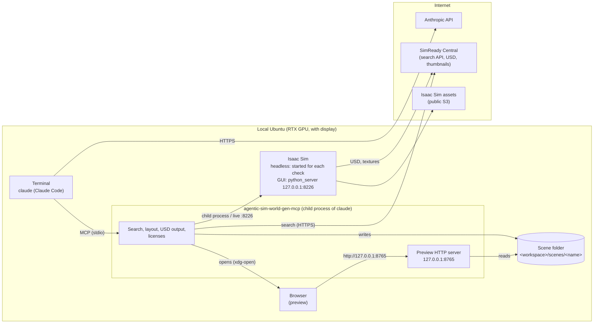

# Everything on one machine (Ubuntu + RTX)

How to run Isaac Sim, Claude Code and the preview on one local Ubuntu machine with an RTX GPU and a display.
You can see the Isaac Sim 3D view, the preview and the terminal on the same screen. "Live mode", which runs the check in the Isaac Sim window you have open, works only in this setup.

If the GPU machine is somewhere else and you reach it over ssh from your own computer (a Mac or similar), see [Over ssh](use-ssh.md).



There are two ports, both on 127.0.0.1 (not exposed to the network).

| Port | What | Variable to change it |
|---|---|---|
| 8765 | Preview HTTP server (runs inside agentic-sim-world-gen-mcp) | `AGENTIC_SIM_WORLD_GEN_PREVIEW` |
| 8226 | In live mode, where checks are sent to the open Isaac Sim (python_server) | `AGENTIC_SIM_WORLD_GEN_ISAAC_LIVE` |

## 1. Requirements

| | Used for |
|---|---|
| Ubuntu + RTX GPU and driver, a desktop (X / Wayland) | Isaac Sim rendering, the browser |
| Isaac Sim 6.1 (pip or standalone) | Physics checks, screenshots, photo comparison, synthetic data |
| Python 3.12 or later and [uv](https://docs.astral.sh/uv/) | agentic-sim-world-gen itself |
| [Claude Code](https://claude.com/claude-code) (logged in) | Building scenes from your instructions |
| ffmpeg (optional, `sudo apt install ffmpeg`) | Extracting frames from videos |

## 2. Install

1. Install Isaac Sim 6.1. For the pip version, run `pip install "isaacsim[all,extscache]==6.1.0.0"` in a dedicated venv (follow NVIDIA's instructions).
   For the standalone version, extract it to `~/isaacsim`.
2. Install agentic-sim-world-gen (same as [Getting Started "2. Install"](getting-started.md#2-install)):

   ```bash
   git clone https://github.com/atinfinity/agentic-sim-world-gen.git
   cd agentic-sim-world-gen
   uv sync --extra usd --extra hf --extra mcp --extra dev
   ```

   **Do not pip install anything into Isaac Sim's Python** (Isaac Sim has its own pxr, and mixing in usd-core breaks it).
3. Set environment variables in `~/.bashrc` or similar:

   ```bash
   export ISAACSIM_PYTHON=~/isaacsim_venv/bin/python   # python of the pip version's venv. For the standalone version: ISAACSIM_PATH=~/isaacsim
   export OMNI_KIT_ACCEPT_EULA=YES                       # needed to run Isaac Sim non-interactively (accepts the NVIDIA Omniverse EULA)
   ```

   These two are all this setup needs. To change where assets are searched, use `AGENTIC_SIM_WORLD_GEN_SOURCES` ([Getting Started "3. Environment variables"](getting-started.md#3-environment-variables)).

4. Check it: if `out/study/check.png` is created, Isaac Sim works (the first run takes a few minutes to fetch assets and compile shaders).

   ```bash
   source .venv/bin/activate
   agentic-sim-world-gen resolve examples/p0_study_room.json -o out/study
   agentic-sim-world-gen compose out/study/scene.resolved.json
   agentic-sim-world-gen check out/study
   ```

## 3. Create a workspace

To build worlds, start Claude Code in a workspace folder outside the repository (inside the repository it reads the development CLAUDE.md every turn, which costs more and fills the context sooner).

```bash
agentic-sim-world-gen workspace ~/agentic-sim-world-gen-ws     # .mcp.json, the world-gen skill (link to the repository), a short CLAUDE.md
cd ~/agentic-sim-world-gen-ws && claude
```

On the first run, approve the `agentic-sim-world-gen` MCP server from `.mcp.json`. Scenes are created in `~/agentic-sim-world-gen-ws/scenes/<name>/`.
For options (`--env`, `--allow-tools`, etc.), see [Getting Started "4."](getting-started.md#4-your-first-world-with-claude-code).

## 4. Your first world

1. Ask Claude:

   > Make a 10 m² study. A desk and a chair, and a bookshelf against the wall.

   Japanese works too, e.g. 「6畳の書斎を作って。机と椅子、壁際に本棚」 (the same request).

2. **Preview**: once there are candidates, Claude opens the preview (`http://127.0.0.1:8765/<name>/preview.html`) in the browser.
   If it does not open, ask Claude to "open the preview", or open the URL from the reply. The page updates itself every time a tool is called.
   To use a different browser, set something like `AGENTIC_SIM_WORLD_GEN_BROWSER="chromium --app={url}"`.
3. **check**: Claude writes the USD (`compose_scene`) and runs a physics check and screenshots in Isaac Sim (`check_in_isaac`, about 35 seconds headless).
   The results appear under "Isaac Sim check" in the preview (24 shots taken from around the scene; drag to rotate).
4. **Open the result**: open `scene.usda` in Isaac Sim.

   ```bash
   isaacsim isaacsim.exp.full.kit          # pip version. Standalone version: ~/isaacsim/isaac-sim.sh
   ```

   Use File → Open on `~/agentic-sim-world-gen-ws/scenes/<name>/scene.usda`. Press Play to run physics (Z-up, meters, objects under `/World/Objects/<id>`).

### Live mode (this setup only)

If you start Isaac Sim with python_server, the check runs in that window and the problem objects are selected. A re-check takes about 8 seconds (headless takes about 34 seconds every time).

```bash
isaacsim isaacsim.exp.full.kit --enable isaacsim.code_editor.python_server   # listens on 127.0.0.1:8226
```

Ask Claude to "check in the open Isaac Sim" (MCP `check_in_isaac(live=true)`, CLI `agentic-sim-world-gen check <scene> --live`).
If Isaac Sim is not running, or objects overlap (GPU physics in the GUI can break), the check runs headless instead (`live_fallback` in the report).
python_server runs arbitrary code, so keep it on 127.0.0.1.

## 5. Inputs and results

- Pass photos, videos and drawings by their local path as is ("make the room in ~/photos/living.jpg"). Sources go in the `<stem>.source.json` next to them ([Getting Started "6. Other inputs"](getting-started.md#6-other-inputs)).
- You can open the finished scene in the local Isaac Sim as is. To hand it to another PC, first write a USD that bundles the assets, then hand over the whole folder:
  "re-export the USD with local references" (MCP `compose_scene(localize=true)`, CLI `agentic-sim-world-gen compose <scene>/scene.resolved.json --localize`).

## 6. Troubleshooting

| Symptom | Fix |
|---|---|
| The preview does not open | Open the URL from the reply by hand. If you start `claude` from a shell without `DISPLAY` (such as a terminal you reached over ssh), it cannot open a browser |
| The preview URL port is not 8765 | If 8765 is in use (by another Claude session, for example), the server starts on the number this folder used before, or the next free one. Pin it with `AGENTIC_SIM_WORLD_GEN_PREVIEW=127.0.0.1:8770` |
| The preview does not update | Quitting Claude Code also stops the preview server. Start it again and ask to "open the preview" |
| A live check ran headless | Read the reason in `live_fallback`. Did you start Isaac Sim with `--enable isaacsim.code_editor.python_server`? Do objects overlap? |
| check says "physics did not run" | Objects touching or interpenetrating blew apart and GPU physics stopped (CUDA error). The same scene fails the same way every time. Move the `blew_up` objects a few cm apart (for example, chairs with casters placed with no gap). In live mode, also restart Isaac Sim |
| Other symptoms | [Getting Started "9. Troubleshooting"](getting-started.md#9-troubleshooting) |
