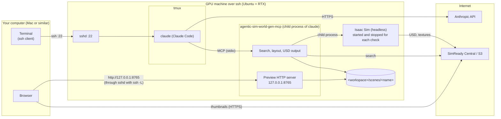

# Over ssh (GPU machine: Ubuntu on the LAN; you: a Mac or similar)

How to run Isaac Sim, Claude Code and agentic-sim-world-gen on a GPU machine you reach over ssh (for example, Ubuntu + RTX on the LAN). From your own computer (a Mac or similar, no GPU needed)
you give instructions in an ssh terminal and only view the preview in a browser. Nothing is installed on your computer (only ssh and a browser).

If you sit at the GPU machine, see [Everything on one machine](use-local.md).



| Connection | Port | What goes over it |
|---|---|---|
| Your terminal → GPU machine | 22 (ssh) | Your instructions to claude inside tmux |
| Your browser → preview on the GPU machine | 8765, forwarded with `ssh -L` | preview.html, the layout plan, check images. Listens only on the GPU machine's 127.0.0.1, not exposed to the LAN |
| Your browser → Hugging Face / S3 | 443 | Candidate thumbnails (the browser fetches URL thumbnails directly) |

The only inbound traffic the GPU machine needs is ssh.

## 1. Requirements

| Where | What you need |
|---|---|
| GPU machine | Ubuntu + RTX GPU and driver, Isaac Sim 6.1 (pip or standalone), Python 3.10 or later and uv, Claude Code (logged in), tmux. No display needed |
| Your computer | An ssh client and a browser |

## 2. Preparing the GPU machine

1. Install Isaac Sim 6.1 and agentic-sim-world-gen (same as steps 1 and 2 of [Everything on one machine "2. Install"](use-local.md#2-install)).
2. Set environment variables in `~/.profile`, or at the **top** of `~/.bashrc` (before the `case $- in` line that exits for non-interactive shells).
   If you put them at the end, they do not apply to non-interactive shells such as `ssh <gpu-host> 'command'`:

   ```bash
   export ISAACSIM_PYTHON=~/isaacsim_venv/bin/python   # for the standalone version: ISAACSIM_PATH=~/isaacsim
   export OMNI_KIT_ACCEPT_EULA=YES
   ```

   The preview port is 8765. If it is in use (by Claude in another workspace, for example), the server uses the number that folder used last time (`~/.cache/agentic-sim-world-gen/preview_ports.json`),
   and if that is also in use, the next free number. With a single workspace it is 8765 every time, so the same `ssh -L` always works.
   To pin a number per folder, write it into .mcp.json, like `agentic-sim-world-gen workspace … --env AGENTIC_SIM_WORLD_GEN_PREVIEW=127.0.0.1:8766`.
3. Create a workspace (outside the repository):

   ```bash
   cd agentic-sim-world-gen && .venv/bin/agentic-sim-world-gen workspace ~/agentic-sim-world-gen-ws
   ```

4. Check it (over ssh): if `out/study/check.png` is created, headless rendering works.

   ```bash
   ssh <gpu-host> 'cd agentic-sim-world-gen && .venv/bin/agentic-sim-world-gen resolve examples/p0_study_room.json -o out/study \
     && .venv/bin/agentic-sim-world-gen compose out/study/scene.resolved.json && .venv/bin/agentic-sim-world-gen check out/study'
   ```

## 3. Your first world

1. From your computer, connect with the preview port forwarded, and start Claude Code inside tmux:

   ```bash
   ssh -L 8765:127.0.0.1:8765 <gpu-host>
   tmux new -s agentic-sim-world-gen          # so Claude keeps working if the connection drops
   cd ~/agentic-sim-world-gen-ws && claude
   ```

   On the first run, approve the `agentic-sim-world-gen` MCP server from `.mcp.json`.
2. Ask:

   > Make a 6-tatami study. A desk and a chair, and a bookshelf against the wall.

   Japanese works too, e.g. 「6畳の書斎を作って。机と椅子、壁際に本棚」 (the same request).

3. **Preview**: the GPU machine cannot open a browser, so Claude's reply shows the URL (`http://127.0.0.1:8765/<name>/preview.html`) and the `ssh -L` steps.
   Open that URL in your local browser. The page updates itself every time a tool is called (it polls once a second).
   If the port is not 8765, redo `ssh -L` with that number (or run `ssh -N -L 8766:127.0.0.1:8766 <gpu-host>` in another terminal).
4. **check**: Isaac Sim runs headless on the GPU machine (35–50 seconds per run). The results appear under "Isaac Sim check" in the preview.
   After physics, 24 shots are taken from around the scene; drag (or use the ← → keys) to rotate them. This stands in for a 3D view.
5. **Open the result**: open Isaac Sim on the GPU machine's display, or bring the scene to your computer (next section).

## 4. Passing inputs and fetching results

```bash
# Photos, videos and drawings to the GPU machine (give Claude that path)
scp -r ~/photos/living <gpu-host>:~/agentic_sim_world_gen_inputs/living
# The finished scene to your computer. To open it in a local Isaac Sim, first re-export it with the assets bundled
ssh <gpu-host> 'cd agentic-sim-world-gen && .venv/bin/agentic-sim-world-gen compose ~/agentic-sim-world-gen-ws/scenes/study/scene.resolved.json --localize'
rsync -av <gpu-host>:~/agentic-sim-world-gen-ws/scenes/study ./
```

You can also ask Claude to "re-export the USD with local references" (MCP `compose_scene(localize=true)`).
A scene.usda without `--localize` references assets by URL, so it opens anywhere with a network connection.
When building a room from photos, Claude crops the photos and reads pixel positions, so put the photos on the GPU machine (it cannot read paths on your computer).

## 5. Limitations and notes

- **Live mode is not available** (it runs the check in an open Isaac Sim window). You would have to be at the GPU machine's display to see it, so check with the headless check and the rotatable images in the preview.
  If you ask for it, the check switches to headless and continues (`live_fallback` in the report). If you also work at the GPU machine, use the [Everything on one machine](use-local.md) setup.
- If ssh drops, you lose the preview too, but Claude inside tmux keeps running. Reconnect with `ssh -L …` and run `tmux attach -t agentic-sim-world-gen`.
- The preview server runs inside the Claude Code session. It stops when you quit `claude`, so after restarting, ask to "open the preview".
- If you use several workspaces at once, the one started later gets a different port (8766 …). Forward each with `ssh -L` (to pin the numbers, use `AGENTIC_SIM_WORLD_GEN_PREVIEW` above).

## 6. Troubleshooting

| Symptom | Fix |
|---|---|
| The browser says it cannot connect | Does the `ssh -L` port match the URL in the reply? Is ssh still connected? Is `claude` running? |
| The preview does not update | If updates at the top of the page have stopped, ssh or claude has stopped. Reconnect and ask to "open the preview" |
| `Address already in use` (on `ssh -L`) | The port is in use on your computer (by another forward, for example). Change only the local number: `ssh -L 9765:127.0.0.1:8765 <gpu-host>`, then open `http://127.0.0.1:9765/…` |
| `Isaac Sim not found` / stuck | Are `ISAACSIM_PYTHON` (or `ISAACSIM_PATH`) and `OMNI_KIT_ACCEPT_EULA=YES` set in the shell that started `claude`? (`echo $ISAACSIM_PYTHON`) |
| A browser opened on the GPU machine's display | You started it from a shell that inherited `DISPLAY` (`ssh -X`, etc.). Run `unset DISPLAY`, then `claude` |
| Screenshots are all black | Does `nvidia-smi` see the GPU? Does the driver support RTX rendering? |
| Other symptoms | [Getting Started "9. Troubleshooting"](getting-started.md#9-troubleshooting) |
