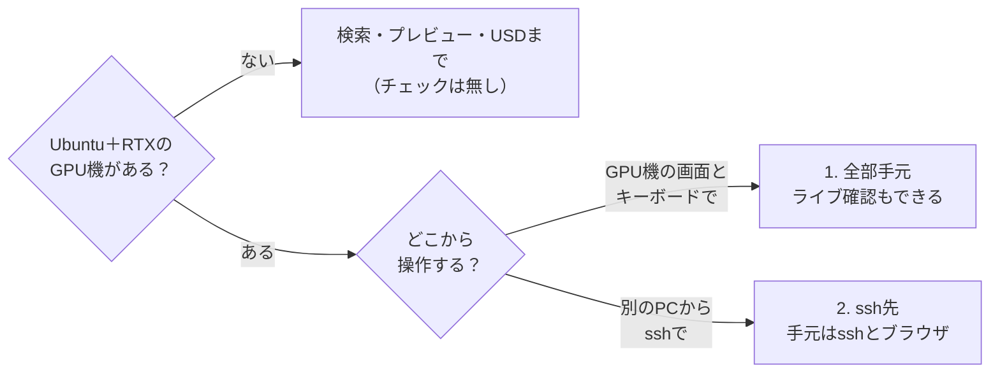
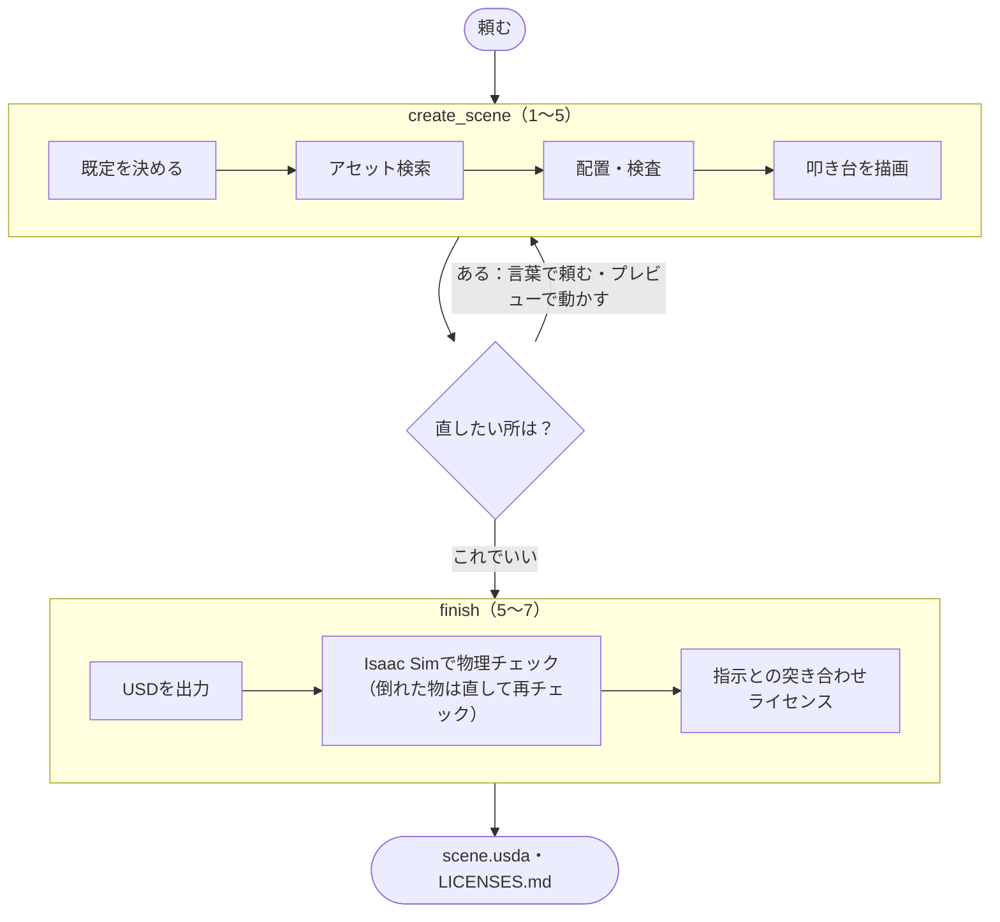
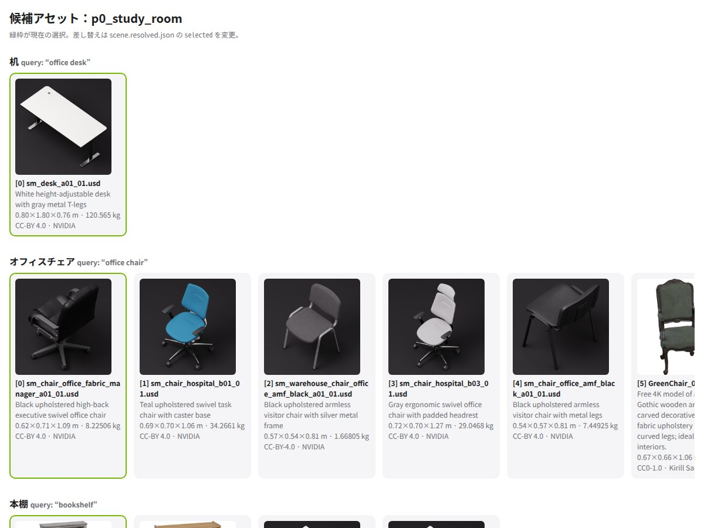
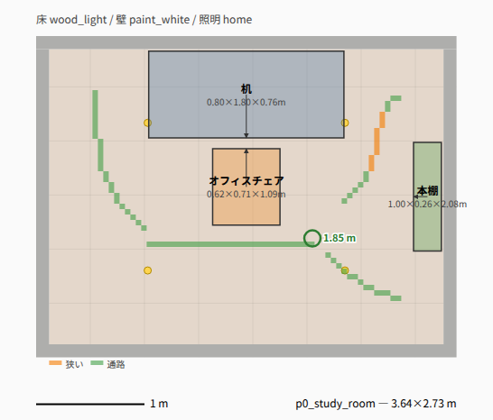
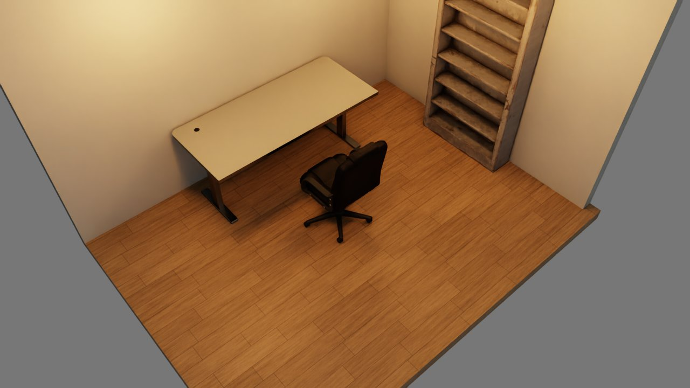
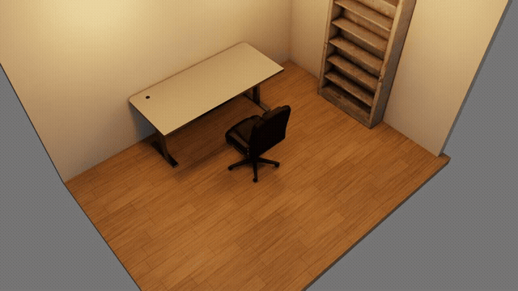
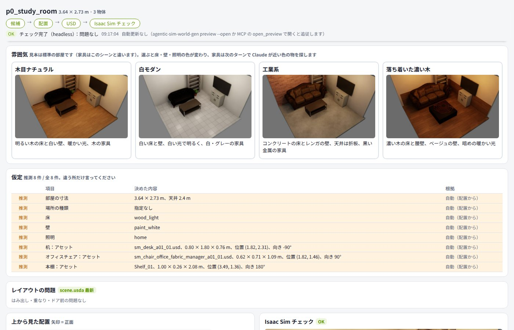
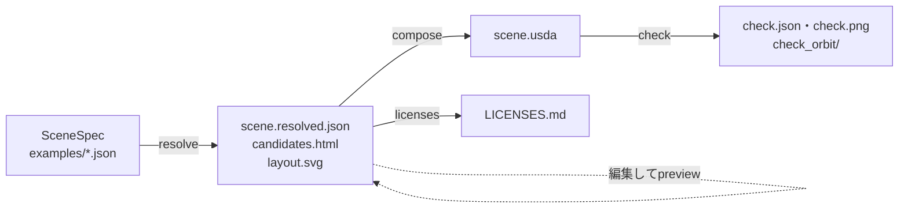

# Getting Started

cloneしてからIsaac Simで最初のワールドを開くまで（目安15分。Isaac Simのインストールは除く）。

## 0. どこで動かすか

Isaac Sim・Claude Code・agentic-sim-world-genは、どちらの形でもGPU機（Ubuntu＋RTX）に入れる。違うのは、GPU機の画面とキーボードで直接操作するか、別のPCからsshで使うか。



| 形 | GPU機 | 手元で見るもの | ライブモード | 手順 |
|---|---|---|---|---|
| 1. 全部手元 | 手元のUbuntu＋RTX（画面あり） | Isaac Simの画面・プレビュー・ターミナル | 使える | [use-local.md](use-local.md) |
| 2. ssh先 | LANのUbuntu＋RTXなど（画面は無くてよい） | sshのターミナルと、ブラウザのプレビュー（`ssh -L`） | 使えない（headless） | [use-ssh.md](use-ssh.md) |

下の節は2つに共通の内容（インストール・環境変数・流れ・出力）。

## 1. 必要なもの

| | 用途 |
|---|---|
| Ubuntu＋RTX GPU、Isaac Sim 6.1（pip版で確認済み。スタンドアロンの`python.sh`は未確認） | 物理チェック・スクショ・写真比較・合成データ |
| Python 3.12以上、[uv](https://docs.astral.sh/uv/) | agentic-sim-world-gen本体（検索・プレビュー・USD出力） |
| [Claude Code](https://claude.com/claude-code) | 日本語の指示からシーンを作る（MCPサーバー＋スキル） |
| ffmpeg（任意。Ubuntu `apt install ffmpeg`、Mac `brew install ffmpeg`） | 動画からコマを抜く（`extract_frames`） |

GPUの無いMac / PCでも、検索・プレビュー・USD出力まではできる（Isaac Simを使う操作だけ「Isaac Sim not found」になる）。

## 2. インストール

```bash
git clone https://github.com/atinfinity/agentic-sim-world-gen.git
cd agentic-sim-world-gen
uv sync --extra usd --extra hf --extra mcp --extra dev   # 間取り図も使うなら --extra dxf --extra ifc も
source .venv/bin/activate
```

`uv sync`は`uv.lock`の版で`.venv`を作り、このリポジトリを編集可能な形で入れる（Pythonは`requires-python`の3.12以上からuvが選ぶ）。
あとでextraを足すときは、使う`--extra`を全部付けて`uv sync`し直す（付けなかったextraは`.venv`から外れる）。

**usd-coreは`.venv`にだけ入れる。** Isaac SimのPython（`python.sh`やpip版のvenv）には何もpip installしない
（Isaac Simは自前のpxrを持っていて、混ざると壊れる）。

## 3. 環境変数

| 変数 | 既定 | 内容 |
|---|---|---|
| `ISAACSIM_PATH` | `~/isaacsim` | スタンドアロン版（未確認）Isaac Simのフォルダ（`python.sh`がある所） |
| `ISAACSIM_PYTHON` | なし | pip版Isaac Simのvenvのpython（設定すると`ISAACSIM_PATH`より優先） |
| `OMNI_KIT_ACCEPT_EULA` | なし | `YES`でNVIDIA Omniverse EULAに同意（非対話でIsaac Simを動かすのに必要） |
| `AGENTIC_SIM_WORLD_GEN_OUT` | `~/agentic_sim_world_gen_scenes` | MCP（Claude Code）で作ったシーンの保存先 |
| `AGENTIC_SIM_WORLD_GEN_EXAMPLES` | リポジトリの`examples/` | 作例ギャラリー（`show_gallery`）に並べるSceneSpecのフォルダ |
| `AGENTIC_SIM_WORLD_GEN_SOURCES` | `simready-central,isaac,polyhaven` | アセットの検索元。`+local:/data/usd`で既定に手持ちのフォルダを足す（`+`なしで並べると既定を置き換える。`default`は既定の3つ）。`polyhaven`（Poly HavenのCC0モデル）は使うときだけ取得する |
| `AGENTIC_SIM_WORLD_GEN_POLYHAVEN_INDEX` | 同梱の索引 | Poly Havenのモデル索引（`scripts/build_polyhaven_models_index.py`で作り直し）の差し替え |
| `AGENTIC_SIM_WORLD_GEN_MDL` | `1` | `0`で床・壁・天井の材質にIsaac Sim同梱のMDLを使わない（CC0のPBRか色だけ）。同梱アセットを写さない絵を作る時に`AGENTIC_SIM_WORLD_GEN_SOURCES`から`isaac`を外すのと一緒に使う |
| `ISAAC_ASSETS_ROOT` | 公開S3 | Isaac Sim同梱アセットをローカル / Nucleusに置いているならそのルート（`Isaac/`の親） |
| `AGENTIC_SIM_WORLD_GEN_ISAAC_LIVE` | `127.0.0.1:8226` | ライブcheckの接続先（[use-local.md「ライブモード」](use-local.md#ライブモードこの形だけ)） |
| `AGENTIC_SIM_WORLD_GEN_PREVIEW` | `127.0.0.1:8765` | プレビューのHTTPサーバー。使用中なら、そのフォルダで前に使った番号か次の空き番号（フォルダごとに`~/.cache/agentic-sim-world-gen/preview_ports.json`に覚える） |
| `AGENTIC_SIM_WORLD_GEN_BROWSER` | `xdg-open` / `open` | プレビューを開くコマンド（例`chromium --app={url}`）。画面の無いシェルでは開かず、URLを返す |

例（pip版）：

```bash
export ISAACSIM_PYTHON=~/isaacsim_venv/bin/python
export OMNI_KIT_ACCEPT_EULA=YES
```

## 4. Claude Codeで最初のワールド

作業用のフォルダを作って、そこでClaude Codeを起動する：

```bash
agentic-sim-world-gen workspace ~/agentic-sim-world-gen-ws     # .mcp.json・スキル world-gen（リポジトリへのリンク）・短い CLAUDE.md・圧縮の後も返答の言語を保つフック
cd ~/agentic-sim-world-gen-ws && claude
```

作業フォルダは**リポジトリの外**に作る（中に作るとエラー）。リポジトリの中で`claude`を起動しても動くが、
開発メモ（CLAUDE.md）を毎ターン読むので料金が高く、会話の圧縮も早く来る。シーンは`~/agentic-sim-world-gen-ws/scenes`にできる。

`workspace`のオプション：

| オプション | 内容 |
|---|---|
| `--out <dir>` | シーンの保存先（`AGENTIC_SIM_WORLD_GEN_OUT`でも可） |
| `--env 名前=値` | MCPサーバーの環境変数（例`--env AGENTIC_SIM_WORLD_GEN_SOURCES=simready-central,isaac,local:/path`）。Claude Codeの環境変数も引き継ぐ |
| `--allow-tools` | agentic-sim-world-genのツールを使うたびの許可を省く |
| `--model sonnet` | このフォルダのClaude Codeのモデル（安いモデルで作る時。出来の比較はまだしていない） |
| `--copy-skill` | スキルをリンクでなく写しにする（リンクなら`git pull`で更新される） |
| `--force` | 作り直す |

初回に`.mcp.json`の`agentic-sim-world-gen` MCPサーバーを承認する（スキルworld-genは自動で読み込まれる）。あとは頼むだけ：

> 6畳の書斎を作って。机と椅子、壁際に本棚

Claudeは次の順に進める（質問が来たら答える。2–3分、API料金は1回 $1前後）。
大きく分けると、`create_scene`で叩き台を作って見せ、あなたが「これでいい」と言ったら`finish`で仕上げる：




1. 指示に無いこと（広さ・床・照明など）は既定で決め、先には聞かない（`plan_questions`）
2. 部屋と家具をSceneSpecにし、英語のクエリ＋類義語でアセットを検索（`create_scene`）。プレビューもここでブラウザに開く
3. 候補のサムネイルを見て選ぶ（`view_candidates`）。合うものが無ければ近いもので代用し、そう報告する
4. 関係で配置（壁際・机の前など）。重なり・はみ出しを検査
5. USDを出力（`compose_scene`）し、物理なしで描画した叩き台を見せて、違う所を聞く（`check_in_isaac`の`draft`）。
   「最後まで進めて」と頼めば止まらない
6. Isaac Simで物理チェック＋スクショ（`check_in_isaac`）。倒れた・沈んだ物があれば直して再チェック
7. 指示の項目ごとに満たしたかを確かめ（`check_request`）、使ったアセットのライセンスをまとめる（`license_report` → LICENSES.md）。
   5の叩き台までは`create_scene`が、5〜7は`finish`が1回でまとめて進める

シーンは`$AGENTIC_SIM_WORLD_GEN_OUT/<名前>/`にできる。途中のプレビューはブラウザで開ける：

| candidates.html（候補一覧、緑枠が選択中） | layout.svg（上から見た配置。矢印が正面） |
|---|---|
|  |  |

checkのスクショ（check.png）：



checkは物理が落ち着いたあとの部屋を周りから24方向で撮る（check_orbit/、約6秒増える。`orbit=0` / `--orbit 0`で撮らない）。
プレビューのページでは、この画像をドラッグ（← → キー）で回せる：



preview.html（`agentic-sim-world-gen preview --open` / MCP `open_preview`）は変更のたびにその場で書き換わる（再読み込みしないので、ちらつかない）。
アセット候補は1物体1行（選択中のサムネイル・アセット名・ライセンスのバッジ・代用や配置の問題のバッジ）で、
今作業中の物だけ開く。「要確認のみ」で代用・ライセンス不明・非商用・配置の問題のある物だけに絞れる。
「変更履歴」はこのシーンで行った操作の一覧（新しい順、最大200件。元に戻す機能は無い）。
操作ごとに何がどう変わったか（アセット、位置・向き、部屋の寸法、床・壁・照明、配置の問題の数）が日本語で付き、
直前の操作の変更内容はページ上部にも出る。関係で決まる物（机の前の椅子など）が連動して動いた分も載る。
checkの結果は「OK」（緑）/「要修正」（赤）のバッジで出る。



（Claude Codeに「6畳の書斎を作って。机と椅子、壁際に本棚を置いて」と頼み、Isaac Simのチェックまで終えたところ。ページ上部の「指示との突き合わせ」「雰囲気」「仮定」は省いている）

続けて「本棚を窓の反対側に」「椅子を黒いものに替えて」のように直していける。

できたワールドをIsaac Simで開く方法と、開いているIsaac Simの画面でcheckする「ライブモード」は[use-local.md](use-local.md#4-最初のワールド)。
ssh先でのプレビューの開き方（`ssh -L`）は[use-ssh.md](use-ssh.md#3-最初のワールド)。

## 5. CLIで同じことをする

Claude Codeを使わず、SceneSpec（JSON）を自分で書いても同じ処理を呼べる。コマンドと、できるファイル：



```bash
agentic-sim-world-gen search "office chair" --limit 5                 # 検索だけ
agentic-sim-world-gen resolve examples/p0_study_room.json -o out/study
#   out/study/scene.resolved.json  候補付きのシーン（selected・position を編集できる）
#   out/study/candidates.html      候補一覧
#   out/study/layout.svg           配置図
agentic-sim-world-gen preview out/study/scene.resolved.json            # 編集後にプレビューを作り直す
agentic-sim-world-gen preview out/study --open                         # preview.html をブラウザで開き、変更のたびに自動更新
agentic-sim-world-gen compose out/study/scene.resolved.json            # -> out/study/scene.usda
agentic-sim-world-gen check out/study                                  # Isaac Sim headless で物理＋スクショ（約 35 秒）
agentic-sim-world-gen licenses out/study                               # -> out/study/LICENSES.md
```

シーンのファイルの例は`examples/`。その形式と、Isaac Simのチェックのスクリプトを直接呼ぶ方法は
[開発に参加する](contributing.md#2-どこに何があるか)。

## 6. 他の入力

| 入力 | 例 | 詳しく |
|---|---|---|
| 間取り図（JSON / DXF / IFC） | `agentic-sim-world-gen plan examples/plans/1ldk.json -o out/1ldk_plan` → plan.jsonを`room.plan_file`に。Claudeには「examples/plans/1ldk.jsonの間取りで、LDKにソファ、和室に座卓」（和室は畳、洗面はタイルの床になる） | [データの形](architecture.md#2-データの形) |
| 間取り図（画像 / PDF） | Claudeに画像を渡すと、なぞってJSONにする（単位px＋下敷き画像） | スキルのplans.md |
| 写真 | 「examples/photos/living_room.jpgの部屋を作って」。出典は隣の`<stem>.source.json`。`agentic-sim-world-gen photo <scene>`で同じ視点の描画と並べる | スキルのphotos.md |
| 写真・動画の深度 | 下の「単眼の深度」のvenvを作り、`agentic-sim-world-gen fit-photos req.json --depth`（写真に`image`）。部屋の寸法が決まりやすくなる | 下の「単眼の深度」 |
| 動画 | 「walk.mp4の部屋を作って」（部屋を歩いて撮った動画、人が写っていないもの）。出典は隣の`walk.source.json`。`agentic-sim-world-gen frames walk.mp4 -o <scene>`でコマを選んで入力写真にする（ffmpegが必要） | スキルのvideos.md |
| 繰り返し配置 | `agentic-sim-world-gen resolve examples/warehouse_racks.json -o out/racks`（ラック列＋通路） | READMEのset_array |
| 屋外 | `agentic-sim-world-gen resolve examples/outdoor_yard.json -o out/yard`（道路・歩道・建物・空） | [データの形](architecture.md#2-データの形) |
| 足りなかったアセットを多い順に見る | `agentic-sim-world-gen missing`（この機械で作った全シーンの代用・候補なし・見送った小物） | [アセット検索](architecture.md#3-アセット検索) |
| 手持ちのUSDフォルダ | `AGENTIC_SIM_WORLD_GEN_SOURCES=+local:/data/usd`、中身の確認は`agentic-sim-world-gen index /data/usd --list` | README |
| 床・壁・照明 | `room.floor: "wood_light"`、`room.lighting: "office"`など（「床はフローリング、照明は夜」でも可） | [USDの合成](architecture.md#6-usdの合成) |
| 合成データ | `agentic-sim-world-gen sdg out/study --frames 24 --coco` → RGB・bbox・セグメンテーション・深度 | [Isaac Sim側](architecture.md#7-isaac-sim側) |

### 単眼の深度（任意）

`fit_photos(depth=true)`は写真ごとの深度をMoGe-2（MIT、141 MB）で求める。MoGeは依存が重いのでagentic-sim-world-genとは別のvenvに入れる：

```bash
python -m venv ~/.venvs/moge && ~/.venvs/moge/bin/pip install torch torchvision pillow numpy scipy \
    opencv-python-headless huggingface-hub click
~/.venvs/moge/bin/pip install --no-deps "git+https://github.com/microsoft/MoGe.git@74fbce054ebed49800de42d0ad0e83495065719a" \
    "git+https://github.com/EasternJournalist/utils3d-moge.git@62f09d58509485564e24d5d9f6aac9ee9ebc0c37" \
    "git+https://github.com/EasternJournalist/pipeline.git@1c511390d90226c00c101f34b84df26a0f8789b4"
export AGENTIC_SIM_WORLD_GEN_DEPTH_PYTHON=~/.venvs/moge/bin/python
AGENTIC_SIM_WORLD_GEN_DEPTH_DOWNLOAD=1 agentic-sim-world-gen fit-photos req.json --depth   # 初回だけモデルを取得
```

同じ手順が`scripts/depth/moge_depth.py`の先頭にある。深度は各写真の隣の`<stem>.depth.npz`に残り、2回目からはモデルを回さない。
`AGENTIC_SIM_WORLD_GEN_DEPTH_MODEL`で別のMoGe-2のモデルにできる。

## 7. 出力

```
<scene>/
  scene.resolved.json   シーンの本体（SceneSpec＋候補＋選択＋計算した位置）。これを編集・再利用する
  candidates.html       候補アセット一覧
  layout.svg            上面の配置図
  scene.usda            Isaac Sim 用ワールド（アセットは URL 参照。--localize でローカルにコピー）
  check.json / .png     物理チェックの報告とスクショ（.gif は gif=true のとき）
  check_orbit/NN.jpg    周りから撮った画像（プレビューでドラッグして回す）
  LICENSES.md           使ったアセット・入力写真・空（HDRI）、アセットのテクスチャに使った写真・書体のライセンスと帰属表示
  plan.json / plan.svg  間取り図を読み込んだとき
  sdg/                  合成データ
```

check.jsonの主な項目：`unstable`（動いた・倒れた）、`sunk`（床に沈んだ）、`no_collider`（当たり判定が無い）、
`static`（動かない固定物。家具なら問題ない）、物ごとの`max_displacement_m`・`moved_body`。
`no_collider`の物は`set_collider`（`box`）でアセットと同じ大きさの見えない箱の当たり判定を付けられる（動かない固定物になる）。
物理が無いと分かっているSimReadyのアセット（Vertivのラックなど）には最初から付く。
Claude（MCP）や`agentic-sim-world-gen check`に返すのは要約で、物体IDごとの数と最大移動、問題のある物体の詳細だけ（物が多くても数千字）。

## 8. ライセンス

USDの各アセットのcustomData `agentic_sim_world_gen:license`とLICENSES.mdに、出典・作者・ライセンスが記録される。
SimReady Central / SimReady（Isaac Sim同梱）は主にCC BY 4.0（帰属表示が必要）。Isaac Sim同梱のProps・Environments・空は
`NVIDIA-Isaac-Sim`（Isaac Simのライセンスに従う。再配布に注意）。

アセットのフォルダの`asset.json`に`image_credits`（テクスチャに使った写真や書体）があれば、LICENSES.mdの
「Material used in the assets」に1件ずつ、使っている物の名前と並べて出る（例: Noto Sans JP、SIL Open Font License 1.1）。

入手先と版も、アセットごとに一つに決まる形で残る（LICENSES.mdの「Sources」、プレビューの「ライセンスと入手先」、
USDのcustomData `agentic_sim_world_gen:origin`）。

- SimReady Central：Hugging Faceのコミット（URLに入っている）とデータセット内のパス
- Isaac Sim同梱：リリース（例6.1）とパス。リリース内で差し替わる可能性があるので「リリース単位」と表示
- 手持ちのフォルダ（`local:`）：アセット自身の版（`asset.json`の`version`、無ければUSDの`assetInfo.version`。
  例v1.3.0）、gitのリモート、そのアセットのフォルダを最後に変えたコミット、ファイルのSHA-256。
  フォルダに未コミットの変更があると「未コミットの変更」と警告する（同じものを取り直せない）。gitの外なら版とSHA-256だけ

共有する前にLICENSES.mdの「Warnings」（非商用、継承条件、不明）を確認し、帰属表示を添える。
不明なものは元のフォルダのライセンスを確認するか、別のアセットに替える。

## 9. トラブルシューティング

| 症状 | 対処 |
|---|---|
| `Isaac Sim not found` | `ISAACSIM_PATH`（python.shのあるフォルダ）か`ISAACSIM_PYTHON`（pip版のpython）を設定 |
| `Isaac Sim EULA not accepted`／止まったまま | `export OMNI_KIT_ACCEPT_EULA=YES` |
| 初回のcheckがとても遅い | アセットのダウンロードとシェーダーのコンパイル。初回は数分、2回目以降は約35秒 |
| 検索が失敗する・遅い（SimReady Central） | Hugging Face側の制限や一時的な不調。少し待って再実行。オフラインでも`AGENTIC_SIM_WORLD_GEN_SOURCES=isaac`なら同梱の索引で検索できる |
| スクショが真っ黒・暗い | 照明プリセット（`room.lighting`）を変えるか`lighting_scale`を上げる。屋外の空はHDRI。GPU / ドライバーがRTX描画に対応しているか確認 |
| マテリアルが赤い | MDLの読み込み失敗（HFからの読み込みが時々失敗する）。`compose --localize`で回避 |
| 物が後ろを向いている | アセットの正面の規約違い。`view_fronts`（CLI `agentic-sim-world-gen fronts <scene>`）で確認し、`front_offset_deg`で直す。手持ちのフォルダならagentic-sim-world-gen.jsonの`front` |
| 物が飛ぶ・倒れる（unstable） | 重なり（`issues`を確認）、細長い・頭が重い形、小さい物の上に置いた等。位置をずらすか`gap`を足すか別のアセットに |
| ライブcheckがheadlessで動いた | 報告の`live_fallback`に理由。Isaac Simを`--enable isaacsim.code_editor.python_server`で起動しているか、物が重なっていないか |
| checkで「physics did not run」 | 物どうしが接したりめり込んだりして吹き飛び、GPU物理が止まった（CUDA error）。同じシーンは何度やっても同じ。`blew_up`の物を数cm離す（キャスター付きの椅子を隙間なしで並べた等）。ライブならIsaac Simも再起動する |

## 次に読むもの

使う：

- [use-local.md](use-local.md)・[use-ssh.md](use-ssh.md)：全部手元／ssh先での手順
- [tools.md](https://github.com/atinfinity/agentic-sim-world-gen/blob/main/.claude/skills/world-gen/tools.md)：全MCPツールと引数
- [.claude/skills/world-gen/SKILL.md](https://github.com/atinfinity/agentic-sim-world-gen/blob/main/.claude/skills/world-gen/SKILL.md)：Claudeの対話手順・家具の標準サイズ・和英クエリ例

コードを変える：

- [architecture.md](architecture.md)：仕組みを図で
- [contributing.md](contributing.md)：セットアップ・テスト・どこに何があるか・プルリクエスト
- [CLAUDE.md](https://github.com/atinfinity/agentic-sim-world-gen/blob/main/CLAUDE.md)：規約（座標系、USDの構造）
