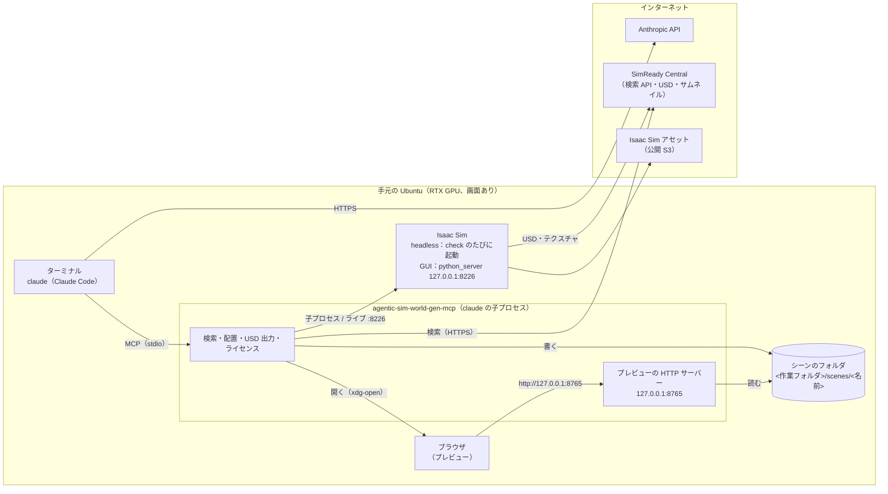

# 全部手元で使う（Ubuntu＋RTX の 1 台）

Isaac Sim・Claude Code・プレビューを、画面のある手元の Ubuntu（RTX GPU）1 台で動かす手順。
Isaac Sim の 3D 画面・プレビュー・ターミナルを同じ画面で見られる。check を開いている Isaac Sim の画面で行う「ライブモード」も、この形でだけ使える。

GPU 機が別の場所にあり、手元（Mac 等）からは ssh で入る場合は [ssh 先で使う](use-ssh.md)。



ポートは 2 つで、どちらも 127.0.0.1（外には開かない）。

| ポート | 何 | 変える変数 |
|---|---|---|
| 8765 | プレビューの HTTP サーバー（agentic-sim-world-gen-mcp の中で動く） | `AGENTIC_SIM_WORLD_GEN_PREVIEW` |
| 8226 | ライブモードで、開いている Isaac Sim に check を送る先（python_server） | `AGENTIC_SIM_WORLD_GEN_ISAAC_LIVE` |

## 1. 必要なもの

| | 用途 |
|---|---|
| Ubuntu＋RTX GPU とドライバー、デスクトップ（X / Wayland） | Isaac Sim の描画、ブラウザ |
| Isaac Sim 6.1（pip 版かスタンドアロン版） | 物理チェック・スクショ・写真比較・合成データ |
| Python 3.10 以上と [uv](https://docs.astral.sh/uv/) | agentic-sim-world-gen 本体 |
| [Claude Code](https://claude.com/claude-code)（ログイン済み） | 日本語の指示からシーンを作る |
| ffmpeg（任意、`sudo apt install ffmpeg`） | 動画からコマを抜く |

## 2. インストール

1. Isaac Sim 6.1 を入れる。pip 版なら専用の venv に `pip install "isaacsim[all,extscache]==6.1.0.0"`（NVIDIA の手順に従う）。
   スタンドアロン版なら `~/isaacsim` に展開する。
2. agentic-sim-world-gen を入れる（[Getting Started「2. インストール」](getting-started.md#2-インストール)と同じ）：

   ```bash
   git clone https://github.com/atinfinity/agentic-sim-world-gen.git
   cd agentic-sim-world-gen
   uv venv --python 3.11 .venv
   uv pip install -e ".[usd,hf,mcp,dev]"
   ```

   **Isaac Sim の Python には何も pip install しない**（Isaac Sim は自前の pxr を持っていて、usd-core が混ざると壊れる）。
3. 環境変数を `~/.bashrc` などに書く：

   ```bash
   export ISAACSIM_PYTHON=~/isaacsim_venv/bin/python   # pip 版の venv の python。スタンドアロン版なら ISAACSIM_PATH=~/isaacsim
   export OMNI_KIT_ACCEPT_EULA=YES                       # 非対話で Isaac Sim を動かすのに必要（NVIDIA Omniverse EULA に同意）
   ```

   この形で要るのはこの 2 つだけ。アセットの検索元を変えるなら `AGENTIC_SIM_WORLD_GEN_SOURCES`（[Getting Started「3. 環境変数」](getting-started.md#3-環境変数)）。

4. 確かめる：`out/study/check.png` ができれば Isaac Sim が動いている（初回はアセットの取得とシェーダーのコンパイルで数分）。

   ```bash
   source .venv/bin/activate
   agentic-sim-world-gen resolve examples/p0_study_room.json -o out/study
   agentic-sim-world-gen compose out/study/scene.resolved.json
   agentic-sim-world-gen check out/study
   ```

## 3. 作業フォルダを作る

ワールドを作るときは、リポジトリの外の作業フォルダで Claude Code を起動する（リポジトリの中だと開発用の CLAUDE.md を毎ターン読むので、料金が高く圧縮も早い）。

```bash
agentic-sim-world-gen workspace ~/agentic-sim-world-gen-ws     # .mcp.json・スキル world-gen（リポジトリへのリンク）・短い CLAUDE.md
cd ~/agentic-sim-world-gen-ws && claude
```

初回に `.mcp.json` の `agentic-sim-world-gen` MCP サーバーを承認する。シーンは `~/agentic-sim-world-gen-ws/scenes/<名前>/` にできる。
オプション（`--env`・`--allow-tools` など）は [Getting Started「4.」](getting-started.md#4-claude-code-で最初のワールド)。

## 4. 最初のワールド

1. Claude に頼む：

   > 6畳の書斎を作って。机と椅子、壁際に本棚

2. **プレビュー**：候補が出たところで、Claude がブラウザでプレビュー（`http://127.0.0.1:8765/<名前>/preview.html`）を開く。
   開かないときは Claude に「プレビューを開いて」と頼むか、返答の URL を開く。ページはツールを呼ぶたびに自動で書き換わる。
   別のブラウザで開きたいときは `AGENTIC_SIM_WORLD_GEN_BROWSER="chromium --app={url}"` のように指定する。
3. **check**：Claude が USD を出して（`compose_scene`）、Isaac Sim で物理チェックとスクショを撮る（`check_in_isaac`、headless で約 35 秒）。
   結果はプレビューの「Isaac Sim チェック」に出る（周りから撮った 24 枚をドラッグで回せる）。
4. **結果を開く**：Isaac Sim で `scene.usda` を開く。

   ```bash
   isaacsim isaacsim.exp.full.kit          # pip 版。スタンドアロン版は ~/isaacsim/isaac-sim.sh
   ```

   File → Open で `~/agentic-sim-world-gen-ws/scenes/<名前>/scene.usda`。Play で物理が動く（Z-up、メートル単位、物は `/World/Objects/<id>`）。

### ライブモード（この形だけ）

Isaac Sim を python_server 付きで起動しておくと、check がその画面で行われ、問題の物が選択状態になる。再チェックは約 8 秒（headless は毎回約 34 秒）。

```bash
isaacsim isaacsim.exp.full.kit --enable isaacsim.code_editor.python_server   # 127.0.0.1:8226 で待ち受け
```

Claude には「開いている Isaac Sim でチェックして」と頼む（MCP `check_in_isaac(live=true)`、CLI `agentic-sim-world-gen check <scene> --live`）。
起動していないとき、物が重なっているとき（GUI の GPU 物理が壊れることがある）は headless で実行される（報告の `live_fallback`）。
python_server は任意のコードを実行するので、127.0.0.1 のまま使う。

## 5. 入力と結果

- 写真・動画・図面は、手元のパスをそのまま渡す（「~/photos/living.jpg の部屋を作って」）。出典は隣の `<stem>.source.json`（[Getting Started「6. 他の入力」](getting-started.md#6-他の入力)）。
- できたシーンはそのまま手元の Isaac Sim で開ける。別の PC に渡すときは、アセットも同梱した USD にしてからフォルダごと渡す：
  「USD をローカル参照で出し直して」（MCP `compose_scene(localize=true)`、CLI `agentic-sim-world-gen compose <scene>/scene.resolved.json --localize`）。

## 6. トラブルシューティング

| 症状 | 対処 |
|---|---|
| プレビューが開かない | 返答の URL を手で開く。`DISPLAY` の無いシェル（ssh で入った端末など）から `claude` を起動すると開けない |
| プレビューの URL のポートが 8765 でない | 8765 が使用中（別の Claude のセッションなど）なら、このフォルダで前に使った番号か、次の空き番号で起動する。`AGENTIC_SIM_WORLD_GEN_PREVIEW=127.0.0.1:8770` で固定できる |
| プレビューが更新されない | Claude Code を終えるとプレビューのサーバーも止まる。起動し直して「プレビューを開いて」 |
| ライブ check が headless で動いた | `live_fallback` の理由を見る。Isaac Sim を `--enable isaacsim.code_editor.python_server` で起動したか、物が重なっていないか |
| check で「physics did not run」 | 物どうしが接したりめり込んだりして吹き飛び、GPU 物理が止まった（CUDA error）。同じシーンは何度やっても同じ。`blew_up` の物を数 cm 離す（キャスター付きの椅子を隙間なしで並べた等）。ライブなら Isaac Sim も再起動する |
| ほかの症状 | [Getting Started「9. トラブルシューティング」](getting-started.md#9-トラブルシューティング) |
