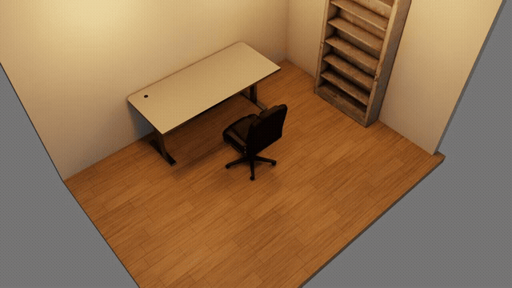

# ssh先で使う（GPU機はLANのUbuntu、手元はMacなど）

Isaac Sim・Claude Code・agentic-sim-world-genは、ssh先のGPU機（LANのUbuntu＋RTXなど）で動かす。
手元のPC（Macなど。GPUは要らない）では、sshのターミナルでClaudeに頼み、ブラウザでプレビューを見るだけ。手元には何もインストールしない（sshとブラウザだけ）。

GPU機の前に座って使うなら[全部手元で使う](use-local.md)。
2つの形の違いは[Getting Started「0. どこで動かすか」](getting-started.md#0-どこで動かすか)の表。


| つながり | ポート | 中身 |
|---|---|---|
| 手元のターミナル → GPU機 | 22（ssh） | tmuxの中のclaudeに日本語で頼む |
| 手元のブラウザ → GPU機のプレビュー | 8765を`ssh -L`で転送 | preview.html・配置図・checkの画像。GPU機の127.0.0.1でだけ待ち受け、LANには公開しない |
| 手元のブラウザ → Hugging Face / S3 | 443 | 候補のサムネイル（URLのものはブラウザが直接取る） |

GPU機に入ってくる通信はsshだけでよい。

## 1. 必要なもの

| 場所 | 要るもの |
|---|---|
| GPU機 | Ubuntu＋RTX GPUとドライバー、Isaac Sim 6.1（pip版かスタンドアロン版）、Python 3.12以上とuv、Claude Code（ログイン済み）、tmux。画面は無くてよい |
| 手元 | sshクライアントとブラウザ |

## 2. GPU機の準備

以下の`<gpu-host>`は、手元からGPU機にsshするときのホスト名（`user@192.168.0.10`や`~/.ssh/config`の`Host`名）に読み替える。

1. Isaac Sim 6.1とagentic-sim-world-genを入れる（[全部手元で使う「2. インストール」](use-local.md#2-インストール)の1・2と同じ）。
2. 環境変数を`~/.profile`か、`~/.bashrc`の**冒頭**（`case $- in`で対話シェル以外を抜ける行より前）に書く。
   末尾に書くと、`ssh <gpu-host> 'コマンド'`のような対話でないシェルには効かない。

   ```bash
   export ISAACSIM_PYTHON=~/isaacsim_venv/bin/python   # pip版のvenvのpython。スタンドアロン版を ~/isaacsim以外に置いたならISAACSIM_PATH=<その場所>
   export OMNI_KIT_ACCEPT_EULA=YES
   ```

3. 作業フォルダを作る（リポジトリの外に）：

   ```bash
   cd agentic-sim-world-gen && .venv/bin/agentic-sim-world-gen workspace ~/agentic-sim-world-gen-ws
   ```

4. 手元からssh越しに確かめる。`out/study/check.png`ができれば、headlessの描画と、対話でないシェルの環境変数の両方が効いている。

   ```bash
   ssh <gpu-host> 'cd agentic-sim-world-gen && .venv/bin/agentic-sim-world-gen resolve examples/p0_study_room.json -o out/study \
     && .venv/bin/agentic-sim-world-gen compose out/study/scene.resolved.json && .venv/bin/agentic-sim-world-gen check out/study'
   ```

## 3. 最初のワールド

1. 手元から、プレビューのポートを転送してGPU機に入り、tmuxの中でClaude Codeを起動する：

   ```bash
   ssh -L 8765:127.0.0.1:8765 <gpu-host>
   tmux new -s agentic-sim-world-gen          # 回線が切れても Claude の作業が止まらないように
   cd ~/agentic-sim-world-gen-ws && claude
   ```

   初回に`.mcp.json`の`agentic-sim-world-gen` MCPサーバーを承認する。
2. 頼む：

   > 6畳の書斎を作って。机と椅子、壁際に本棚

3. **プレビュー**：GPU機ではブラウザを開けないので、Claudeの返答にURL（`http://127.0.0.1:8765/<名前>/preview.html`）と`ssh -L`の手順が出る。
   そのURLを手元のブラウザで開く。ページは1秒ごとに更新を確かめ、ツールが呼ばれるたびに書き換わる。
   URLのポートが8765でなければ（下の「5. 注意」）、その番号で`ssh -L`し直す（別のターミナルで`ssh -N -L 8766:127.0.0.1:8766 <gpu-host>`を足してもよい）。
4. **check**：Isaac SimはGPU機でheadlessで動く（1回35〜50秒）。結果はプレビューの「Isaac Simチェック」に出る。
   物理が落ち着いたあとに周りから撮った24枚を、ドラッグか ← → キーで回して見られる。これが3D画面の代わりになる。

   

5. **結果を開く**：GPU機の画面でIsaac Simを開くか、シーンを手元に持ってくる（次の節）。

## 4. 入力を渡す・結果を持ってくる

写真から部屋を作るとき、Claudeは写真を切り出して画素の位置を読む。手元のパスは読めないので、写真・動画・図面はGPU機に置いてから、そのパスをClaudeに渡す。

```bash
# 写真・動画・図面を GPU 機へ（Claude にはそのパスを渡す）
scp -r ~/photos/living <gpu-host>:~/agentic_sim_world_gen_inputs/living
# できたシーンを手元へ。手元の Isaac Sim で開くなら、アセットも同梱して出し直してから
ssh <gpu-host> 'cd agentic-sim-world-gen && .venv/bin/agentic-sim-world-gen compose ~/agentic-sim-world-gen-ws/scenes/study/scene.resolved.json --localize'
rsync -av <gpu-host>:~/agentic-sim-world-gen-ws/scenes/study ./
```

出し直しは、Claudeに「USDをローカル参照で出し直して」と頼んでもよい（MCP `compose_scene(localize=true)`）。
`--localize`なしのscene.usdaはアセットをURLで参照するので、ネットにつながればどこでも開ける。

## 5. できないこと・注意

- **ライブモード**（開いているIsaac Simの画面でcheckする）は使わない。GPU機の画面の前にいないと見えないので、headlessのcheckと、プレビューで回して見る画像で確かめる。
  頼んでもheadlessに切り替えて続ける（報告の`live_fallback`）。GPU機の前でも作業するなら[全部手元で使う](use-local.md)の形にする。
- sshが切れるとプレビューも見えなくなるが、tmuxの中のClaudeは動き続ける。`ssh -L …`でつなぎ直して`tmux attach -t agentic-sim-world-gen`。
- プレビューのサーバーはClaude Codeのセッションの中で動く。`claude`を終えると止まるので、起動し直したら「プレビューを開いて」と頼む。
- プレビューのポートは既定で8765。使用中（別の作業フォルダのClaudeなど）なら、そのフォルダが前回使った番号（`~/.cache/agentic-sim-world-gen/preview_ports.json`に記録）、
  それも使用中なら次の空き番号になる。作業フォルダが1つなら毎回8765なので、`ssh -L`はいつも同じでよい。
  作業フォルダを複数同時に使うなら、それぞれの番号で`ssh -L`する。フォルダごとに番号を決めておくには、
  `agentic-sim-world-gen workspace … --env AGENTIC_SIM_WORLD_GEN_PREVIEW=127.0.0.1:8766`のように`.mcp.json`に書く。

## 6. トラブルシューティング

| 症状 | 対処 |
|---|---|
| ブラウザで「接続できない」 | `ssh -L`のポートが返答のURLと同じか。sshが切れていないか。`claude`が起動中か |
| プレビューが更新されない | ページ上部の更新が止まっていれば、sshかclaudeが止まっている。つなぎ直して「プレビューを開いて」 |
| `Address already in use`（`ssh -L`のとき） | 手元でそのポートが使用中（別の転送など）。手元側の番号だけ変える：`ssh -L 9765:127.0.0.1:8765 <gpu-host>`で`http://127.0.0.1:9765/…` |
| `Isaac Sim not found` / 止まったまま | `ISAACSIM_PYTHON`（か`ISAACSIM_PATH`）と`OMNI_KIT_ACCEPT_EULA=YES`が、`claude`を起動したシェルに入っているか（`echo $ISAACSIM_PYTHON`） |
| GPU機の画面にブラウザが開いた | `DISPLAY`を引き継いだシェル（`ssh -X`など）で起動した。`unset DISPLAY`してから`claude` |
| スクショが真っ黒 | `nvidia-smi`でGPUが見えるか。ドライバーがRTX描画に対応しているか |
| ほかの症状 | [Getting Started「9. トラブルシューティング」](getting-started.md#9-トラブルシューティング) |
