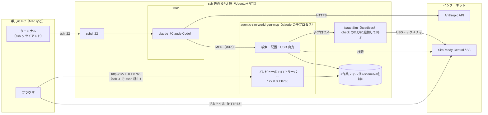

# ssh 先で使う（GPU 機は LAN の Ubuntu、手元は Mac など）

Isaac Sim・Claude Code・agentic-sim-world-gen は ssh 先の GPU 機（LAN の Ubuntu＋RTX など）で動かし、手元の PC（Mac など、GPU 不要）からは
ssh のターミナルで頼み、ブラウザでプレビューだけを見る手順。手元には何もインストールしない（ssh とブラウザだけ）。

GPU 機の前に座って使うなら [全部手元で使う](use-local.md)。



| つながり | ポート | 中身 |
|---|---|---|
| 手元のターミナル → GPU 機 | 22（ssh） | tmux の中の claude に日本語で頼む |
| 手元のブラウザ → GPU 機のプレビュー | 8765 を `ssh -L` で転送 | preview.html・配置図・check の画像。GPU 機の 127.0.0.1 にだけ開き、LAN には公開しない |
| 手元のブラウザ → Hugging Face / S3 | 443 | 候補のサムネイル（URL のものはブラウザが直接取る） |

GPU 機に入ってくる通信は ssh だけでよい。

## 1. 必要なもの

| 場所 | 要るもの |
|---|---|
| GPU 機 | Ubuntu＋RTX GPU とドライバー、Isaac Sim 6.1（pip 版かスタンドアロン版）、Python 3.10 以上と uv、Claude Code（ログイン済み）、tmux。画面は無くてよい |
| 手元 | ssh クライアントとブラウザ |

## 2. GPU 機の準備

1. Isaac Sim 6.1 と agentic-sim-world-gen を入れる（[全部手元で使う「2. インストール」](use-local.md#2-インストール)の 1・2 と同じ）。
2. 環境変数を `~/.profile` か、`~/.bashrc` の**冒頭**（`case $- in` で対話シェル以外を抜ける行より前）に書く。
   末尾に書くと `ssh <GPU 機> 'コマンド'` のような対話でないシェルには効かない：

   ```bash
   export ISAACSIM_PYTHON=~/isaacsim_venv/bin/python   # スタンドアロン版なら ISAACSIM_PATH=~/isaacsim
   export OMNI_KIT_ACCEPT_EULA=YES
   ```

   プレビューのポートは 8765。使用中（別の作業フォルダの Claude など）なら、そのフォルダで前回使った番号（`~/.cache/agentic-sim-world-gen/preview_ports.json`）、
   それも使用中なら次の空き番号になる。作業フォルダが 1 つなら毎回 8765 なので、`ssh -L` は同じでよい。
   フォルダごとに番号を固定したいときは、`agentic-sim-world-gen workspace … --env AGENTIC_SIM_WORLD_GEN_PREVIEW=127.0.0.1:8766` のように .mcp.json に書く。
3. 作業フォルダを作る（リポジトリの外に）：

   ```bash
   cd agentic-sim-world-gen && .venv/bin/agentic-sim-world-gen workspace ~/agentic-sim-world-gen-ws
   ```

4. 確かめる（ssh 越しに）：`out/study/check.png` ができれば headless の描画が動いている。

   ```bash
   ssh <GPU 機> 'cd agentic-sim-world-gen && .venv/bin/agentic-sim-world-gen resolve examples/p0_study_room.json -o out/study \
     && .venv/bin/agentic-sim-world-gen compose out/study/scene.resolved.json && .venv/bin/agentic-sim-world-gen check out/study'
   ```

## 3. 最初のワールド

1. 手元から、プレビューのポートを転送して入り、tmux の中で Claude Code を起動する：

   ```bash
   ssh -L 8765:127.0.0.1:8765 <GPU 機>
   tmux new -s agentic-sim-world-gen          # 回線が切れても Claude の作業が止まらないように
   cd ~/agentic-sim-world-gen-ws && claude
   ```

   初回に `.mcp.json` の `agentic-sim-world-gen` MCP サーバーを承認する。
2. 頼む：

   > 6畳の書斎を作って。机と椅子、壁際に本棚

3. **プレビュー**：GPU 機ではブラウザを開けないので、Claude の返答に URL（`http://127.0.0.1:8765/<名前>/preview.html`）と `ssh -L` の手順が出る。
   その URL を手元のブラウザで開く。ページはツールを呼ぶたびに自動で書き換わる（1 秒ごとに確かめる）。
   ポートが 8765 でなければ、その番号で `ssh -L` し直す（別のターミナルで `ssh -N -L 8766:127.0.0.1:8766 <GPU 機>` でもよい）。
4. **check**：Isaac Sim は GPU 機で headless で動く（1 回 35〜50 秒）。結果はプレビューの「Isaac Sim チェック」に出る。
   物理のあと周りから撮った 24 枚をドラッグ（← → キー）で回せるので、3D の画面の代わりになる。
5. **結果を開く**：GPU 機の画面で Isaac Sim を開くか、シーンを手元に持ってくる（次の節）。

## 4. 入力を渡す・結果を持ってくる

```bash
# 写真・動画・図面を GPU 機へ（Claude にはそのパスを渡す）
scp -r ~/photos/living <GPU 機>:~/agentic_sim_world_gen_inputs/living
# できたシーンを手元へ。手元の Isaac Sim で開くなら、アセットも同梱して出し直してから
ssh <GPU 機> 'cd agentic-sim-world-gen && .venv/bin/agentic-sim-world-gen compose ~/agentic-sim-world-gen-ws/scenes/study/scene.resolved.json --localize'
rsync -av <GPU 機>:~/agentic-sim-world-gen-ws/scenes/study ./
```

Claude に「USD をローカル参照で出し直して」と頼んでもよい（MCP `compose_scene(localize=true)`）。
`--localize` なしの scene.usda はアセットを URL で参照していて、ネットにつながればどこでも開ける。
写真から部屋を作るときは、Claude が写真を切り出して画素の位置を読むので、写真は GPU 機に置く（手元のパスは読めない）。

## 5. できないこと・注意

- **ライブモードは使えない**（check を開いている Isaac Sim の画面で行う）。GPU 機の画面の前にいないと見えないので、headless の check と、プレビューで回して見る画像で確かめる。
  頼んでも headless に切り替えて続ける（報告の `live_fallback`）。GPU 機の前でも作業するなら [全部手元で使う](use-local.md) の形で。
- ssh が切れるとプレビューも見えなくなるが、tmux の中の Claude は動き続ける。`ssh -L …` でつなぎ直して `tmux attach -t agentic-sim-world-gen`。
- プレビューのサーバーは Claude Code のセッションの中で動く。`claude` を終えると止まるので、起動し直したら「プレビューを開いて」と頼む。
- 作業フォルダを複数同時に使うと、後から起動した方が別のポート（8766 …）になる。それぞれ `ssh -L` する（番号を固定するなら上の `AGENTIC_SIM_WORLD_GEN_PREVIEW`）。

## 6. トラブルシューティング

| 症状 | 対処 |
|---|---|
| ブラウザで「接続できない」 | `ssh -L` のポートが返答の URL と同じか。ssh が切れていないか。`claude` が起動中か |
| プレビューが更新されない | ページ上部の更新が止まっていれば、ssh か claude が止まっている。つなぎ直して「プレビューを開いて」 |
| `Address already in use`（`ssh -L` のとき） | 手元でそのポートが使用中（別の転送など）。手元側の番号だけ変える：`ssh -L 9765:127.0.0.1:8765 <GPU 機>` で `http://127.0.0.1:9765/…` |
| `Isaac Sim not found` / 止まったまま | `ISAACSIM_PYTHON`（か `ISAACSIM_PATH`）と `OMNI_KIT_ACCEPT_EULA=YES` が、`claude` を起動したシェルに入っているか（`echo $ISAACSIM_PYTHON`） |
| GPU 機の画面にブラウザが開いた | `DISPLAY` を引き継いだシェル（`ssh -X` など）で起動した。`unset DISPLAY` してから `claude` |
| スクショが真っ黒 | `nvidia-smi` で GPU が見えるか。ドライバーが RTX 描画に対応しているか |
| ほかの症状 | [Getting Started「9. トラブルシューティング」](getting-started.md#9-トラブルシューティング) |
